# 2026-09-30 @ CHESS 7b2

!!! danger "Under Construction"

    This page was auto-transcribed from handwritten notebooks and log files. We are currently reviewing for correctness and adding missing information (see TODO comments in markdown source). Use with caution.

First CHESS beam time of the 2026-3 run cycle.

## Goals

- Beamline alignment and optimization after summer upgrades
- DHFR-Fol-NADP crystals from new batch: complete diffuse map at ambient temperature
- RT diffraction from Mac1 grown from alternate crystallization procedures (Katie L's crystals). 

## Participants

Steve M, Neti B, and Katie L (main), Stephen T and Supratik G (learning) from Ando lab; support from Mike P, Mike C, John I, and Tricia C at CHESS.

<div class="grid cards" markdown>

- 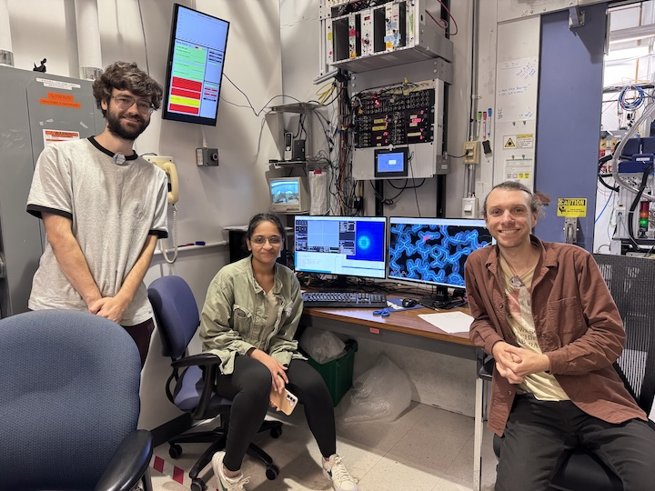<br>
<!-- TODO: caption (names, left to right) -->

</div>

## Data

Root directory at CHESS: `/nfs/chess/raw/2026-3/id7b2/meisburger/20260930`

Root directory on OSN: `s3://diffuse-chess-public/20260930`

## Beamline setup

parameter | value | notes
--- | --- | ---
X-ray energy | 14 keV @ 0.01% bandwidth | Si 111 channel cut mono inserted
Beam size | 100 µm x 100 µm (initially) | Slit-defined, no CRL. Adjusted to match crystal size when noted, below.
Flux | 3.9 x 10^10^ ph/s | ICol ~17,700 / 0.1 s; see SPEC `ct` output below
Background reduction | On-axis mirror with Mo tube |
Centering camera | on-axis camera | New long working distance camera. Scalebar in screenshots (green bar, lower left) is 100 µm.
Beamstop | 700 µm diameter Mo disk suspended on mylar sheet | semi-transparent 
Data collection software | "MX Collect" (python) & SPEC | Modified by Mike P to handle the new camera
Temperature control | none (ambient) |

<!-- TODO: Add the pixel size (µm / pixel at each zoom ratio) of the new on-axis camera, as recorded in earlier entries for the old cameras. -->

Steve M, Steve T, Neti B, Mike P, Mike C, and Tricia C arrived between 9 and 10 am on September 30 to align the station. No significant bumping or cave optics adjustments were needed. However, a lot of things changed in the hutch over the summer, and in-hutch alignment was tricky. Getting beam through the channel cut, CRL pass-through, slits, and cleanup aperture turned out to be pretty difficult. Our hope was to begin data collection at noon, but alignment took all day; Mike P and Steve M stayed until midnight to finish. So data collection did not begin until October 1.

One new item is the centering camera. We previously were able to automatically save camera images at certain angles (every 30˚). This has not been implemented yet for the new camera, so we resorted to screenshots instead.

<div class="grid cards" markdown>

- 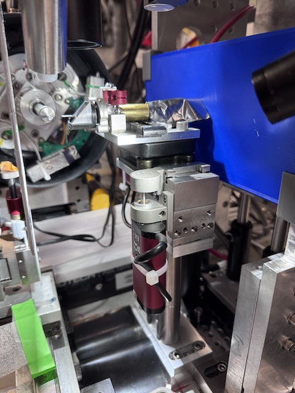<br>
<!-- TODO: caption (goniometer / sample position, side view?) -->

- 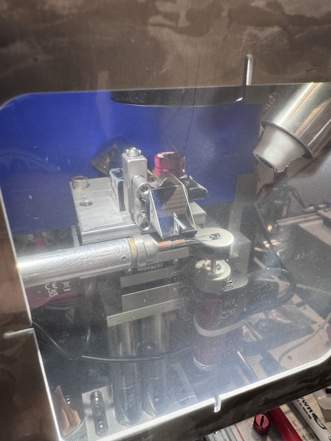<br>
<!-- TODO: caption (goniometer and sample position viewed through the enclosure?) -->

- 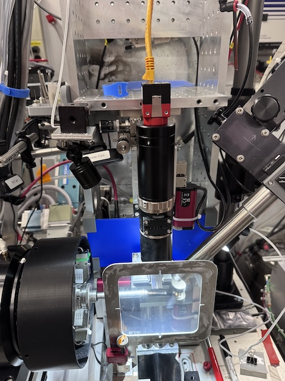<br>
<!-- TODO: caption (new on-axis long working distance camera?) -->

</div>

## Samples

Name | Sample | Well composition | Drop composition | Notes
--- | --- | --- | --- | ---
Lysozyme | Hen egg lysozyme, 50 mg/mL in NaOAc <!-- TODO: confirm protein stock for Supratik's tray --> | <!-- TODO --> | <!-- TODO --> | 24-well hanging-drop vapor diffusion tray set up by Supratik G for practice. <!-- TODO: tray date --> |
DHFR-Folate-NADP | E. coli dihydrofolate reductase expressed and purified at Cornell. Dialyzed in 20 mM imidazole pH 7.0 with 1 mM folic acid and concentrated to 35 mg/mL. NADP+ added in 3:1 molar excess (final concentrations: 31.5 mg/mL DHFR, 6.3 mM NADP) | 15-18% PEG 400, 100 mM MnCl~2~, 20 mM imidazole pH 7.0 <!-- TODO: PEG 400 % for wells A1, A2, and B4 (the wells used today) --> | <!-- TODO --> | Crystals were looped in the cold room under red light and transported to CHESS at 4 deg C. See Neti B's Notebook <!-- TODO: notebook number / page; tray number and date --> |
Mac1 (P4~3~) | SARS CoV2 NSP3 macrodomain <!-- TODO: construct, buffer, and concentration for these trays --> | Several conditions from Katie L's optimization trays (see notes) <!-- TODO: compositions of Index H11, Index H12, and PEGRx F5 conditions as used in each tray --> | <!-- TODO --> | Trays named in the notebook: "Index H11 phase diagram" (wells G12, D11), "Index H11 new optimization" (wells D12, D?5), "Index H12 diagram" (well G12), and PEGRx F5 (well ?5). Crystals mac1_2 onward were looped in a humidity chamber. <!-- TODO: tray dates and Katie L notebook pages --> |

## Data collection

Steve M and Neti B arrived at the beamline at 8:15 on October 1. Katie L and Supratik G arrived later. The plan was to collect DHFR data in the morning, before handing off the beamline to Raley at noon (Raley has the non-diffuse beamtime after ours), and to request more time later for Mac1 experiments.

<!-- TODO: Approximate arrival time for Katie L and Supratik G. -->

Steve tuned mono, mith, and upz, then locked in beam position feedback. He measured flux using the ion chamber (I2), see table above:

```
From id7b2.classe.cornell.edu
Thu Oct 01 08:44:50 2026

Output of macro ct           (14 keV, no atten, no CRL, slits 100 x 100)

Thu Oct 01 08:44:51 2026

     Seconds = 1
       Diode = 42 (42/s)
          I2 = 46016 (46016/s)       @ 50 nA/V
        ICol = 177142 (177142/s)
        Gate = 0 (0/s)
       QuadX = 0 (0/s)
       QuadY = 0.00013 (0.00013/s)
       newI1 = 146197 (146197/s)
       newI0 = 249982 (249982/s)
```

The flux is down from last run (9.7 x 10^10^ ph/s on 2026-06-22) by about 2.5x. Probably the focusing mirror or cave optics need attention. But it's plenty of flux for now. We will run without attenuation.

Collected a 1 s exposure with nothing in the beam to double-check the beamstop position and document the background scatter. Slits set to 100 x 100 µm.

Subdirectory: `setup`

<!-- TODO: The handwritten notebook (p. 50) gives the exposure for air_656 as 0.1 s; the scan log says 1 s (used here). -->

| prefix   |   φ0 (deg.) |   ∆φ (deg.) |   images |   ∆t (s) |   tf (%) |   d (mm) |   E (keV) |
|----------|-------------|-------------|----------|----------|----------|----------|-----------|
| air_656  |           0 |           0 |        1 |        1 |      100 |      185 |        14 |

Looks great!

### 1. Lysozyme (dose test)

Neti looped a ~100 µm lysozyme crystal from Supratik's tray, well A1. Slits 100 x 100 µm.

Subdirectory: `lysozyme`

| prefix       |   φ0 (deg.) |   φ1 (deg.) |   ∆φ (deg.) |   images |   ∆t (s) |   tf (%) |   d (mm) |   E (keV) |
|--------------|-------------|-------------|-------------|----------|----------|----------|----------|-----------|
| lys_1_657    |           0 |         360 |         0.1 |     3600 |     0.03 |      100 |      185 |        14 |
| lys_1_bg_658 |           0 |         360 |         1   |      360 |     0.3  |      100 |      185 |        14 |

!!! warning "multiple lattices"
    
    The well was crowded with small crystals, and evidently there are multiple in the loop (55% indexed). Not a useful diffuse dataset, but fine for checking radiation damage.

Processing with xia2: mosaicity 0.018˚, 55% indexed. B-factor decay is about 5 Å<sup>2</sup> per 180˚, or 0.1 Å<sup>2</sup> / second. So, tolerable dose limit is ~20 s at this flux. This is a bit higher than expected. Let's repeat with a fresh crystal at 0.01 second exposures.

??? info "xia2 processing"

    |                 | lys_1_657                               |
    |-----------------|-----------------------------------------|
    | scan            | 657                                     |
    | Mosaic spread   | 0.018                                   |
    | Resolution      | 1.26                                    |
    | Unit Cell       | [79.49, 79.49, 38.04, 90.0, 90.0, 90.0] |
    | Image range     | [1, 3600]                               |
    | Completeness    | 100.0                                   |
    | Multiplicity    | 25.3                                    |
    | I/sigma         | 15.0                                    |
    | Rpim            | 0.019                                   |
    | Wilson B factor | 20.04                                   |
    | Space group     | P 43 21 2                               |

### 2. Lysozyme (dose test, repeat)

Neti looped a ~50 µm lysozyme crystal from Supratik's tray, well B1. Slits 100 x 100 µm.

Subdirectory: `lysozyme`

| prefix       |   φ0 (deg.) |   φ1 (deg.) |   ∆φ (deg.) |   images |   ∆t (s) |   tf (%) |   d (mm) |   E (keV) |
|--------------|-------------|-------------|-------------|----------|----------|----------|----------|-----------|
| lys_2_659    |           0 |         360 |         0.1 |     3600 |     0.01 |      100 |      185 |        14 |
| lys_2_bg_660 |           0 |         360 |         1   |      360 |     0.1  |      100 |      185 |        14 |

!!! warning "directory naming"

    Both lysozyme crystals (lys_1 and lys_2) were saved directly in `lysozyme`, without a per-crystal subdirectory. This differs from the DHFR samples below and from the later lysozyme crystal (`lysozyme/Lys_steve_T`).

<!-- TODO: Fill in the dose-test conclusion from lys_2 (B-factor decay per second at 0.01 s exposures). -->

??? info "xia2 processing"

    |                 | lys_2_659                               |
    |-----------------|-----------------------------------------|
    | scan            | 659                                     |
    | Mosaic spread   | 0.007                                   |
    | Resolution      | 1.36                                    |
    | Unit Cell       | [79.44, 79.44, 38.04, 90.0, 90.0, 90.0] |
    | Image range     | [1, 3600]                               |
    | Completeness    | 100.0                                   |
    | Multiplicity    | 26.3                                    |
    | I/sigma         | 8.8                                     |
    | Rpim            | 0.034                                   |
    | Wilson B factor | 20.16                                   |
    | Space group     | P 43 21 2                               |

---

!!! tip "setup change"

    To avoid damaging folate, we turned off all lights in the hutch and used amber light from the microscope for centering.

### 3. DHFR-Folate-NADP

!!! quote inline end ""

    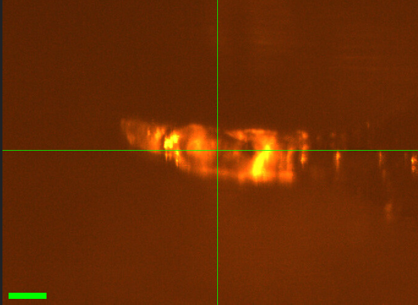

Neti mounted DHFR crystal #1 (from well A1).

Slits changed to 50 x 50 µm. Vector scan along the length of the crystal (spinx translation: 246.4 µm).

Subdirectory: `DHFR/DHFR_1_A1`

Neti saved a screenshot in the same directory to show what the crystal looked like.

<div style="clear: both;"></div>

| prefix             |   φ0 (deg.) |   φ1 (deg.) |   ∆φ (deg.) |   images |   ∆t (s) |   tf (%) |   d (mm) |   E (keV) |
|--------------------|-------------|-------------|-------------|----------|----------|----------|----------|-----------|
| DHFR_1_A1_661\*    |           0 |         360 |         0.1 |     3600 |     0.01 |      100 |      999 |        14 |
| DHFR_1_A1_662      |           0 |         360 |         0.1 |     3600 |     0.01 |      100 |      185 |        14 |
| DHFR_1_A1_bg_663   |           0 |         360 |         1   |      360 |     0.1  |      100 |      185 |        14 |

!!! warning "incomplete dataset"

    \* `DHFR_1_A1_661`: forgot to move the detector in (d = 999 mm). Closed the shutter after a few seconds to avoid damaging the crystal. Repeated the collection with the correct detector distance (`DHFR_1_A1_662`). Do not use scan 661. Note that the crystal received a few seconds of extra dose before scan 662.

!!! warning "file naming"

    The screenshot for this crystal is named `DHFR_A1.png` (no crystal number), unlike the later screenshots (`DHFR_3_A2.png`, etc.).

<!-- TODO: Confirm the screenshot file name on disk at CHESS (`DHFR/DHFR_1_A1/`). -->

??? info "xia2 processing"

    |                 | DHFR_1_A1_662                           |
    |-----------------|-----------------------------------------|
    | scan            | 662                                     |
    | Mosaic spread   | 0.048                                   |
    | Resolution      | 1.4                                     |
    | Unit Cell       | [34.43, 45.73, 99.31, 90.0, 90.0, 90.0] |
    | Image range     | [1, 3600]                               |
    | Completeness    | 100.0                                   |
    | Multiplicity    | 13.3                                    |
    | I/sigma         | 6.4                                     |
    | Rpim            | 0.071                                   |
    | Wilson B factor | 18.19                                   |
    | Space group     | P 21 21 21                              |

### 4. DHFR-Folate-NADP

Neti mounted DHFR crystal #2 (from well A2). The crystal is sitting on the neck of the loop (not good for diffuse). No screenshot was recorded.

Slits 50 x 50 µm. Vector scan (spinx translation: 217.6 µm).

Subdirectory: `DHFR/DHFR_2_A2`

| prefix             |   φ0 (deg.) |   φ1 (deg.) |   ∆φ (deg.) |   images |   ∆t (s) |   tf (%) |   d (mm) |   E (keV) |
|--------------------|-------------|-------------|-------------|----------|----------|----------|----------|-----------|
| DHFR_2_A2_664      |           0 |         360 |         0.1 |     3600 |     0.01 |      100 |      185 |        14 |
| DHFR_2_A2_bg_665   |           0 |         360 |         1   |      360 |     0.1  |      100 |      185 |        14 |

!!! warning "crystal on the neck of the loop"

    Loop material is likely in the beam path, so this dataset is not ideal for diffuse scattering. Statistics are also somewhat poorer than the other DHFR crystals (Rpim 0.107, resolution 1.53 Å).

??? info "xia2 processing"

    |                 | DHFR_2_A2_664                           |
    |-----------------|-----------------------------------------|
    | scan            | 664                                     |
    | Mosaic spread   | 0.023                                   |
    | Resolution      | 1.53                                    |
    | Unit Cell       | [34.38, 45.47, 99.51, 90.0, 90.0, 90.0] |
    | Image range     | [1, 3600]                               |
    | Completeness    | 100.0                                   |
    | Multiplicity    | 13.2                                    |
    | I/sigma         | 8.5                                     |
    | Rpim            | 0.107                                   |
    | Wilson B factor | 21.17                                   |
    | Space group     | P 21 21 21                              |

### 5. DHFR-Folate-NADP

!!! quote inline end ""

    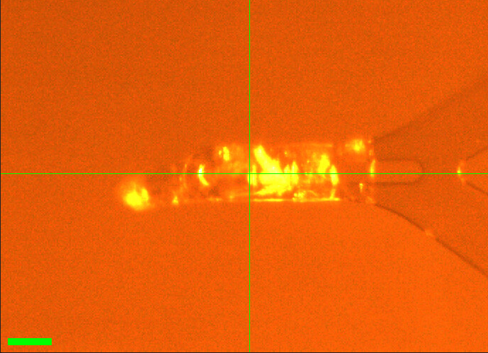

Neti mounted DHFR crystal #3 (from well A2). The crystal is sitting on the tip of the loop.

Slits 50 x 50 µm. Vector scan (spinx translation: 255.9 µm).

<!-- TODO: Slit size for scan 666 is hard to read in the notebook (50 x 50 or 50 x 90 µm?). Check SPEC file. -->

Subdirectory: `DHFR/DHFR_3_A2`

Neti saved a screenshot in the same directory.

<div style="clear: both;"></div>

| prefix             |   φ0 (deg.) |   φ1 (deg.) |   ∆φ (deg.) |   images |   ∆t (s) |   tf (%) |   d (mm) |   E (keV) |
|--------------------|-------------|-------------|-------------|----------|----------|----------|----------|-----------|
| DHFR_3_A2_666      |           0 |         360 |         0.1 |     3600 |     0.01 |      100 |      185 |        14 |
| DHFR_3_A2_bg_667   |           0 |         360 |         1   |      360 |     0.1  |      100 |      185 |        14 |

<!-- TODO: The handwritten notebook (p. 51) gives the DHFR_3 unit cell as 34.39, 45.45, 99.52, which matches the xia2 result for DHFR_4 (scan 668), not DHFR_3. The xia2 output below (34.38, 45.60, 99.37) is used here; the notebook value is probably a transcription error. -->

??? info "xia2 processing"

    |                 | DHFR_3_A2_666                          |
    |-----------------|----------------------------------------|
    | scan            | 666                                    |
    | Mosaic spread   | 0.026                                  |
    | Resolution      | 1.41                                   |
    | Unit Cell       | [34.38, 45.6, 99.37, 90.0, 90.0, 90.0] |
    | Image range     | [1, 3600]                              |
    | Completeness    | 99.5                                   |
    | Multiplicity    | 13.4                                   |
    | I/sigma         | 6.3                                    |
    | Rpim            | 0.057                                  |
    | Wilson B factor | 18.73                                  |
    | Space group     | P 21 21 21                             |

### 6. DHFR-Folate-NADP

!!! quote inline end ""

    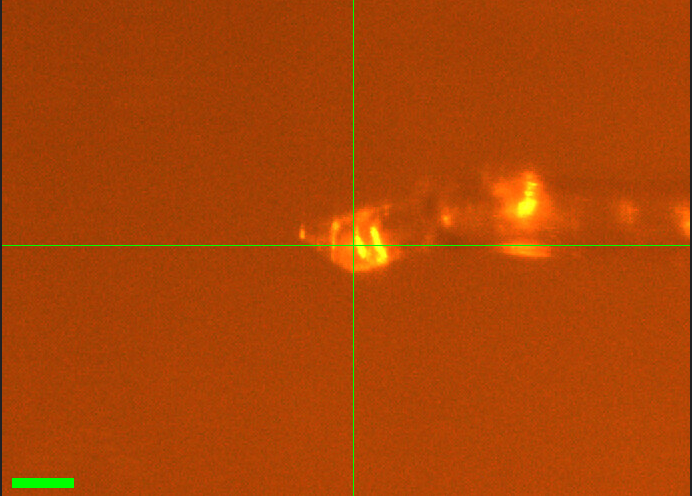

Neti mounted another DHFR crystal (#4, from well A2).

Slits 50 x 50 µm. Vector scan (spinx translation: 228.9 µm).

Subdirectory: `DHFR/DHFR_4_A2`

Neti saved a screenshot in the same directory.

<div style="clear: both;"></div>

| prefix             |   φ0 (deg.) |   φ1 (deg.) |   ∆φ (deg.) |   images |   ∆t (s) |   tf (%) |   d (mm) |   E (keV) |
|--------------------|-------------|-------------|-------------|----------|----------|----------|----------|-----------|
| DHFR_4_A2_668      |           0 |         360 |         0.1 |     3600 |     0.01 |      100 |      185 |        14 |
| DHFR_4_A2_bg_669   |           0 |         360 |         1   |      360 |     0.1  |      100 |      185 |        14 |

!!! warning "weak start of dataset"

    Very few spots at the beginning of the dataset. It needs to be truncated and refit. The xia2 result below used the full image range.

<!-- TODO: Reprocess DHFR_4_A2_668 with a truncated image range and update the table below. Which frames should be excluded? -->

??? info "xia2 processing"

    |                 | DHFR_4_A2_668                           |
    |-----------------|-----------------------------------------|
    | scan            | 668                                     |
    | Mosaic spread   | 0.03                                    |
    | Resolution      | 1.51                                    |
    | Unit Cell       | [34.39, 45.45, 99.52, 90.0, 90.0, 90.0] |
    | Image range     | [1, 3600]                               |
    | Completeness    | 100.0                                   |
    | Multiplicity    | 13.2                                    |
    | I/sigma         | 7.0                                     |
    | Rpim            | 0.072                                   |
    | Wilson B factor | 20.78                                   |
    | Space group     | P 21 21 21                              |

### 7. DHFR-Folate-NADP

!!! quote inline end ""

    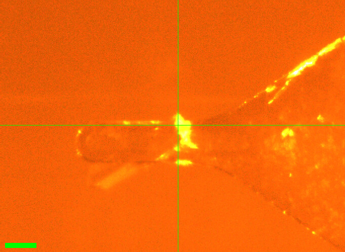

Neti mounted DHFR crystal #5 (from well A2).

Slits 50 x 50 µm. Vector scan (spinx translation: 235.2 µm).

<!-- TODO: The slit entry for scan 670 has a crossed-out value before "50 x 50" in the notebook (p. 52). Confirm with SPEC file. -->

Subdirectory: `DHFR/DHFR_5_A2`

Neti saved a screenshot in the same directory.

<div style="clear: both;"></div>

| prefix             |   φ0 (deg.) |   φ1 (deg.) |   ∆φ (deg.) |   images |   ∆t (s) |   tf (%) |   d (mm) |   E (keV) |
|--------------------|-------------|-------------|-------------|----------|----------|----------|----------|-----------|
| DHFR_5_A2_670      |           0 |         360 |         0.1 |     3600 |     0.01 |      100 |      185 |        14 |
| DHFR_5_A2_bg_671   |           0 |         360 |         1   |      360 |     0.1  |      100 |      185 |        14 |

!!! warning "poor statistics"

    Rpim is 0.204, about 2–4x higher than the other DHFR crystals collected today (0.049–0.107), despite similar resolution and I/sigma. Check processing (e.g. multiple lattices, indexing rate, or a problem partway through the scan) before using this dataset.

??? info "xia2 processing"

    |                 | DHFR_5_A2_670                           |
    |-----------------|-----------------------------------------|
    | scan            | 670                                     |
    | Mosaic spread   | 0.023                                   |
    | Resolution      | 1.47                                    |
    | Unit Cell       | [34.41, 45.52, 99.47, 90.0, 90.0, 90.0] |
    | Image range     | [1, 3600]                               |
    | Completeness    | 100.0                                   |
    | Multiplicity    | 13.1                                    |
    | I/sigma         | 8.6                                     |
    | Rpim            | 0.204                                   |
    | Wilson B factor | 19.92                                   |
    | Space group     | P 21 21 21                              |

### 8. DHFR-Folate-NADP

!!! quote inline end ""

    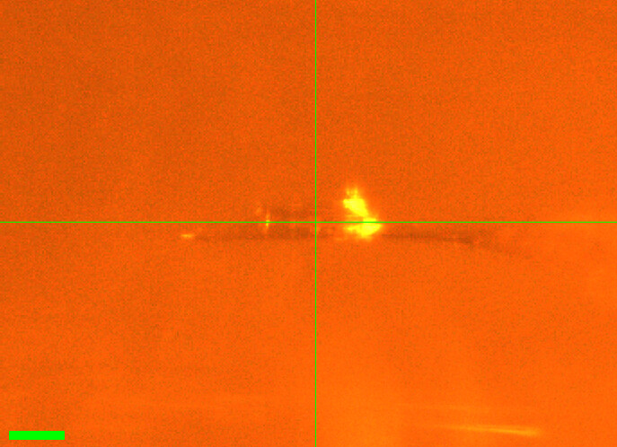

Neti mounted DHFR crystal #6 (from well A2).

Slits changed to 50 µm (height) x 120 µm (width), per notebook. Regular (not vector) scan.

<!-- TODO: The notebook writes slits as "50(h) x 120(w)", i.e. height x width, whereas earlier entries use (h x v) = horizontal x vertical. Confirm values and orientation from SPEC file. -->

Subdirectory: `DHFR/DFHR_6_A2`

Saved a screenshot in the same directory.

<div style="clear: both;"></div>

| prefix             |   φ0 (deg.) |   φ1 (deg.) |   ∆φ (deg.) |   images |   ∆t (s) |   tf (%) |   d (mm) |   E (keV) |
|--------------------|-------------|-------------|-------------|----------|----------|----------|----------|-----------|
| DHFR_6_A2_672      |           0 |         360 |         0.1 |     3600 |     0.01 |      100 |      185 |        14 |
| DHFR_6_A2_bg_673   |           0 |         360 |         1   |      360 |     0.1  |      100 |      185 |        14 |

!!! warning "directory name typo"

    The subdirectory was accidentally named `DHFR/DFHR_6_A2` (should be `DHFR/DHFR_6_A2`). File prefixes are correct (`DHFR_6_A2_*`).

??? info "xia2 processing"

    |                 | DHFR_6_A2_672                           |
    |-----------------|-----------------------------------------|
    | scan            | 672                                     |
    | Mosaic spread   | 0.019                                   |
    | Resolution      | 1.33                                    |
    | Unit Cell       | [34.42, 45.58, 99.42, 90.0, 90.0, 90.0] |
    | Image range     | [1, 3600]                               |
    | Completeness    | 100.0                                   |
    | Multiplicity    | 13.3                                    |
    | I/sigma         | 9.8                                     |
    | Rpim            | 0.049                                   |
    | Wilson B factor | 17.01                                   |
    | Space group     | P 21 21 21                              |

### 9. DHFR-Folate-NADP

Neti mounted a funky looking crystal (#7, from well B4). It has "split ends", so we shot from the middle only. No screenshot was recorded.

Slits changed to 100 µm (height) x 150 µm (width), per notebook. Regular (not vector) scan.

<!-- TODO: Same slit convention question as crystal #6 ("100(h) x 150(w)" in notebook). Confirm from SPEC file. -->

Subdirectory: `DHFR/DHFR_7_B4`

| prefix          |   φ0 (deg.) |   φ1 (deg.) |   ∆φ (deg.) |   images |   ∆t (s) |   tf (%) |   d (mm) |   E (keV) |
|-----------------|-------------|-------------|-------------|----------|----------|----------|----------|-----------|
| DHFR_7_B4_674   |           0 |         360 |         0.1 |     3600 |     0.01 |      100 |      185 |        14 |

!!! warning "poor diffraction"

    Poor diffraction. The background scan was skipped, and no xia2 processing results are available.

<!-- TODO: Was xia2 attempted on DHFR_7_B4_674? If so, add the result or the failure mode (e.g. did not index). -->

### 10. Lysozyme

Steve T looped another lysozyme crystal from well A2 of Supratik's tray. Slits 100 x 100 µm.

<!-- TODO: Crystal size. -->

Subdirectory: `lysozyme/Lys_steve_T`

| prefix          |   φ0 (deg.) |   φ1 (deg.) |   ∆φ (deg.) |   images |   ∆t (s) |   tf (%) |   d (mm) |   E (keV) |
|-----------------|-------------|-------------|-------------|----------|----------|----------|----------|-----------|
| Lys_A2_675      |           0 |         360 |         0.1 |     3600 |     0.01 |      100 |      185 |        14 |
| Lys_A2_bg_676   |           0 |         360 |         1   |      360 |     0.1  |      100 |      185 |        14 |

!!! warning "directory and file naming"

    This crystal does not follow the naming convention used earlier in the day. The subdirectory is named after the person (`lysozyme/Lys_steve_T`; written as `Lys-Steve_T` in the notebook), and the prefix `Lys_A2` uses a capital L and the well name instead of a crystal number (lys_1 and lys_2 above; this would have been `lys_3`).

<!-- TODO: xia2 processing for Lys_A2_675 has not been run (or results are missing). Add table. -->

---

We handed off the beamline to Raley S. at noon for her scheduled beamtime (under a different proposal). We will use extra time for Mac1 if Raley finishes early.

---

Katie L and Neti B returned at 8:00 pm to collect Mac1.

### 11. Mac1 (P4~3~)

!!! quote inline end ""

    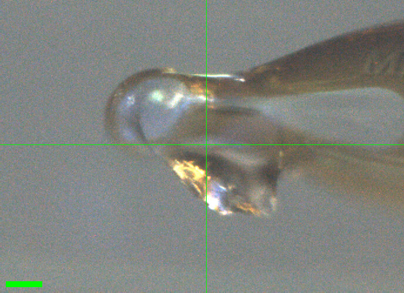

Katie looped the bigger crystal from the "Index H11 phase diagram" tray, well G12. Slits 100 x 100 µm.

Subdirectory: `mac1/mac1_1`

<div style="clear: both;"></div>

| prefix        |   φ0 (deg.) |   φ1 (deg.) |   ∆φ (deg.) |   images |   ∆t (s) |   tf (%) |   d (mm) |   E (keV) |
|---------------|-------------|-------------|-------------|----------|----------|----------|----------|-----------|
| mac1_1_684    |           0 |         360 |         0.1 |     3600 |     0.01 |      100 |      185 |        14 |
| mac1_1_bg_685 |           0 |         360 |         1   |      360 |     0.1  |      100 |      185 |        14 |

!!! warning "lower completeness, higher mosaicity"

    Completeness is 90.2% and mosaic spread 0.071˚, compared with 95.9–100% and 0.012–0.042˚ for the other Mac1 crystals today.

<!-- TODO: A note under mac1_1 in the notebook (p. 53) is crossed out and illegible. Check with Katie L whether it was relevant. -->

??? info "xia2 processing"

    |                 | mac1_1_684                            |
    |-----------------|---------------------------------------|
    | scan            | 684                                   |
    | Mosaic spread   | 0.071                                 |
    | Resolution      | 1.06                                  |
    | Unit Cell       | [89.4, 89.4, 40.29, 90.0, 90.0, 90.0] |
    | Image range     | [1, 3600]                             |
    | Completeness    | 90.2                                  |
    | Multiplicity    | 11.2                                  |
    | I/sigma         | 14.1                                  |
    | Rpim            | 0.019                                 |
    | Wilson B factor | 12.59                                 |
    | Space group     | P 43                                  |

### 12. Mac1 (P4~3~)

!!! quote inline end ""

    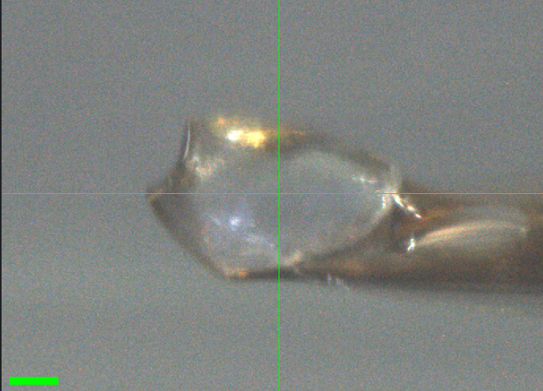

Katie looped a crystal in the humidity chamber, from the "Index H11 phase diagram" tray, well D11. The crystal had cracked in half; this half was easier to grab. Slits 100 x 100 µm.

Subdirectory: `mac1/mac1_2`

<div style="clear: both;"></div>

| prefix              |   φ0 (deg.) |   φ1 (deg.) |   ∆φ (deg.) |   images |   ∆t (s) |   tf (%) |   d (mm) |   E (keV) |
|---------------------|-------------|-------------|-------------|----------|----------|----------|----------|-----------|
| mac1_2_686          |           0 |         360 |         0.1 |     3600 |     0.01 |      100 |      185 |        14 |
| mac1_2_bg_687\*     |           0 |         360 |         1   |      360 |     0.1  |      100 |      185 |        14 |
| mac1_2_bg_fr_688    |           0 |         360 |         1   |      360 |     0.1  |      100 |      185 |        14 |

!!! warning "bad background scan"

    \* `mac1_2_bg_687`: the crystal was still in the beam path, so this "background" is an overexposed crystal dataset, not a background. Diffraction still looked very good. Use `mac1_2_bg_fr_688` as the background for mac1_2. Note also that the crystal received an extra 36 s of exposure after the data scan.

<!-- TODO: The notebook says mac1_2_bg_fr_688 "is the correct background for the two data sets above". Does this mean mac1_1 and mac1_2, i.e. is mac1_1_bg_685 also unusable? And what does "fr" stand for? -->

??? info "xia2 processing"

    |                 | mac1_2_686                              |
    |-----------------|-----------------------------------------|
    | scan            | 686                                     |
    | Mosaic spread   | 0.021                                   |
    | Resolution      | 1.07                                    |
    | Unit Cell       | [89.51, 89.51, 40.69, 90.0, 90.0, 90.0] |
    | Image range     | [1, 3600]                               |
    | Completeness    | 95.9                                    |
    | Multiplicity    | 10.8                                    |
    | I/sigma         | 17.0                                    |
    | Rpim            | 0.015                                   |
    | Wilson B factor | 13.25                                   |
    | Space group     | P 43                                    |

### 13. Mac1 (P4~3~)

!!! quote inline end ""

    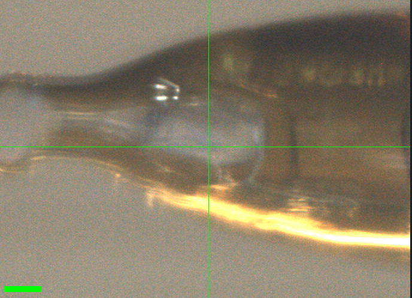

Katie looped the second half of the cracked crystal from mac1_2 ("Index H11 phase diagram" tray, well D11) in the humidity chamber. Slits 100 x 100 µm.

<!-- TODO: The slit entry for mac1_3 is partly illegible in the notebook (100 x 100?). Check SPEC file. -->

Subdirectory: `mac1/mac1_3`

<div style="clear: both;"></div>

| prefix        |   φ0 (deg.) |   φ1 (deg.) |   ∆φ (deg.) |   images |   ∆t (s) |   tf (%) |   d (mm) |   E (keV) |
|---------------|-------------|-------------|-------------|----------|----------|----------|----------|-----------|
| mac1_3_689    |           0 |         360 |         0.1 |     3600 |     0.01 |      100 |      185 |        14 |
| mac1_3_bg_690 |           0 |         360 |         1   |      360 |     0.1  |      100 |      185 |        14 |

??? info "xia2 processing"

    |                 | mac1_3_689                              |
    |-----------------|-----------------------------------------|
    | scan            | 689                                     |
    | Mosaic spread   | 0.035                                   |
    | Resolution      | 1.14                                    |
    | Unit Cell       | [89.51, 89.51, 40.71, 90.0, 90.0, 90.0] |
    | Image range     | [1, 3600]                               |
    | Completeness    | 100.0                                   |
    | Multiplicity    | 11.9                                    |
    | I/sigma         | 14.5                                    |
    | Rpim            | 0.022                                   |
    | Wilson B factor | 13.54                                   |
    | Space group     | P 43                                    |

### 14. Mac1 (P4~3~)

!!! quote inline end ""

    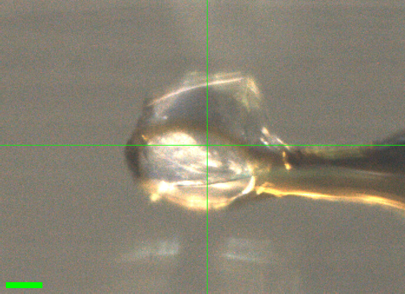

Katie looped a crystal in the humidity chamber, from the "Index H11 new optimization" tray, well D12, using a 300 µm loop. The crystal sits on the edge of the loop. Slits 100 x 100 µm.

<!-- TODO: The notebook says only "H11, New" for this crystal. Confirm it is the same "Index H11 new optimization" tray as mac1_5. -->

Subdirectory: `mac1/mac1_4`

<div style="clear: both;"></div>

| prefix        |   φ0 (deg.) |   φ1 (deg.) |   ∆φ (deg.) |   images |   ∆t (s) |   tf (%) |   d (mm) |   E (keV) |
|---------------|-------------|-------------|-------------|----------|----------|----------|----------|-----------|
| mac1_4_691    |           0 |         360 |         0.1 |     3600 |     0.01 |      100 |      185 |        14 |
| mac1_4_bg_692 |           0 |         360 |         1   |      360 |     0.1  |      100 |      185 |        14 |

??? info "xia2 processing"

    |                 | mac1_4_691                              |
    |-----------------|-----------------------------------------|
    | scan            | 691                                     |
    | Mosaic spread   | 0.017                                   |
    | Resolution      | 1.06                                    |
    | Unit Cell       | [89.51, 89.51, 40.55, 90.0, 90.0, 90.0] |
    | Image range     | [1, 3600]                               |
    | Completeness    | 96.6                                    |
    | Multiplicity    | 10.5                                    |
    | I/sigma         | 16.1                                    |
    | Rpim            | 0.016                                   |
    | Wilson B factor | 12.92                                   |
    | Space group     | P 43                                    |

### 15. Mac1 (P4~3~)

!!! quote inline end ""

    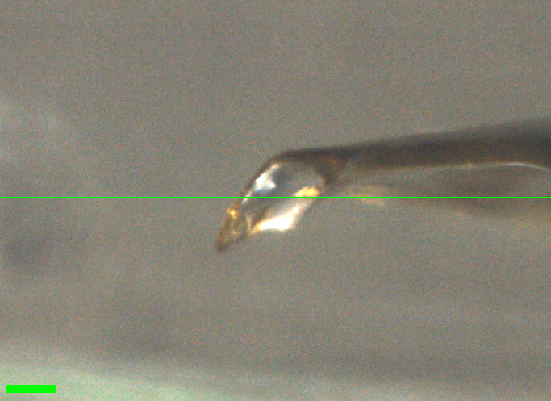

Neti looped a crystal in the humidity chamber, from the "Index H11 new optimization" tray. Slits 100 x 100 µm.

<!-- TODO: Well number for mac1_5 is overwritten and illegible in the notebook (D5?). Also confirm slits (partly illegible). -->
<!-- TODO: The notebook gives the frame numbers as 963/964; the scan log has 693/694 (used here). -->

Subdirectory: `mac1/mac1_5`

<div style="clear: both;"></div>

| prefix        |   φ0 (deg.) |   φ1 (deg.) |   ∆φ (deg.) |   images |   ∆t (s) |   tf (%) |   d (mm) |   E (keV) |
|---------------|-------------|-------------|-------------|----------|----------|----------|----------|-----------|
| mac1_5_693    |           0 |         360 |         0.1 |     3600 |     0.01 |      100 |      185 |        14 |
| mac1_5_bg_694 |           0 |         360 |         1   |      360 |     0.1  |      100 |      185 |        14 |

!!! warning "weaker data"

    I/sigma is 9.4 and Rpim 0.032, versus 14–17 and 0.015–0.022 for the other Mac1 crystals today.

??? info "xia2 processing"

    |                 | mac1_5_693                              |
    |-----------------|-----------------------------------------|
    | scan            | 693                                     |
    | Mosaic spread   | 0.012                                   |
    | Resolution      | 1.13                                    |
    | Unit Cell       | [89.45, 89.45, 40.37, 90.0, 90.0, 90.0] |
    | Image range     | [1, 3600]                               |
    | Completeness    | 99.3                                    |
    | Multiplicity    | 11.7                                    |
    | I/sigma         | 9.4                                     |
    | Rpim            | 0.032                                   |
    | Wilson B factor | 13.05                                   |
    | Space group     | P 43                                    |

### 16. Mac1 (P4~3~)

!!! quote inline end ""

    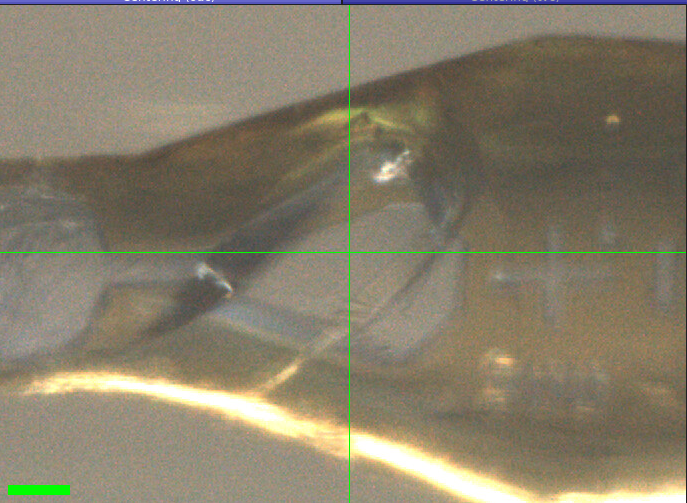

Katie looped a crystal in the humidity chamber, from the "Index H12 diagram" tray, well G12, using a 300 µm loop. Slits changed to 150 x 150 µm. We took two datasets at two different positions on the same crystal (regular, not vector, scans), with one shared background.

<!-- TODO: The notebook says "Index H12 diagram" here, while the other trays are H11. Confirm H12 is correct. -->

Subdirectory: `mac1/mac1_6`

<div style="clear: both;"></div>

| prefix        |   φ0 (deg.) |   φ1 (deg.) |   ∆φ (deg.) |   images |   ∆t (s) |   tf (%) |   d (mm) |   E (keV) |
|---------------|-------------|-------------|-------------|----------|----------|----------|----------|-----------|
| mac1_6_695    |           0 |         360 |         0.1 |     3600 |     0.01 |      100 |      185 |        14 |
| mac1_6_2_696  |           0 |         360 |         0.1 |     3600 |     0.01 |      100 |      185 |        14 |
| mac1_6_bg_697 |           0 |         360 |         1   |      360 |     0.1  |      100 |      185 |        14 |

!!! warning "two datasets, one crystal"

    `mac1_6_2_696` is a second dataset on the same crystal at a different position, not a separate crystal. Both datasets share the background `mac1_6_bg_697`. The background was collected after both data scans, so it reflects the crystal's state after two full datasets. The two positions are not recorded in the scan log (regular scans).

??? info "xia2 processing"

    |                 | mac1_6_695                              | mac1_6_2_696                            |
    |-----------------|-----------------------------------------|-----------------------------------------|
    | scan            | 695                                     | 696                                     |
    | Mosaic spread   | 0.042                                   | 0.017                                   |
    | Resolution      | 1.08                                    | 1.07                                    |
    | Unit Cell       | [89.48, 89.48, 40.42, 90.0, 90.0, 90.0] | [89.48, 89.48, 40.39, 90.0, 90.0, 90.0] |
    | Image range     | [1, 3600]                               | [1, 3600]                               |
    | Completeness    | 97.8                                    | 97.0                                    |
    | Multiplicity    | 10.9                                    | 10.7                                    |
    | I/sigma         | 14.6                                    | 16.5                                    |
    | Rpim            | 0.019                                   | 0.017                                   |
    | Wilson B factor | 12.94                                   | 12.85                                   |
    | Space group     | P 43                                    | P 43                                    |

### 17. Mac1 (P4~3~)

!!! quote inline end ""

    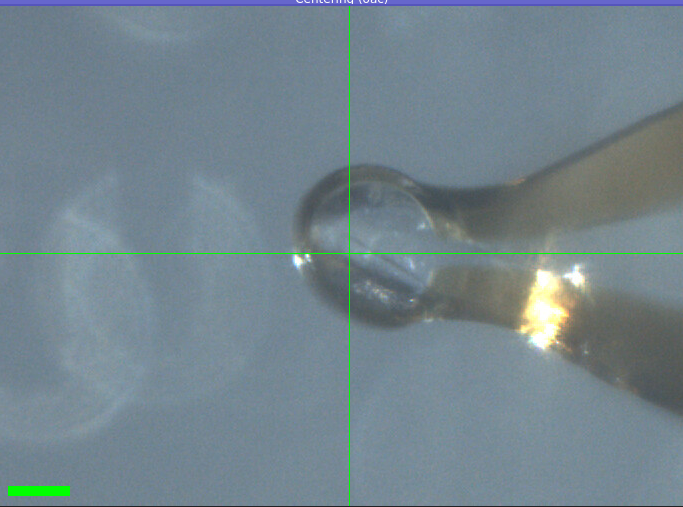

Katie looped a crystal in the humidity chamber, from the PEGRx F5 tray. Slits 150 x 150 µm. Vector scan (spinx translation: 252.8 µm).

<!-- TODO: Well for mac1_7 is overwritten in the notebook (A5? E5?). Is "200 µm" the crystal size or the loop size? -->

Subdirectory: `mac1/mac1_7`

<div style="clear: both;"></div>

| prefix        |   φ0 (deg.) |   φ1 (deg.) |   ∆φ (deg.) |   images |   ∆t (s) |   tf (%) |   d (mm) |   E (keV) |
|---------------|-------------|-------------|-------------|----------|----------|----------|----------|-----------|
| mac1_7_698    |           0 |         360 |         0.1 |     3600 |     0.01 |      100 |      185 |        14 |
| mac1_7_bg_699 |           0 |         360 |         1   |      360 |     0.1  |      100 |      185 |        14 |

<!-- TODO: No xia2 result for mac1_7_698. Was processing attempted? -->

!!! success "Done!"
