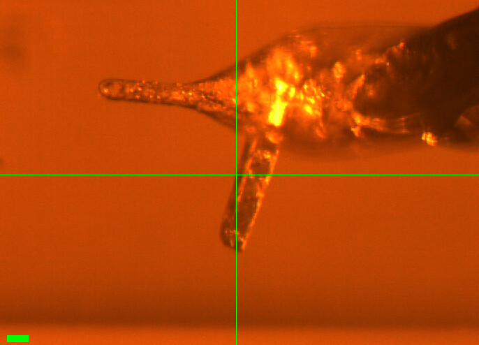
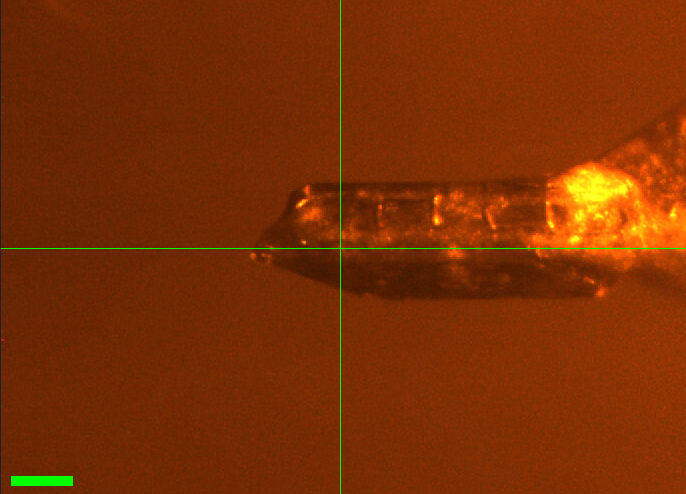
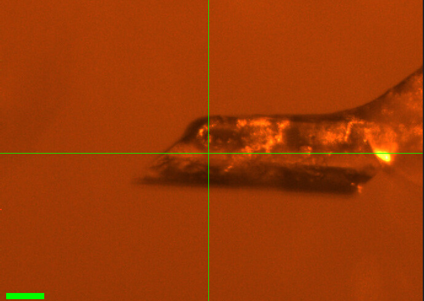
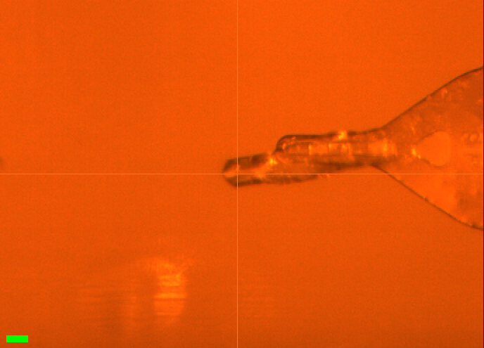
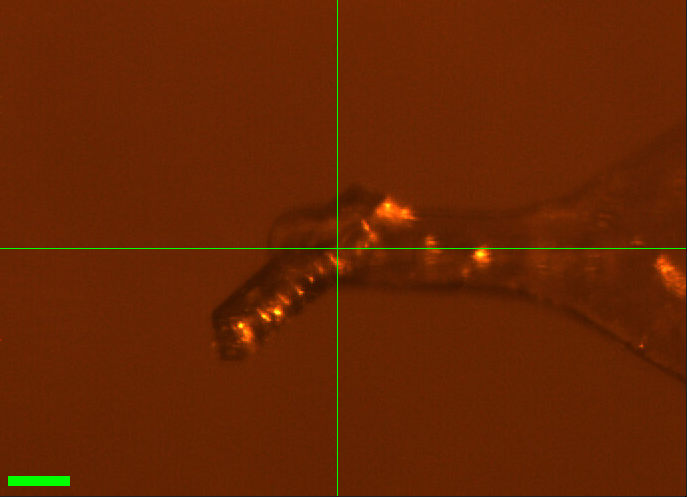
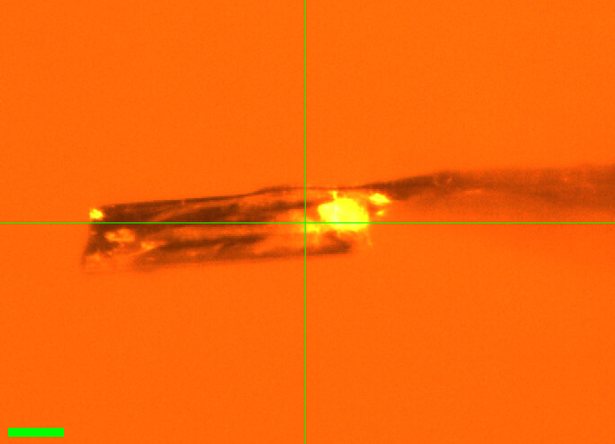

# 2026-10-14 @ CHESS 7b2

!!! danger "Under Construction"

    This page was auto-transcribed from handwritten notebooks and log files. We are currently reviewing for correctness and adding missing information (see TODO comments in markdown source). Use with caution.

Second CHESS beam time of the 2026-3 run cycle.


## Goals

- Temperature-dependent data on DHFR crystals (vector scans, 180˚ per temperature step, 280–320 K)

## Participants

Steve M and Neti B from Ando lab; support from Mike P, John I, and Tricia C at CHESS.


## Data

Root directory at CHESS: `/nfs/chess/raw/2026-3/id7b2/meisburger/20261014`

Root directory on OSN: `s3://diffuse-chess-public/20261014`

## Beamline setup

!!! failure "Failed to control temperature"

    During beamtime, we struggled with the cryostream controller, and ultimately ended the beamtime early when it became unusable. When troubleshooting during setup, the cold stream head was swapped out. Unfortunately, we neglected to align it to the goniometer before starting data collection and didn't notice this until after data collection ended. Based on the misaligned position, the capillary was (mostly? partly?) bathed in sheath flow, which is at room temperature. Thus, the temperature values recorded below are the setpoint of the controller, but not the crystal temperature (which is likely close to room temp. for all datasets). The ambient T datasets are usable, but all the others are suspect. We plan to repeat these experiments in two weeks.

parameter | value | notes
--- | --- | ---
X-ray energy | 14 keV @ 0.01% bandwidth | Si 111 channel cut mono inserted
Beam size | 100 µm x 100 µm | Slit-defined, no CRL. Not changed during the beamtime.
Flux | 6.5 x 10^10^ ph/s | I2 ~72,900 / s, ICol ~270,700 / s; see SPEC `ct` output below
Background reduction | On-axis mirror with Mo tube |
Centering camera | on-axis camera | New long working distance camera (as on 2026-09-30). Scalebar in screenshots: green bar, lower left.
Beamstop | Semi-transparent Mo beamstop |
Data collection software | "MX Collect" (python) & SPEC | Modified by Mike P to use the new camera
Temperature control | Oxford cryostream, end-on |

Steve M and Neti B arrived at ~9–10 AM. The DHFR crystals had been looped the day before by Neti; Steve transported them to CHESS on the evening of 10/13, and they were stored in the cold room overnight. Mike P, John I, and Tricia C aligned the station.

Steve adjusted the mirror and the s3h calibration, and recovered a lot of flux (up ~1.6x from 3.9 x 10^10^ ph/s on 2026-09-30):

```
From id7b2.classe.cornell.edu
Wed Oct 14 15:21:43 2026

Output of macro ct

Wed Oct 14 15:21:44 2026

     Seconds = 1
       Diode = 36 (36/s)
          I2 = 72925 (72925/s)
        ICol = 270685 (270685/s)
        Gate = 0 (0/s)
       QuadX = 0 (0/s)
       QuadY = 0.000132 (0.000132/s)
       newI1 = 152599 (152599/s)
       newI0 = 234765 (234765/s)
```

## Samples

Name | Sample | Well composition | Drop composition | Notes
--- | --- | --- | --- | ---
DHFR-Folate-NADP | E. coli dihydrofolate reductase with folate and NADP+ (protein prep 07/28/26) | 15% PEG 400, 100 mM MnCl2, 20 mM imidazole pH 7.0 |  1.5 μL pf Protein solution + 1.5 μL of well solution + 1 μL seed stock (seed stock referance Steve M notebook #3 page 66) | Crystals were obtained from the tray set on 10/06/26 (Neti B notebook #4, page 39). Crysstals looped by Neti B in cold room under red light on 10/13 and stored in the cold room at CHESS overnight.|

## Data collection

Collected a 1 s exposure with nothing in the beam to document the background scatter. Slits 100 x 100 µm.

Subdirectory: `setup`

| prefix   | φ0 (deg.) | ∆φ (deg.) | images | ∆t (s) | tf (%) | d (mm) | E (keV) |
|----------|-----------|-----------|--------|--------|--------|--------|---------|
| air_1751 |         0 |       0.1 |      1 |      1 |    100 |    185 |      14 |
| air_1752 |         0 |       0.1 |      1 |      1 |    100 |    185 |      14 |


### 1. DHFR-Folate-NADP (dose test)

Starting the DHFR samples with crystal #25 (the plan was to go in reverse order). No screenshot was recorded.

Regular (not vector) scans, 360˚. Slits 100 x 100 µm. Temperature 300 K (per xia2 metadata).

Subdirectory: `DHFR/DHFR_25`

| prefix              | φ0 (deg.) | φ1 (deg.) | ∆φ (deg.) | images | ∆t (s) | tf (%) | d (mm) | E (keV) |
|---------------------|-----------|-----------|-----------|--------|--------|--------|--------|---------|
| DHFR_25_300K_1753\* |         0 |       360 |       0.1 |   3600 |   0.01 |    100 |    185 |      14 |
| DHFR_25_300K_1754   |         0 |       360 |       0.1 |   3600 |   0.01 |    100 |    185 |      14 |

!!! warning "first scan at the tip of the crystal"

    \* `DHFR_25_300K_1753` was collected at the tip of the crystal because the shutter was not open unit the end. The crystal was then moved to a new spot for `DHFR_25_300K_1754`. Only 1754 processed successfully.


!!! warning "no background"

    No background scan was collected for this crystal.

B-factor decayed by ~4 Å<sup>2</sup> over the 36 s data collection. So the lifetime (without vector, at 100% transmission) is approximately 18 s. Our strategy will be to collect 180˚ from each crystal and vector over a ~500 µm distance if possible, maintaining 100% transmission.


??? info "xia2 processing"

    |                 | DHFR_25_300K_1754                       |
    |-----------------|-----------------------------------------|
    | scan            | 1754                                    |
    | Mosaic spread   | 0.105                                   |
    | Resolution      | 1.22                                    |
    | Unit Cell       | [34.42, 45.71, 99.09, 90.0, 90.0, 90.0] |
    | Image range     | [1, 3600]                               |
    | Completeness    | 100.0                                   |
    | Multiplicity    | 12.6                                    |
    | I/sigma         | 10.0                                    |
    | Rpim            | 0.026                                   |
    | Wilson B factor | 14.5                                    |
    | Space group     | P 21 21 21                              |
    | temperature     | 300                                     |
    | Reports | [xia2.html](https://nyu1.osn.mghpcc.org/diffuse-chess-public/processing/20261014_xia2/reprocess_20261101/DHFR/DHFR_25/DHFR_25_300K_1754/all/xia2.html)<br>[dials.scale.html](https://nyu1.osn.mghpcc.org/diffuse-chess-public/processing/20261014_xia2/reprocess_20261101/DHFR/DHFR_25/DHFR_25_300K_1754/all/LogFiles/AUTOMATIC_DEFAULT_SCALE.html) |
    | Logs | [index.log](https://nyu1.osn.mghpcc.org/diffuse-chess-public/processing/20261014_xia2/reprocess_20261101/DHFR/DHFR_25/DHFR_25_300K_1754/all/LogFiles/AUTOMATIC_DEFAULT_NATIVE_SWEEP1_INDEX.log)<br>[integrate.log](https://nyu1.osn.mghpcc.org/diffuse-chess-public/processing/20261014_xia2/reprocess_20261101/DHFR/DHFR_25/DHFR_25_300K_1754/all/LogFiles/AUTOMATIC_DEFAULT_NATIVE_SWEEP1_INTEGRATE.log)<br>[refine.log](https://nyu1.osn.mghpcc.org/diffuse-chess-public/processing/20261014_xia2/reprocess_20261101/DHFR/DHFR_25/DHFR_25_300K_1754/all/LogFiles/AUTOMATIC_DEFAULT_NATIVE_SWEEP1_REFINE.log)<br>[truncate.log](https://nyu1.osn.mghpcc.org/diffuse-chess-public/processing/20261014_xia2/reprocess_20261101/DHFR/DHFR_25/DHFR_25_300K_1754/all/LogFiles/AUTOMATIC_DEFAULT_NATIVE_truncate.log)<br>[scale.log](https://nyu1.osn.mghpcc.org/diffuse-chess-public/processing/20261014_xia2/reprocess_20261101/DHFR/DHFR_25/DHFR_25_300K_1754/all/LogFiles/AUTOMATIC_DEFAULT_SCALE.log)<br>[xtriage.log](https://nyu1.osn.mghpcc.org/diffuse-chess-public/processing/20261014_xia2/reprocess_20261101/DHFR/DHFR_25/DHFR_25_300K_1754/all/LogFiles/Xtriage.log) |
    | MTZ | [free.mtz](https://nyu1.osn.mghpcc.org/diffuse-chess-public/processing/20261014_xia2/reprocess_20261101/DHFR/DHFR_25/DHFR_25_300K_1754/all/DEFAULT/scale/AUTOMATIC_DEFAULT_free.mtz)<br>[scaled_unmerged.mtz](https://nyu1.osn.mghpcc.org/diffuse-chess-public/processing/20261014_xia2/reprocess_20261101/DHFR/DHFR_25/DHFR_25_300K_1754/all/DEFAULT/scale/AUTOMATIC_DEFAULT_scaled_unmerged.mtz) |

### 2. DHFR-Folate-NADP (multi-T)

Crystal #4. No screenshot was recorded.

Vector scan (spinx translation: 419.2 µm). Slits 100 x 100 µm.

Plan: 295, 310, 295, 280, 295 K temperature series, with 5 minute wait time after each temperature change. (A 320 K step and a final 295 K step were added at the end.)

Subdirectory: `DHFR/DHFR_4`

| prefix              | φ0 (deg.) | φ1 (deg.) | ∆φ (deg.) | images | ∆t (s) | tf (%) | d (mm) | E (keV) |
|---------------------|-----------|-----------|-----------|--------|--------|--------|--------|---------|
| DHFR_4_295K_1755    |         0 |       180 |       0.1 |   1800 |   0.01 |    100 |    185 |      14 |
| DHFR_4_295K_bg_1756 |         0 |       180 |         1 |    180 |    0.1 |    100 |    185 |      14 |

xia2 `DHFR_4_295K_1755`: 1.16 Å, Rpim 0.047, cell 34.45, 45.79, 98.95 Å, mosaicity 0.022˚, Wilson B 14.0 Å<sup>2</sup>

---

Ramped to 310 K and waited 5 min.

| prefix              | φ0 (deg.) | φ1 (deg.) | ∆φ (deg.) | images | ∆t (s) | tf (%) | d (mm) | E (keV) |
|---------------------|-----------|-----------|-----------|--------|--------|--------|--------|---------|
| DHFR_4_310K_1757    |         0 |       180 |       0.1 |   1800 |   0.01 |    100 |    185 |      14 |
| DHFR_4_310K_bg_1758 |         0 |       180 |         1 |    180 |    0.1 |    100 |    185 |      14 |

xia2 `DHFR_4_310K_1757`: 1.16 Å, Rpim 0.047, cell 34.45, 45.79, 98.96 Å, mosaicity 0.022˚, Wilson B 14.1 Å<sup>2</sup>

---

Changed temperature to 295 K, waited 5 min.

| prefix              | φ0 (deg.) | φ1 (deg.) | ∆φ (deg.) | images | ∆t (s) | tf (%) | d (mm) | E (keV) |
|---------------------|-----------|-----------|-----------|--------|--------|--------|--------|---------|
| DHFR_4_295K_1759    |         0 |       180 |       0.1 |   1800 |   0.01 |    100 |    185 |      14 |
| DHFR_4_295K_bg_1760 |         0 |       180 |         1 |    180 |    0.1 |    100 |    185 |      14 |

xia2 `DHFR_4_295K_1759`: 1.19 Å, Rpim 0.060, cell 34.45, 45.77, 98.99 Å, mosaicity 0.021˚, Wilson B 14.0 Å<sup>2</sup>

---

Changed temperature to 280 K, waited 5 min.

| prefix              | φ0 (deg.) | φ1 (deg.) | ∆φ (deg.) | images | ∆t (s) | tf (%) | d (mm) | E (keV) |
|---------------------|-----------|-----------|-----------|--------|--------|--------|--------|---------|
| DHFR_4_280K_1761    |         0 |       180 |       0.1 |   1800 |   0.01 |    100 |    185 |      14 |
| DHFR_4_280K_bg_1762 |         0 |       180 |         1 |    180 |    0.1 |    100 |    185 |      14 |

xia2 `DHFR_4_280K_1761`: 1.21 Å, Rpim 0.046, cell 34.42, 45.67, 99.02 Å, mosaicity 0.024˚, Wilson B 14.3 Å<sup>2</sup>

---

Changed temperature to 295 K, waited 5 min.

| prefix              | φ0 (deg.) | φ1 (deg.) | ∆φ (deg.) | images | ∆t (s) | tf (%) | d (mm) | E (keV) |
|---------------------|-----------|-----------|-----------|--------|--------|--------|--------|---------|
| DHFR_4_295K_1763    |         0 |       180 |       0.1 |   1800 |   0.01 |    100 |    185 |      14 |
| DHFR_4_295K_bg_1764 |         0 |       180 |         1 |    180 |    0.1 |    100 |    185 |      14 |

xia2 `DHFR_4_295K_1763`: 1.22 Å, Rpim 0.049, cell 34.42, 45.69, 99.06 Å, mosaicity 0.023˚, Wilson B 14.6 Å<sup>2</sup>

---

Changed temperature to 320 K, waited 5 min.

| prefix              | φ0 (deg.) | φ1 (deg.) | ∆φ (deg.) | images | ∆t (s) | tf (%) | d (mm) | E (keV) |
|---------------------|-----------|-----------|-----------|--------|--------|--------|--------|---------|
| DHFR_4_320K_1765    |         0 |       180 |       0.1 |   1800 |   0.01 |    100 |    185 |      14 |
| DHFR_4_320K_bg_1766 |         0 |       180 |         1 |    180 |    0.1 |    100 |    185 |      14 |

xia2 `DHFR_4_320K_1765`: 1.22 Å, Rpim 0.042, cell 34.45, 45.78, 99.02 Å, mosaicity 0.024˚, Wilson B 14.9 Å<sup>2</sup>

---

Changed temperature to 295 K.

| prefix              | φ0 (deg.) | φ1 (deg.) | ∆φ (deg.) | images | ∆t (s) | tf (%) | d (mm) | E (keV) |
|---------------------|-----------|-----------|-----------|--------|--------|--------|--------|---------|
| DHFR_4_295K_1767    |         0 |       180 |       0.1 |   1800 |   0.01 |    100 |    185 |      14 |
| DHFR_4_295K_bg_1768 |         0 |       180 |         1 |    180 |    0.1 |    100 |    185 |      14 |

xia2 `DHFR_4_295K_1767`: 1.25 Å, Rpim 0.041, cell 34.45, 45.75, 99.09 Å, mosaicity 0.027˚, Wilson B 15.5 Å<sup>2</sup>

!!! warning "condensation"

    Condensation drops were observed on the plastic capillary when decresing temprarure from 320 K to 295 K. `DHFR_4_295K_1767` may be affected.


??? info "xia2 processing"

    |                 | DHFR_4_295K_1755                        | DHFR_4_310K_1757                        | DHFR_4_295K_1759                        | DHFR_4_280K_1761                        | DHFR_4_295K_1763                        | DHFR_4_320K_1765                        | DHFR_4_295K_1767                        |
    |-----------------|-----------------------------------------|-----------------------------------------|-----------------------------------------|-----------------------------------------|-----------------------------------------|-----------------------------------------|-----------------------------------------|
    | scan            | 1755                                    | 1757                                    | 1759                                    | 1761                                    | 1763                                    | 1765                                    | 1767                                    |
    | Mosaic spread   | 0.022                                   | 0.022                                   | 0.021                                   | 0.024                                   | 0.023                                   | 0.024                                   | 0.027                                   |
    | Resolution      | 1.16                                    | 1.16                                    | 1.19                                    | 1.21                                    | 1.22                                    | 1.22                                    | 1.25                                    |
    | Unit Cell       | [34.45, 45.79, 98.95, 90.0, 90.0, 90.0] | [34.45, 45.79, 98.96, 90.0, 90.0, 90.0] | [34.45, 45.77, 98.99, 90.0, 90.0, 90.0] | [34.42, 45.67, 99.02, 90.0, 90.0, 90.0] | [34.42, 45.69, 99.06, 90.0, 90.0, 90.0] | [34.45, 45.78, 99.02, 90.0, 90.0, 90.0] | [34.45, 45.75, 99.09, 90.0, 90.0, 90.0] |
    | Image range     | [1, 1800]                               | [1, 1800]                               | [1, 1800]                               | [1, 1800]                               | [1, 1800]                               | [1, 1800]                               | [1, 1800]                               |
    | Completeness    | 95.0                                    | 95.0                                    | 96.6                                    | 96.9                                    | 97.0                                    | 97.0                                    | 97.2                                    |
    | Multiplicity    | 6.3                                     | 6.3                                     | 6.4                                     | 6.5                                     | 6.5                                     | 6.5                                     | 6.6                                     |
    | I/sigma         | 7.8                                     | 7.7                                     | 5.7                                     | 8.1                                     | 7.9                                     | 8.7                                     | 9.0                                     |
    | Rpim            | 0.047                                   | 0.047                                   | 0.06                                    | 0.046                                   | 0.049                                   | 0.042                                   | 0.041                                   |
    | Wilson B factor | 13.98                                   | 14.1                                    | 13.96                                   | 14.35                                   | 14.61                                   | 14.88                                   | 15.5                                    |
    | Space group     | P 21 21 21                              | P 21 21 21                              | P 21 21 21                              | P 21 21 21                              | P 21 21 21                              | P 21 21 21                              | P 21 21 21                              |
    | temperature     | 295                                     | 310                                     | 295                                     | 280                                     | 295                                     | 320                                     | 295                                     |
    | Reports | [xia2.html](https://nyu1.osn.mghpcc.org/diffuse-chess-public/processing/20261014_xia2/reprocess_20261101/DHFR/DHFR_4/DHFR_4_295K_1755/all/xia2.html)<br>[dials.scale.html](https://nyu1.osn.mghpcc.org/diffuse-chess-public/processing/20261014_xia2/reprocess_20261101/DHFR/DHFR_4/DHFR_4_295K_1755/all/LogFiles/AUTOMATIC_DEFAULT_SCALE.html) | [xia2.html](https://nyu1.osn.mghpcc.org/diffuse-chess-public/processing/20261014_xia2/reprocess_20261101/DHFR/DHFR_4/DHFR_4_310K_1757/all/xia2.html)<br>[dials.scale.html](https://nyu1.osn.mghpcc.org/diffuse-chess-public/processing/20261014_xia2/reprocess_20261101/DHFR/DHFR_4/DHFR_4_310K_1757/all/LogFiles/AUTOMATIC_DEFAULT_SCALE.html) | [xia2.html](https://nyu1.osn.mghpcc.org/diffuse-chess-public/processing/20261014_xia2/reprocess_20261101/DHFR/DHFR_4/DHFR_4_295K_1759/all/xia2.html)<br>[dials.scale.html](https://nyu1.osn.mghpcc.org/diffuse-chess-public/processing/20261014_xia2/reprocess_20261101/DHFR/DHFR_4/DHFR_4_295K_1759/all/LogFiles/AUTOMATIC_DEFAULT_SCALE.html) | [xia2.html](https://nyu1.osn.mghpcc.org/diffuse-chess-public/processing/20261014_xia2/reprocess_20261101/DHFR/DHFR_4/DHFR_4_280K_1761/all/xia2.html)<br>[dials.scale.html](https://nyu1.osn.mghpcc.org/diffuse-chess-public/processing/20261014_xia2/reprocess_20261101/DHFR/DHFR_4/DHFR_4_280K_1761/all/LogFiles/AUTOMATIC_DEFAULT_SCALE.html) | [xia2.html](https://nyu1.osn.mghpcc.org/diffuse-chess-public/processing/20261014_xia2/reprocess_20261101/DHFR/DHFR_4/DHFR_4_295K_1763/all/xia2.html)<br>[dials.scale.html](https://nyu1.osn.mghpcc.org/diffuse-chess-public/processing/20261014_xia2/reprocess_20261101/DHFR/DHFR_4/DHFR_4_295K_1763/all/LogFiles/AUTOMATIC_DEFAULT_SCALE.html) | [xia2.html](https://nyu1.osn.mghpcc.org/diffuse-chess-public/processing/20261014_xia2/reprocess_20261101/DHFR/DHFR_4/DHFR_4_320K_1765/all/xia2.html)<br>[dials.scale.html](https://nyu1.osn.mghpcc.org/diffuse-chess-public/processing/20261014_xia2/reprocess_20261101/DHFR/DHFR_4/DHFR_4_320K_1765/all/LogFiles/AUTOMATIC_DEFAULT_SCALE.html) | [xia2.html](https://nyu1.osn.mghpcc.org/diffuse-chess-public/processing/20261014_xia2/reprocess_20261101/DHFR/DHFR_4/DHFR_4_295K_1767/all/xia2.html)<br>[dials.scale.html](https://nyu1.osn.mghpcc.org/diffuse-chess-public/processing/20261014_xia2/reprocess_20261101/DHFR/DHFR_4/DHFR_4_295K_1767/all/LogFiles/AUTOMATIC_DEFAULT_SCALE.html) |
    | Logs | [index.log](https://nyu1.osn.mghpcc.org/diffuse-chess-public/processing/20261014_xia2/reprocess_20261101/DHFR/DHFR_4/DHFR_4_295K_1755/all/LogFiles/AUTOMATIC_DEFAULT_NATIVE_SWEEP1_INDEX.log)<br>[integrate.log](https://nyu1.osn.mghpcc.org/diffuse-chess-public/processing/20261014_xia2/reprocess_20261101/DHFR/DHFR_4/DHFR_4_295K_1755/all/LogFiles/AUTOMATIC_DEFAULT_NATIVE_SWEEP1_INTEGRATE.log)<br>[refine.log](https://nyu1.osn.mghpcc.org/diffuse-chess-public/processing/20261014_xia2/reprocess_20261101/DHFR/DHFR_4/DHFR_4_295K_1755/all/LogFiles/AUTOMATIC_DEFAULT_NATIVE_SWEEP1_REFINE.log)<br>[truncate.log](https://nyu1.osn.mghpcc.org/diffuse-chess-public/processing/20261014_xia2/reprocess_20261101/DHFR/DHFR_4/DHFR_4_295K_1755/all/LogFiles/AUTOMATIC_DEFAULT_NATIVE_truncate.log)<br>[scale.log](https://nyu1.osn.mghpcc.org/diffuse-chess-public/processing/20261014_xia2/reprocess_20261101/DHFR/DHFR_4/DHFR_4_295K_1755/all/LogFiles/AUTOMATIC_DEFAULT_SCALE.log)<br>[xtriage.log](https://nyu1.osn.mghpcc.org/diffuse-chess-public/processing/20261014_xia2/reprocess_20261101/DHFR/DHFR_4/DHFR_4_295K_1755/all/LogFiles/Xtriage.log) | [index.log](https://nyu1.osn.mghpcc.org/diffuse-chess-public/processing/20261014_xia2/reprocess_20261101/DHFR/DHFR_4/DHFR_4_310K_1757/all/LogFiles/AUTOMATIC_DEFAULT_NATIVE_SWEEP1_INDEX.log)<br>[integrate.log](https://nyu1.osn.mghpcc.org/diffuse-chess-public/processing/20261014_xia2/reprocess_20261101/DHFR/DHFR_4/DHFR_4_310K_1757/all/LogFiles/AUTOMATIC_DEFAULT_NATIVE_SWEEP1_INTEGRATE.log)<br>[refine.log](https://nyu1.osn.mghpcc.org/diffuse-chess-public/processing/20261014_xia2/reprocess_20261101/DHFR/DHFR_4/DHFR_4_310K_1757/all/LogFiles/AUTOMATIC_DEFAULT_NATIVE_SWEEP1_REFINE.log)<br>[truncate.log](https://nyu1.osn.mghpcc.org/diffuse-chess-public/processing/20261014_xia2/reprocess_20261101/DHFR/DHFR_4/DHFR_4_310K_1757/all/LogFiles/AUTOMATIC_DEFAULT_NATIVE_truncate.log)<br>[scale.log](https://nyu1.osn.mghpcc.org/diffuse-chess-public/processing/20261014_xia2/reprocess_20261101/DHFR/DHFR_4/DHFR_4_310K_1757/all/LogFiles/AUTOMATIC_DEFAULT_SCALE.log)<br>[xtriage.log](https://nyu1.osn.mghpcc.org/diffuse-chess-public/processing/20261014_xia2/reprocess_20261101/DHFR/DHFR_4/DHFR_4_310K_1757/all/LogFiles/Xtriage.log) | [index.log](https://nyu1.osn.mghpcc.org/diffuse-chess-public/processing/20261014_xia2/reprocess_20261101/DHFR/DHFR_4/DHFR_4_295K_1759/all/LogFiles/AUTOMATIC_DEFAULT_NATIVE_SWEEP1_INDEX.log)<br>[integrate.log](https://nyu1.osn.mghpcc.org/diffuse-chess-public/processing/20261014_xia2/reprocess_20261101/DHFR/DHFR_4/DHFR_4_295K_1759/all/LogFiles/AUTOMATIC_DEFAULT_NATIVE_SWEEP1_INTEGRATE.log)<br>[refine.log](https://nyu1.osn.mghpcc.org/diffuse-chess-public/processing/20261014_xia2/reprocess_20261101/DHFR/DHFR_4/DHFR_4_295K_1759/all/LogFiles/AUTOMATIC_DEFAULT_NATIVE_SWEEP1_REFINE.log)<br>[truncate.log](https://nyu1.osn.mghpcc.org/diffuse-chess-public/processing/20261014_xia2/reprocess_20261101/DHFR/DHFR_4/DHFR_4_295K_1759/all/LogFiles/AUTOMATIC_DEFAULT_NATIVE_truncate.log)<br>[scale.log](https://nyu1.osn.mghpcc.org/diffuse-chess-public/processing/20261014_xia2/reprocess_20261101/DHFR/DHFR_4/DHFR_4_295K_1759/all/LogFiles/AUTOMATIC_DEFAULT_SCALE.log)<br>[xtriage.log](https://nyu1.osn.mghpcc.org/diffuse-chess-public/processing/20261014_xia2/reprocess_20261101/DHFR/DHFR_4/DHFR_4_295K_1759/all/LogFiles/Xtriage.log) | [index.log](https://nyu1.osn.mghpcc.org/diffuse-chess-public/processing/20261014_xia2/reprocess_20261101/DHFR/DHFR_4/DHFR_4_280K_1761/all/LogFiles/AUTOMATIC_DEFAULT_NATIVE_SWEEP1_INDEX.log)<br>[integrate.log](https://nyu1.osn.mghpcc.org/diffuse-chess-public/processing/20261014_xia2/reprocess_20261101/DHFR/DHFR_4/DHFR_4_280K_1761/all/LogFiles/AUTOMATIC_DEFAULT_NATIVE_SWEEP1_INTEGRATE.log)<br>[refine.log](https://nyu1.osn.mghpcc.org/diffuse-chess-public/processing/20261014_xia2/reprocess_20261101/DHFR/DHFR_4/DHFR_4_280K_1761/all/LogFiles/AUTOMATIC_DEFAULT_NATIVE_SWEEP1_REFINE.log)<br>[truncate.log](https://nyu1.osn.mghpcc.org/diffuse-chess-public/processing/20261014_xia2/reprocess_20261101/DHFR/DHFR_4/DHFR_4_280K_1761/all/LogFiles/AUTOMATIC_DEFAULT_NATIVE_truncate.log)<br>[scale.log](https://nyu1.osn.mghpcc.org/diffuse-chess-public/processing/20261014_xia2/reprocess_20261101/DHFR/DHFR_4/DHFR_4_280K_1761/all/LogFiles/AUTOMATIC_DEFAULT_SCALE.log)<br>[xtriage.log](https://nyu1.osn.mghpcc.org/diffuse-chess-public/processing/20261014_xia2/reprocess_20261101/DHFR/DHFR_4/DHFR_4_280K_1761/all/LogFiles/Xtriage.log) | [index.log](https://nyu1.osn.mghpcc.org/diffuse-chess-public/processing/20261014_xia2/reprocess_20261101/DHFR/DHFR_4/DHFR_4_295K_1763/all/LogFiles/AUTOMATIC_DEFAULT_NATIVE_SWEEP1_INDEX.log)<br>[integrate.log](https://nyu1.osn.mghpcc.org/diffuse-chess-public/processing/20261014_xia2/reprocess_20261101/DHFR/DHFR_4/DHFR_4_295K_1763/all/LogFiles/AUTOMATIC_DEFAULT_NATIVE_SWEEP1_INTEGRATE.log)<br>[refine.log](https://nyu1.osn.mghpcc.org/diffuse-chess-public/processing/20261014_xia2/reprocess_20261101/DHFR/DHFR_4/DHFR_4_295K_1763/all/LogFiles/AUTOMATIC_DEFAULT_NATIVE_SWEEP1_REFINE.log)<br>[truncate.log](https://nyu1.osn.mghpcc.org/diffuse-chess-public/processing/20261014_xia2/reprocess_20261101/DHFR/DHFR_4/DHFR_4_295K_1763/all/LogFiles/AUTOMATIC_DEFAULT_NATIVE_truncate.log)<br>[scale.log](https://nyu1.osn.mghpcc.org/diffuse-chess-public/processing/20261014_xia2/reprocess_20261101/DHFR/DHFR_4/DHFR_4_295K_1763/all/LogFiles/AUTOMATIC_DEFAULT_SCALE.log)<br>[xtriage.log](https://nyu1.osn.mghpcc.org/diffuse-chess-public/processing/20261014_xia2/reprocess_20261101/DHFR/DHFR_4/DHFR_4_295K_1763/all/LogFiles/Xtriage.log) | [index.log](https://nyu1.osn.mghpcc.org/diffuse-chess-public/processing/20261014_xia2/reprocess_20261101/DHFR/DHFR_4/DHFR_4_320K_1765/all/LogFiles/AUTOMATIC_DEFAULT_NATIVE_SWEEP1_INDEX.log)<br>[integrate.log](https://nyu1.osn.mghpcc.org/diffuse-chess-public/processing/20261014_xia2/reprocess_20261101/DHFR/DHFR_4/DHFR_4_320K_1765/all/LogFiles/AUTOMATIC_DEFAULT_NATIVE_SWEEP1_INTEGRATE.log)<br>[refine.log](https://nyu1.osn.mghpcc.org/diffuse-chess-public/processing/20261014_xia2/reprocess_20261101/DHFR/DHFR_4/DHFR_4_320K_1765/all/LogFiles/AUTOMATIC_DEFAULT_NATIVE_SWEEP1_REFINE.log)<br>[truncate.log](https://nyu1.osn.mghpcc.org/diffuse-chess-public/processing/20261014_xia2/reprocess_20261101/DHFR/DHFR_4/DHFR_4_320K_1765/all/LogFiles/AUTOMATIC_DEFAULT_NATIVE_truncate.log)<br>[scale.log](https://nyu1.osn.mghpcc.org/diffuse-chess-public/processing/20261014_xia2/reprocess_20261101/DHFR/DHFR_4/DHFR_4_320K_1765/all/LogFiles/AUTOMATIC_DEFAULT_SCALE.log)<br>[xtriage.log](https://nyu1.osn.mghpcc.org/diffuse-chess-public/processing/20261014_xia2/reprocess_20261101/DHFR/DHFR_4/DHFR_4_320K_1765/all/LogFiles/Xtriage.log) | [index.log](https://nyu1.osn.mghpcc.org/diffuse-chess-public/processing/20261014_xia2/reprocess_20261101/DHFR/DHFR_4/DHFR_4_295K_1767/all/LogFiles/AUTOMATIC_DEFAULT_NATIVE_SWEEP1_INDEX.log)<br>[integrate.log](https://nyu1.osn.mghpcc.org/diffuse-chess-public/processing/20261014_xia2/reprocess_20261101/DHFR/DHFR_4/DHFR_4_295K_1767/all/LogFiles/AUTOMATIC_DEFAULT_NATIVE_SWEEP1_INTEGRATE.log)<br>[refine.log](https://nyu1.osn.mghpcc.org/diffuse-chess-public/processing/20261014_xia2/reprocess_20261101/DHFR/DHFR_4/DHFR_4_295K_1767/all/LogFiles/AUTOMATIC_DEFAULT_NATIVE_SWEEP1_REFINE.log)<br>[truncate.log](https://nyu1.osn.mghpcc.org/diffuse-chess-public/processing/20261014_xia2/reprocess_20261101/DHFR/DHFR_4/DHFR_4_295K_1767/all/LogFiles/AUTOMATIC_DEFAULT_NATIVE_truncate.log)<br>[scale.log](https://nyu1.osn.mghpcc.org/diffuse-chess-public/processing/20261014_xia2/reprocess_20261101/DHFR/DHFR_4/DHFR_4_295K_1767/all/LogFiles/AUTOMATIC_DEFAULT_SCALE.log)<br>[xtriage.log](https://nyu1.osn.mghpcc.org/diffuse-chess-public/processing/20261014_xia2/reprocess_20261101/DHFR/DHFR_4/DHFR_4_295K_1767/all/LogFiles/Xtriage.log) |
    | MTZ | [free.mtz](https://nyu1.osn.mghpcc.org/diffuse-chess-public/processing/20261014_xia2/reprocess_20261101/DHFR/DHFR_4/DHFR_4_295K_1755/all/DEFAULT/scale/AUTOMATIC_DEFAULT_free.mtz)<br>[scaled_unmerged.mtz](https://nyu1.osn.mghpcc.org/diffuse-chess-public/processing/20261014_xia2/reprocess_20261101/DHFR/DHFR_4/DHFR_4_295K_1755/all/DEFAULT/scale/AUTOMATIC_DEFAULT_scaled_unmerged.mtz) | [free.mtz](https://nyu1.osn.mghpcc.org/diffuse-chess-public/processing/20261014_xia2/reprocess_20261101/DHFR/DHFR_4/DHFR_4_310K_1757/all/DEFAULT/scale/AUTOMATIC_DEFAULT_free.mtz)<br>[scaled_unmerged.mtz](https://nyu1.osn.mghpcc.org/diffuse-chess-public/processing/20261014_xia2/reprocess_20261101/DHFR/DHFR_4/DHFR_4_310K_1757/all/DEFAULT/scale/AUTOMATIC_DEFAULT_scaled_unmerged.mtz) | [free.mtz](https://nyu1.osn.mghpcc.org/diffuse-chess-public/processing/20261014_xia2/reprocess_20261101/DHFR/DHFR_4/DHFR_4_295K_1759/all/DEFAULT/scale/AUTOMATIC_DEFAULT_free.mtz)<br>[scaled_unmerged.mtz](https://nyu1.osn.mghpcc.org/diffuse-chess-public/processing/20261014_xia2/reprocess_20261101/DHFR/DHFR_4/DHFR_4_295K_1759/all/DEFAULT/scale/AUTOMATIC_DEFAULT_scaled_unmerged.mtz) | [free.mtz](https://nyu1.osn.mghpcc.org/diffuse-chess-public/processing/20261014_xia2/reprocess_20261101/DHFR/DHFR_4/DHFR_4_280K_1761/all/DEFAULT/scale/AUTOMATIC_DEFAULT_free.mtz)<br>[scaled_unmerged.mtz](https://nyu1.osn.mghpcc.org/diffuse-chess-public/processing/20261014_xia2/reprocess_20261101/DHFR/DHFR_4/DHFR_4_280K_1761/all/DEFAULT/scale/AUTOMATIC_DEFAULT_scaled_unmerged.mtz) | [free.mtz](https://nyu1.osn.mghpcc.org/diffuse-chess-public/processing/20261014_xia2/reprocess_20261101/DHFR/DHFR_4/DHFR_4_295K_1763/all/DEFAULT/scale/AUTOMATIC_DEFAULT_free.mtz)<br>[scaled_unmerged.mtz](https://nyu1.osn.mghpcc.org/diffuse-chess-public/processing/20261014_xia2/reprocess_20261101/DHFR/DHFR_4/DHFR_4_295K_1763/all/DEFAULT/scale/AUTOMATIC_DEFAULT_scaled_unmerged.mtz) | [free.mtz](https://nyu1.osn.mghpcc.org/diffuse-chess-public/processing/20261014_xia2/reprocess_20261101/DHFR/DHFR_4/DHFR_4_320K_1765/all/DEFAULT/scale/AUTOMATIC_DEFAULT_free.mtz)<br>[scaled_unmerged.mtz](https://nyu1.osn.mghpcc.org/diffuse-chess-public/processing/20261014_xia2/reprocess_20261101/DHFR/DHFR_4/DHFR_4_320K_1765/all/DEFAULT/scale/AUTOMATIC_DEFAULT_scaled_unmerged.mtz) | [free.mtz](https://nyu1.osn.mghpcc.org/diffuse-chess-public/processing/20261014_xia2/reprocess_20261101/DHFR/DHFR_4/DHFR_4_295K_1767/all/DEFAULT/scale/AUTOMATIC_DEFAULT_free.mtz)<br>[scaled_unmerged.mtz](https://nyu1.osn.mghpcc.org/diffuse-chess-public/processing/20261014_xia2/reprocess_20261101/DHFR/DHFR_4/DHFR_4_295K_1767/all/DEFAULT/scale/AUTOMATIC_DEFAULT_scaled_unmerged.mtz) |

### 3. DHFR-Folate-NADP (multi-T)

!!! quote inline end ""

    

Crystal #3. Might be 2 crystals (the screenshot shows a second rod sticking out below the main crystal). Mounted the crystal and waited 5 min. Checked for condensation; none after this.

Vector scan (spinx translation: 172.8 µm). Slits 100 x 100 µm.

Subdirectory: `DHFR/DHFR_3`

Took a screenshot of the crystal.

<div style="clear: both;"></div>

| prefix              | φ0 (deg.) | φ1 (deg.) | ∆φ (deg.) | images | ∆t (s) | tf (%) | d (mm) | E (keV) |
|---------------------|-----------|-----------|-----------|--------|--------|--------|--------|---------|
| DHFR_3_295K_1769    |         0 |       180 |       0.1 |   1800 |   0.01 |    100 |    185 |      14 |
| DHFR_3_295K_bg_1770 |         0 |       180 |         1 |    180 |    0.1 |    100 |    185 |      14 |

xia2 `DHFR_3_295K_1769`: 1.25 Å, Rpim 0.034, cell 34.32, 45.37, 99.24 Å, mosaicity 0.050˚, Wilson B 15.9 Å<sup>2</sup>

xia2: unit cell [34.3, 45.4, 99.2, 90, 90, 90], 1.24 Å.

Changed temperature to 310 K, waited 5 min.


---

| prefix              | φ0 (deg.) | φ1 (deg.) | ∆φ (deg.) | images | ∆t (s) | tf (%) | d (mm) | E (keV) |
|---------------------|-----------|-----------|-----------|--------|--------|--------|--------|---------|
| DHFR_3_310K_1771    |         0 |       180 |       0.1 |   1800 |   0.01 |    100 |    185 |      14 |
| DHFR_3_310K_bg_1772 |         0 |       180 |         1 |    180 |    0.1 |    100 |    185 |      14 |

xia2 `DHFR_3_310K_1771`: 1.61 Å, Rpim 0.063, cell 34.15, 44.58, 99.37 Å, mosaicity 0.288˚, Wilson B 21.4 Å<sup>2</sup>

!!! warning "poor diffraction at 310 K"

    The diffraction at 310 K (`DHFR_3_310K_1771`) looked bad, so we moved on. The crystal may also contain a second lattice (see screenshot).


??? info "xia2 processing"

    |                 | DHFR_3_295K_1769                        | DHFR_3_310K_1771                        |
    |-----------------|-----------------------------------------|-----------------------------------------|
    | scan            | 1769                                    | 1771                                    |
    | Mosaic spread   | 0.05                                    | 0.288                                   |
    | Resolution      | 1.25                                    | 1.61                                    |
    | Unit Cell       | [34.32, 45.37, 99.24, 90.0, 90.0, 90.0] | [34.15, 44.58, 99.37, 90.0, 90.0, 90.0] |
    | Image range     | [1, 1800]                               | [1, 1800]                               |
    | Completeness    | 100.0                                   | 100.0                                   |
    | Multiplicity    | 6.4                                     | 6.4                                     |
    | I/sigma         | 12.3                                    | 4.8                                     |
    | Rpim            | 0.034                                   | 0.063                                   |
    | Wilson B factor | 15.91                                   | 21.37                                   |
    | Space group     | P 21 21 21                              | P 21 21 21                              |
    | temperature     | 295                                     | 310                                     |
    | Reports | [xia2.html](https://nyu1.osn.mghpcc.org/diffuse-chess-public/processing/20261014_xia2/reprocess_20261101/DHFR/DHFR_3/DHFR_3_295K_1769/all/xia2.html)<br>[dials.scale.html](https://nyu1.osn.mghpcc.org/diffuse-chess-public/processing/20261014_xia2/reprocess_20261101/DHFR/DHFR_3/DHFR_3_295K_1769/all/LogFiles/AUTOMATIC_DEFAULT_SCALE.html) | [xia2.html](https://nyu1.osn.mghpcc.org/diffuse-chess-public/processing/20261014_xia2/reprocess_20261101/DHFR/DHFR_3/DHFR_3_310K_1771/all/xia2.html)<br>[dials.scale.html](https://nyu1.osn.mghpcc.org/diffuse-chess-public/processing/20261014_xia2/reprocess_20261101/DHFR/DHFR_3/DHFR_3_310K_1771/all/LogFiles/AUTOMATIC_DEFAULT_SCALE.html) |
    | Logs | [index.log](https://nyu1.osn.mghpcc.org/diffuse-chess-public/processing/20261014_xia2/reprocess_20261101/DHFR/DHFR_3/DHFR_3_295K_1769/all/LogFiles/AUTOMATIC_DEFAULT_NATIVE_SWEEP1_INDEX.log)<br>[integrate.log](https://nyu1.osn.mghpcc.org/diffuse-chess-public/processing/20261014_xia2/reprocess_20261101/DHFR/DHFR_3/DHFR_3_295K_1769/all/LogFiles/AUTOMATIC_DEFAULT_NATIVE_SWEEP1_INTEGRATE.log)<br>[refine.log](https://nyu1.osn.mghpcc.org/diffuse-chess-public/processing/20261014_xia2/reprocess_20261101/DHFR/DHFR_3/DHFR_3_295K_1769/all/LogFiles/AUTOMATIC_DEFAULT_NATIVE_SWEEP1_REFINE.log)<br>[truncate.log](https://nyu1.osn.mghpcc.org/diffuse-chess-public/processing/20261014_xia2/reprocess_20261101/DHFR/DHFR_3/DHFR_3_295K_1769/all/LogFiles/AUTOMATIC_DEFAULT_NATIVE_truncate.log)<br>[scale.log](https://nyu1.osn.mghpcc.org/diffuse-chess-public/processing/20261014_xia2/reprocess_20261101/DHFR/DHFR_3/DHFR_3_295K_1769/all/LogFiles/AUTOMATIC_DEFAULT_SCALE.log)<br>[xtriage.log](https://nyu1.osn.mghpcc.org/diffuse-chess-public/processing/20261014_xia2/reprocess_20261101/DHFR/DHFR_3/DHFR_3_295K_1769/all/LogFiles/Xtriage.log) | [index.log](https://nyu1.osn.mghpcc.org/diffuse-chess-public/processing/20261014_xia2/reprocess_20261101/DHFR/DHFR_3/DHFR_3_310K_1771/all/LogFiles/AUTOMATIC_DEFAULT_NATIVE_SWEEP1_INDEX.log)<br>[integrate.log](https://nyu1.osn.mghpcc.org/diffuse-chess-public/processing/20261014_xia2/reprocess_20261101/DHFR/DHFR_3/DHFR_3_310K_1771/all/LogFiles/AUTOMATIC_DEFAULT_NATIVE_SWEEP1_INTEGRATE.log)<br>[refine.log](https://nyu1.osn.mghpcc.org/diffuse-chess-public/processing/20261014_xia2/reprocess_20261101/DHFR/DHFR_3/DHFR_3_310K_1771/all/LogFiles/AUTOMATIC_DEFAULT_NATIVE_SWEEP1_REFINE.log)<br>[truncate.log](https://nyu1.osn.mghpcc.org/diffuse-chess-public/processing/20261014_xia2/reprocess_20261101/DHFR/DHFR_3/DHFR_3_310K_1771/all/LogFiles/AUTOMATIC_DEFAULT_NATIVE_truncate.log)<br>[scale.log](https://nyu1.osn.mghpcc.org/diffuse-chess-public/processing/20261014_xia2/reprocess_20261101/DHFR/DHFR_3/DHFR_3_310K_1771/all/LogFiles/AUTOMATIC_DEFAULT_SCALE.log)<br>[xtriage.log](https://nyu1.osn.mghpcc.org/diffuse-chess-public/processing/20261014_xia2/reprocess_20261101/DHFR/DHFR_3/DHFR_3_310K_1771/all/LogFiles/Xtriage.log) |
    | MTZ | [free.mtz](https://nyu1.osn.mghpcc.org/diffuse-chess-public/processing/20261014_xia2/reprocess_20261101/DHFR/DHFR_3/DHFR_3_295K_1769/all/DEFAULT/scale/AUTOMATIC_DEFAULT_free.mtz)<br>[scaled_unmerged.mtz](https://nyu1.osn.mghpcc.org/diffuse-chess-public/processing/20261014_xia2/reprocess_20261101/DHFR/DHFR_3/DHFR_3_295K_1769/all/DEFAULT/scale/AUTOMATIC_DEFAULT_scaled_unmerged.mtz) | [free.mtz](https://nyu1.osn.mghpcc.org/diffuse-chess-public/processing/20261014_xia2/reprocess_20261101/DHFR/DHFR_3/DHFR_3_310K_1771/all/DEFAULT/scale/AUTOMATIC_DEFAULT_free.mtz)<br>[scaled_unmerged.mtz](https://nyu1.osn.mghpcc.org/diffuse-chess-public/processing/20261014_xia2/reprocess_20261101/DHFR/DHFR_3/DHFR_3_310K_1771/all/DEFAULT/scale/AUTOMATIC_DEFAULT_scaled_unmerged.mtz) |

### 4. DHFR-Folate-NADP

!!! quote inline end ""

    

Crystal #2. Took a photo (`DHFR-2.PNG` in the notebook; `DHFR_2.png` here). The cryostream was coming down from 310 K to 295 K.

Vector scan (spinx translation: 374.3 µm). Slits 100 x 100 µm.

Subdirectory: `DHFR/DHFR_2`

<div style="clear: both;"></div>

| prefix              | φ0 (deg.) | φ1 (deg.) | ∆φ (deg.) | images | ∆t (s) | tf (%) | d (mm) | E (keV) |
|---------------------|-----------|-----------|-----------|--------|--------|--------|--------|---------|
| DHFR_2_295K_1773\*  |         0 |       180 |       0.1 |   1800 |   0.01 |    100 |    185 |      14 |
| DHFR_2_295K_1774    |         0 |       180 |       0.1 |   1800 |   0.01 |    100 |    185 |      14 |
| DHFR_2_295K_bg_1775 |         0 |       180 |         1 |    180 |    0.1 |    100 |    185 |      14 |

!!! warning "repeated scan"

    \* `DHFR_2_295K_1773` was repeated due to shutter not opening as `DHFR_2_295K_1774` 42 s later (the notebook scan number was corrected from 1773 to 1774). Use 1774.

!!! warning "poor statistics"

    xia2: mosaicity 0.32˚ and resolution 1.67 Å, much worse than the other DHFR crystals measured today (first 295 K scan: mosaicity 0.02–0.08˚, resolution 1.16–1.25 Å). Rpim 0.094.

A 310 K scan (`DHFR_2_310K`) was planned but crossed out in the notebook and not collected.

??? info "xia2 processing"

    |                 | DHFR_2_295K_1774                       |
    |-----------------|----------------------------------------|
    | scan            | 1774                                   |
    | Mosaic spread   | 0.321                                  |
    | Resolution      | 1.67                                   |
    | Unit Cell       | [34.27, 45.17, 99.2, 90.0, 90.0, 90.0] |
    | Image range     | [1, 1800]                              |
    | Completeness    | 99.4                                   |
    | Multiplicity    | 6.6                                    |
    | I/sigma         | 8.2                                    |
    | Rpim            | 0.094                                  |
    | Wilson B factor | 18.54                                  |
    | Space group     | P 21 21 21                             |
    | temperature     | 295                                    |
    | Reports | [xia2.html](https://nyu1.osn.mghpcc.org/diffuse-chess-public/processing/20261014_xia2/reprocess_20261101/DHFR/DHFR_2/DHFR_2_295K_1774/all/xia2.html)<br>[dials.scale.html](https://nyu1.osn.mghpcc.org/diffuse-chess-public/processing/20261014_xia2/reprocess_20261101/DHFR/DHFR_2/DHFR_2_295K_1774/all/LogFiles/AUTOMATIC_DEFAULT_SCALE.html) |
    | Logs | [index.log](https://nyu1.osn.mghpcc.org/diffuse-chess-public/processing/20261014_xia2/reprocess_20261101/DHFR/DHFR_2/DHFR_2_295K_1774/all/LogFiles/AUTOMATIC_DEFAULT_NATIVE_SWEEP1_INDEX.log)<br>[integrate.log](https://nyu1.osn.mghpcc.org/diffuse-chess-public/processing/20261014_xia2/reprocess_20261101/DHFR/DHFR_2/DHFR_2_295K_1774/all/LogFiles/AUTOMATIC_DEFAULT_NATIVE_SWEEP1_INTEGRATE.log)<br>[refine.log](https://nyu1.osn.mghpcc.org/diffuse-chess-public/processing/20261014_xia2/reprocess_20261101/DHFR/DHFR_2/DHFR_2_295K_1774/all/LogFiles/AUTOMATIC_DEFAULT_NATIVE_SWEEP1_REFINE.log)<br>[truncate.log](https://nyu1.osn.mghpcc.org/diffuse-chess-public/processing/20261014_xia2/reprocess_20261101/DHFR/DHFR_2/DHFR_2_295K_1774/all/LogFiles/AUTOMATIC_DEFAULT_NATIVE_truncate.log)<br>[scale.log](https://nyu1.osn.mghpcc.org/diffuse-chess-public/processing/20261014_xia2/reprocess_20261101/DHFR/DHFR_2/DHFR_2_295K_1774/all/LogFiles/AUTOMATIC_DEFAULT_SCALE.log)<br>[xtriage.log](https://nyu1.osn.mghpcc.org/diffuse-chess-public/processing/20261014_xia2/reprocess_20261101/DHFR/DHFR_2/DHFR_2_295K_1774/all/LogFiles/Xtriage.log) |
    | MTZ | [free.mtz](https://nyu1.osn.mghpcc.org/diffuse-chess-public/processing/20261014_xia2/reprocess_20261101/DHFR/DHFR_2/DHFR_2_295K_1774/all/DEFAULT/scale/AUTOMATIC_DEFAULT_free.mtz)<br>[scaled_unmerged.mtz](https://nyu1.osn.mghpcc.org/diffuse-chess-public/processing/20261014_xia2/reprocess_20261101/DHFR/DHFR_2/DHFR_2_295K_1774/all/DEFAULT/scale/AUTOMATIC_DEFAULT_scaled_unmerged.mtz) |

dinner break

### 5. DHFR-Folate-NADP

!!! quote inline end ""

    

Crystal #1. Took a photo.

Vector scan (spinx translation: 350.4 µm). Slits 100 x 100 µm.

Subdirectory: `DHFR/DHFR_1`

<div style="clear: both;"></div>

| prefix              | φ0 (deg.) | φ1 (deg.) | ∆φ (deg.) | images | ∆t (s) | tf (%) | d (mm) | E (keV) |
|---------------------|-----------|-----------|-----------|--------|--------|--------|--------|---------|
| DHFR_1_295K_1776    |         0 |       180 |       0.1 |   1800 |   0.01 |    100 |    185 |      14 |
| DHFR_1_295K_bg_1777 |         0 |       180 |         1 |    180 |    0.1 |    100 |    185 |      14 |

xia2 `DHFR_1_295K_1776`: 1.16 Å, Rpim 0.024, cell 34.28, 45.19, 99.21 Å, mosaicity 0.079˚, Wilson B 14.8 Å<sup>2</sup>

Great crystal. xia2: [34.30, 45.17, 99.25], mosaicity 0.079˚. There is some radiation damage?

---

Changed temperature to 310 K. No condensation yet. There are a few drops on the capillary, but probably not condensation.

| prefix              | φ0 (deg.) | φ1 (deg.) | ∆φ (deg.) | images | ∆t (s) | tf (%) | d (mm) | E (keV) |
|---------------------|-----------|-----------|-----------|--------|--------|--------|--------|---------|
| DHFR_1_310K_1778    |         0 |       180 |       0.1 |   1800 |   0.01 |    100 |    185 |      14 |
| DHFR_1_310K_bg_1779 |         0 |       180 |         1 |    180 |    0.1 |    100 |    185 |      14 |

xia2 `DHFR_1_310K_1778`: 1.76 Å, Rpim 0.059, cell 34.07, 44.73, 99.02 Å, mosaicity 0.863˚, Wilson B 26.1 Å<sup>2</sup>

!!! warning "very mosaic at 310 K"

    The diffraction at 310 K looked very mosaic, so we moved on to another crystal. xia2: mosaicity 0.86˚ (vs 0.079˚ at 295 K), resolution 1.76 Å (vs 1.16 Å), Wilson B 26.1 Å<sup>2</sup> (vs 14.8 Å<sup>2</sup>), and the unit cell shrank (a, b = 34.07, 44.73 Å vs 34.28, 45.19 Å).

??? info "xia2 processing"

    |                 | DHFR_1_295K_1776                        | DHFR_1_310K_1778                        |
    |-----------------|-----------------------------------------|-----------------------------------------|
    | scan            | 1776                                    | 1778                                    |
    | Mosaic spread   | 0.079                                   | 0.863                                   |
    | Resolution      | 1.16                                    | 1.76                                    |
    | Unit Cell       | [34.28, 45.19, 99.21, 90.0, 90.0, 90.0] | [34.07, 44.73, 99.02, 90.0, 90.0, 90.0] |
    | Image range     | [1, 1800]                               | [1, 1800]                               |
    | Completeness    | 95.0                                    | 98.3                                    |
    | Multiplicity    | 6.3                                     | 6.6                                     |
    | I/sigma         | 13.1                                    | 8.3                                     |
    | Rpim            | 0.024                                   | 0.059                                   |
    | Wilson B factor | 14.84                                   | 26.13                                   |
    | Space group     | P 21 21 21                              | P 21 21 21                              |
    | temperature     | 295                                     | 310                                     |
    | Reports | [xia2.html](https://nyu1.osn.mghpcc.org/diffuse-chess-public/processing/20261014_xia2/reprocess_20261101/DHFR/DHFR_1/DHFR_1_295K_1776/all/xia2.html)<br>[dials.scale.html](https://nyu1.osn.mghpcc.org/diffuse-chess-public/processing/20261014_xia2/reprocess_20261101/DHFR/DHFR_1/DHFR_1_295K_1776/all/LogFiles/AUTOMATIC_DEFAULT_SCALE.html) | [xia2.html](https://nyu1.osn.mghpcc.org/diffuse-chess-public/processing/20261014_xia2/reprocess_20261101/DHFR/DHFR_1/DHFR_1_310K_1778/all/xia2.html)<br>[dials.scale.html](https://nyu1.osn.mghpcc.org/diffuse-chess-public/processing/20261014_xia2/reprocess_20261101/DHFR/DHFR_1/DHFR_1_310K_1778/all/LogFiles/AUTOMATIC_DEFAULT_SCALE.html) |
    | Logs | [index.log](https://nyu1.osn.mghpcc.org/diffuse-chess-public/processing/20261014_xia2/reprocess_20261101/DHFR/DHFR_1/DHFR_1_295K_1776/all/LogFiles/AUTOMATIC_DEFAULT_NATIVE_SWEEP1_INDEX.log)<br>[integrate.log](https://nyu1.osn.mghpcc.org/diffuse-chess-public/processing/20261014_xia2/reprocess_20261101/DHFR/DHFR_1/DHFR_1_295K_1776/all/LogFiles/AUTOMATIC_DEFAULT_NATIVE_SWEEP1_INTEGRATE.log)<br>[refine.log](https://nyu1.osn.mghpcc.org/diffuse-chess-public/processing/20261014_xia2/reprocess_20261101/DHFR/DHFR_1/DHFR_1_295K_1776/all/LogFiles/AUTOMATIC_DEFAULT_NATIVE_SWEEP1_REFINE.log)<br>[truncate.log](https://nyu1.osn.mghpcc.org/diffuse-chess-public/processing/20261014_xia2/reprocess_20261101/DHFR/DHFR_1/DHFR_1_295K_1776/all/LogFiles/AUTOMATIC_DEFAULT_NATIVE_truncate.log)<br>[scale.log](https://nyu1.osn.mghpcc.org/diffuse-chess-public/processing/20261014_xia2/reprocess_20261101/DHFR/DHFR_1/DHFR_1_295K_1776/all/LogFiles/AUTOMATIC_DEFAULT_SCALE.log)<br>[xtriage.log](https://nyu1.osn.mghpcc.org/diffuse-chess-public/processing/20261014_xia2/reprocess_20261101/DHFR/DHFR_1/DHFR_1_295K_1776/all/LogFiles/Xtriage.log) | [index.log](https://nyu1.osn.mghpcc.org/diffuse-chess-public/processing/20261014_xia2/reprocess_20261101/DHFR/DHFR_1/DHFR_1_310K_1778/all/LogFiles/AUTOMATIC_DEFAULT_NATIVE_SWEEP1_INDEX.log)<br>[integrate.log](https://nyu1.osn.mghpcc.org/diffuse-chess-public/processing/20261014_xia2/reprocess_20261101/DHFR/DHFR_1/DHFR_1_310K_1778/all/LogFiles/AUTOMATIC_DEFAULT_NATIVE_SWEEP1_INTEGRATE.log)<br>[refine.log](https://nyu1.osn.mghpcc.org/diffuse-chess-public/processing/20261014_xia2/reprocess_20261101/DHFR/DHFR_1/DHFR_1_310K_1778/all/LogFiles/AUTOMATIC_DEFAULT_NATIVE_SWEEP1_REFINE.log)<br>[truncate.log](https://nyu1.osn.mghpcc.org/diffuse-chess-public/processing/20261014_xia2/reprocess_20261101/DHFR/DHFR_1/DHFR_1_310K_1778/all/LogFiles/AUTOMATIC_DEFAULT_NATIVE_truncate.log)<br>[scale.log](https://nyu1.osn.mghpcc.org/diffuse-chess-public/processing/20261014_xia2/reprocess_20261101/DHFR/DHFR_1/DHFR_1_310K_1778/all/LogFiles/AUTOMATIC_DEFAULT_SCALE.log)<br>[xtriage.log](https://nyu1.osn.mghpcc.org/diffuse-chess-public/processing/20261014_xia2/reprocess_20261101/DHFR/DHFR_1/DHFR_1_310K_1778/all/LogFiles/Xtriage.log) |
    | MTZ | [free.mtz](https://nyu1.osn.mghpcc.org/diffuse-chess-public/processing/20261014_xia2/reprocess_20261101/DHFR/DHFR_1/DHFR_1_295K_1776/all/DEFAULT/scale/AUTOMATIC_DEFAULT_free.mtz)<br>[scaled_unmerged.mtz](https://nyu1.osn.mghpcc.org/diffuse-chess-public/processing/20261014_xia2/reprocess_20261101/DHFR/DHFR_1/DHFR_1_295K_1776/all/DEFAULT/scale/AUTOMATIC_DEFAULT_scaled_unmerged.mtz) | [free.mtz](https://nyu1.osn.mghpcc.org/diffuse-chess-public/processing/20261014_xia2/reprocess_20261101/DHFR/DHFR_1/DHFR_1_310K_1778/all/DEFAULT/scale/AUTOMATIC_DEFAULT_free.mtz)<br>[scaled_unmerged.mtz](https://nyu1.osn.mghpcc.org/diffuse-chess-public/processing/20261014_xia2/reprocess_20261101/DHFR/DHFR_1/DHFR_1_310K_1778/all/DEFAULT/scale/AUTOMATIC_DEFAULT_scaled_unmerged.mtz) |

### 6. DHFR-Folate-NADP (multi-T)

!!! quote inline end ""

    

Crystal #5. Took a photo: it is a thin crystal.

Vector scan (spinx translation: 443.1 µm). Slits 100 x 100 µm.

Subdirectory: `DHFR/DHFR_5`

<div style="clear: both;"></div>

| prefix              | φ0 (deg.) | φ1 (deg.) | ∆φ (deg.) | images | ∆t (s) | tf (%) | d (mm) | E (keV) |
|---------------------|-----------|-----------|-----------|--------|--------|--------|--------|---------|
| DHFR_5_295k_1780    |         0 |       180 |       0.1 |   1800 |   0.01 |    100 |    185 |      14 |
| DHFR_5_295k_bg_1781 |         0 |       180 |         1 |    180 |    0.1 |    100 |    185 |      14 |

xia2 `DHFR_5_295k_1780`: 1.24 Å, Rpim 0.166, cell 34.43, 45.63, 99.05 Å, mosaicity 0.019˚, Wilson B 15.6 Å<sup>2</sup>

xia2: [34.4, 45.6, 99.1], mosaicity 0.02˚.

---

Cooled to 280 K.

| prefix              | φ0 (deg.) | φ1 (deg.) | ∆φ (deg.) | images | ∆t (s) | tf (%) | d (mm) | E (keV) |
|---------------------|-----------|-----------|-----------|--------|--------|--------|--------|---------|
| DHFR_5_280k_1782    |         0 |       180 |       0.1 |   1800 |   0.01 |    100 |    185 |      14 |
| DHFR_5_280k_bg_1783 |         0 |       180 |         1 |    180 |    0.1 |    100 |    185 |      14 |

xia2 `DHFR_5_280k_1782`: 1.47 Å, Rpim 0.268, cell 34.40, 45.52, 99.13 Å, mosaicity 0.021˚, Wilson B 15.4 Å<sup>2</sup>

Good scattering. xia2: [34.4, 45.5, 99.14].

---

Heated back to 295 K. No condensation yet.

| prefix              | φ0 (deg.) | φ1 (deg.) | ∆φ (deg.) | images | ∆t (s) | tf (%) | d (mm) | E (keV) |
|---------------------|-----------|-----------|-----------|--------|--------|--------|--------|---------|
| DHFR_5_295K_1784    |         0 |       180 |       0.1 |   1800 |   0.01 |    100 |    185 |      14 |
| DHFR_5_295K_bg_1785 |         0 |       180 |         1 |    180 |    0.1 |    100 |    185 |      14 |

xia2 `DHFR_5_295K_1784`: 1.50 Å, Rpim 0.249, cell 34.42, 45.63, 99.14 Å, mosaicity 0.030˚, Wilson B 15.6 Å<sup>2</sup>

---

Good scattering. Heated to 310 K. No condensation yet.

| prefix              | φ0 (deg.) | φ1 (deg.) | ∆φ (deg.) | images | ∆t (s) | tf (%) | d (mm) | E (keV) |
|---------------------|-----------|-----------|-----------|--------|--------|--------|--------|---------|
| DHFR_5_310K_1786    |         0 |       180 |       0.1 |   1800 |   0.01 |    100 |    185 |      14 |
| DHFR_5_310K_bg_1787 |         0 |       180 |         1 |    180 |    0.1 |    100 |    185 |      14 |

xia2 `DHFR_5_310K_1786`: 1.25 Å, Rpim 0.302, cell 34.45, 45.70, 99.07 Å, mosaicity 0.029˚, Wilson B 15.0 Å<sup>2</sup>

---

Good scattering. Going down to 295 K. Condensation seen (not too much, though).

| prefix              | φ0 (deg.) | φ1 (deg.) | ∆φ (deg.) | images | ∆t (s) | tf (%) | d (mm) | E (keV) |
|---------------------|-----------|-----------|-----------|--------|--------|--------|--------|---------|
| DHFR_5_295K_1788    |         0 |       180 |       0.1 |   1800 |   0.01 |    100 |    185 |      14 |
| DHFR_5_295K_bg_1789 |         0 |       180 |         1 |    180 |    0.1 |    100 |    185 |      14 |

xia2 `DHFR_5_295K_1788`: 1.30 Å, Rpim 0.180, cell 34.44, 45.64, 99.07 Å, mosaicity 0.017˚, Wilson B 15.7 Å<sup>2</sup>

Good scattering.

!!! warning "file naming"

    The first two temperature steps use a lowercase "k" in the prefix (`DHFR_5_295k_1780`, `DHFR_5_280k_1782` and their backgrounds), unlike all other scans (`..._295K_...`).

!!! warning "high Rpim"

    Although the diffraction looked good, xia2 reports Rpim 0.17–0.30 for this crystal, several times higher than the other DHFR crystals measured today (0.023–0.063, excluding DHFR_2 at 0.094). Resolution also varies across the series at 295 K: 1.24 Å (1780), 1.50 Å (1784), 1.30 Å (1788).

!!! warning "condensation"

    Some condensation was observed after the 310 K step, before `DHFR_5_295K_1788`.


??? info "xia2 processing"

    |                 | DHFR_5_295k_1780                        | DHFR_5_280k_1782                       | DHFR_5_295K_1784                        | DHFR_5_310K_1786                       | DHFR_5_295K_1788                        |
    |-----------------|-----------------------------------------|----------------------------------------|-----------------------------------------|----------------------------------------|-----------------------------------------|
    | scan            | 1780                                    | 1782                                   | 1784                                    | 1786                                   | 1788                                    |
    | Mosaic spread   | 0.019                                   | 0.021                                  | 0.03                                    | 0.029                                  | 0.017                                   |
    | Resolution      | 1.24                                    | 1.47                                   | 1.5                                     | 1.25                                   | 1.3                                     |
    | Unit Cell       | [34.43, 45.63, 99.05, 90.0, 90.0, 90.0] | [34.4, 45.52, 99.13, 90.0, 90.0, 90.0] | [34.42, 45.63, 99.14, 90.0, 90.0, 90.0] | [34.45, 45.7, 99.07, 90.0, 90.0, 90.0] | [34.44, 45.64, 99.07, 90.0, 90.0, 90.0] |
    | Image range     | [1, 1800]                               | [1, 1800]                              | [1, 1800]                               | [1, 1800]                              | [1, 1800]                               |
    | Completeness    | 99.9                                    | 100.0                                  | 100.0                                   | 99.9                                   | 100.0                                   |
    | Multiplicity    | 5.6                                     | 6.1                                    | 6.0                                     | 5.7                                    | 5.7                                     |
    | I/sigma         | 7.4                                     | 14.3                                   | 16.1                                    | 8.4                                    | 7.0                                     |
    | Rpim            | 0.166                                   | 0.268                                  | 0.249                                   | 0.302                                  | 0.18                                    |
    | Wilson B factor | 15.57                                   | 15.44                                  | 15.59                                   | 14.97                                  | 15.67                                   |
    | Space group     | P 21 21 21                              | P 21 21 21                             | P 21 21 21                              | P 21 21 21                             | P 21 21 21                              |
    | temperature     | 295                                     | 280                                    | 295                                     | 310                                    | 295                                     |
    | Reports | [xia2.html](https://nyu1.osn.mghpcc.org/diffuse-chess-public/processing/20261014_xia2/reprocess_20261101/DHFR/DHFR_5/DHFR_5_295k_1780/all/xia2.html)<br>[dials.scale.html](https://nyu1.osn.mghpcc.org/diffuse-chess-public/processing/20261014_xia2/reprocess_20261101/DHFR/DHFR_5/DHFR_5_295k_1780/all/LogFiles/AUTOMATIC_DEFAULT_SCALE.html) | [xia2.html](https://nyu1.osn.mghpcc.org/diffuse-chess-public/processing/20261014_xia2/reprocess_20261101/DHFR/DHFR_5/DHFR_5_280k_1782/all/xia2.html)<br>[dials.scale.html](https://nyu1.osn.mghpcc.org/diffuse-chess-public/processing/20261014_xia2/reprocess_20261101/DHFR/DHFR_5/DHFR_5_280k_1782/all/LogFiles/AUTOMATIC_DEFAULT_SCALE.html) | [xia2.html](https://nyu1.osn.mghpcc.org/diffuse-chess-public/processing/20261014_xia2/reprocess_20261101/DHFR/DHFR_5/DHFR_5_295K_1784/all/xia2.html)<br>[dials.scale.html](https://nyu1.osn.mghpcc.org/diffuse-chess-public/processing/20261014_xia2/reprocess_20261101/DHFR/DHFR_5/DHFR_5_295K_1784/all/LogFiles/AUTOMATIC_DEFAULT_SCALE.html) | [xia2.html](https://nyu1.osn.mghpcc.org/diffuse-chess-public/processing/20261014_xia2/reprocess_20261101/DHFR/DHFR_5/DHFR_5_310K_1786/all/xia2.html)<br>[dials.scale.html](https://nyu1.osn.mghpcc.org/diffuse-chess-public/processing/20261014_xia2/reprocess_20261101/DHFR/DHFR_5/DHFR_5_310K_1786/all/LogFiles/AUTOMATIC_DEFAULT_SCALE.html) | [xia2.html](https://nyu1.osn.mghpcc.org/diffuse-chess-public/processing/20261014_xia2/reprocess_20261101/DHFR/DHFR_5/DHFR_5_295K_1788/all/xia2.html)<br>[dials.scale.html](https://nyu1.osn.mghpcc.org/diffuse-chess-public/processing/20261014_xia2/reprocess_20261101/DHFR/DHFR_5/DHFR_5_295K_1788/all/LogFiles/AUTOMATIC_DEFAULT_SCALE.html) |
    | Logs | [index.log](https://nyu1.osn.mghpcc.org/diffuse-chess-public/processing/20261014_xia2/reprocess_20261101/DHFR/DHFR_5/DHFR_5_295k_1780/all/LogFiles/AUTOMATIC_DEFAULT_NATIVE_SWEEP1_INDEX.log)<br>[integrate.log](https://nyu1.osn.mghpcc.org/diffuse-chess-public/processing/20261014_xia2/reprocess_20261101/DHFR/DHFR_5/DHFR_5_295k_1780/all/LogFiles/AUTOMATIC_DEFAULT_NATIVE_SWEEP1_INTEGRATE.log)<br>[refine.log](https://nyu1.osn.mghpcc.org/diffuse-chess-public/processing/20261014_xia2/reprocess_20261101/DHFR/DHFR_5/DHFR_5_295k_1780/all/LogFiles/AUTOMATIC_DEFAULT_NATIVE_SWEEP1_REFINE.log)<br>[truncate.log](https://nyu1.osn.mghpcc.org/diffuse-chess-public/processing/20261014_xia2/reprocess_20261101/DHFR/DHFR_5/DHFR_5_295k_1780/all/LogFiles/AUTOMATIC_DEFAULT_NATIVE_truncate.log)<br>[scale.log](https://nyu1.osn.mghpcc.org/diffuse-chess-public/processing/20261014_xia2/reprocess_20261101/DHFR/DHFR_5/DHFR_5_295k_1780/all/LogFiles/AUTOMATIC_DEFAULT_SCALE.log)<br>[xtriage.log](https://nyu1.osn.mghpcc.org/diffuse-chess-public/processing/20261014_xia2/reprocess_20261101/DHFR/DHFR_5/DHFR_5_295k_1780/all/LogFiles/Xtriage.log) | [index.log](https://nyu1.osn.mghpcc.org/diffuse-chess-public/processing/20261014_xia2/reprocess_20261101/DHFR/DHFR_5/DHFR_5_280k_1782/all/LogFiles/AUTOMATIC_DEFAULT_NATIVE_SWEEP1_INDEX.log)<br>[integrate.log](https://nyu1.osn.mghpcc.org/diffuse-chess-public/processing/20261014_xia2/reprocess_20261101/DHFR/DHFR_5/DHFR_5_280k_1782/all/LogFiles/AUTOMATIC_DEFAULT_NATIVE_SWEEP1_INTEGRATE.log)<br>[refine.log](https://nyu1.osn.mghpcc.org/diffuse-chess-public/processing/20261014_xia2/reprocess_20261101/DHFR/DHFR_5/DHFR_5_280k_1782/all/LogFiles/AUTOMATIC_DEFAULT_NATIVE_SWEEP1_REFINE.log)<br>[truncate.log](https://nyu1.osn.mghpcc.org/diffuse-chess-public/processing/20261014_xia2/reprocess_20261101/DHFR/DHFR_5/DHFR_5_280k_1782/all/LogFiles/AUTOMATIC_DEFAULT_NATIVE_truncate.log)<br>[scale.log](https://nyu1.osn.mghpcc.org/diffuse-chess-public/processing/20261014_xia2/reprocess_20261101/DHFR/DHFR_5/DHFR_5_280k_1782/all/LogFiles/AUTOMATIC_DEFAULT_SCALE.log)<br>[xtriage.log](https://nyu1.osn.mghpcc.org/diffuse-chess-public/processing/20261014_xia2/reprocess_20261101/DHFR/DHFR_5/DHFR_5_280k_1782/all/LogFiles/Xtriage.log) | [index.log](https://nyu1.osn.mghpcc.org/diffuse-chess-public/processing/20261014_xia2/reprocess_20261101/DHFR/DHFR_5/DHFR_5_295K_1784/all/LogFiles/AUTOMATIC_DEFAULT_NATIVE_SWEEP1_INDEX.log)<br>[integrate.log](https://nyu1.osn.mghpcc.org/diffuse-chess-public/processing/20261014_xia2/reprocess_20261101/DHFR/DHFR_5/DHFR_5_295K_1784/all/LogFiles/AUTOMATIC_DEFAULT_NATIVE_SWEEP1_INTEGRATE.log)<br>[refine.log](https://nyu1.osn.mghpcc.org/diffuse-chess-public/processing/20261014_xia2/reprocess_20261101/DHFR/DHFR_5/DHFR_5_295K_1784/all/LogFiles/AUTOMATIC_DEFAULT_NATIVE_SWEEP1_REFINE.log)<br>[truncate.log](https://nyu1.osn.mghpcc.org/diffuse-chess-public/processing/20261014_xia2/reprocess_20261101/DHFR/DHFR_5/DHFR_5_295K_1784/all/LogFiles/AUTOMATIC_DEFAULT_NATIVE_truncate.log)<br>[scale.log](https://nyu1.osn.mghpcc.org/diffuse-chess-public/processing/20261014_xia2/reprocess_20261101/DHFR/DHFR_5/DHFR_5_295K_1784/all/LogFiles/AUTOMATIC_DEFAULT_SCALE.log)<br>[xtriage.log](https://nyu1.osn.mghpcc.org/diffuse-chess-public/processing/20261014_xia2/reprocess_20261101/DHFR/DHFR_5/DHFR_5_295K_1784/all/LogFiles/Xtriage.log) | [index.log](https://nyu1.osn.mghpcc.org/diffuse-chess-public/processing/20261014_xia2/reprocess_20261101/DHFR/DHFR_5/DHFR_5_310K_1786/all/LogFiles/AUTOMATIC_DEFAULT_NATIVE_SWEEP1_INDEX.log)<br>[integrate.log](https://nyu1.osn.mghpcc.org/diffuse-chess-public/processing/20261014_xia2/reprocess_20261101/DHFR/DHFR_5/DHFR_5_310K_1786/all/LogFiles/AUTOMATIC_DEFAULT_NATIVE_SWEEP1_INTEGRATE.log)<br>[refine.log](https://nyu1.osn.mghpcc.org/diffuse-chess-public/processing/20261014_xia2/reprocess_20261101/DHFR/DHFR_5/DHFR_5_310K_1786/all/LogFiles/AUTOMATIC_DEFAULT_NATIVE_SWEEP1_REFINE.log)<br>[truncate.log](https://nyu1.osn.mghpcc.org/diffuse-chess-public/processing/20261014_xia2/reprocess_20261101/DHFR/DHFR_5/DHFR_5_310K_1786/all/LogFiles/AUTOMATIC_DEFAULT_NATIVE_truncate.log)<br>[scale.log](https://nyu1.osn.mghpcc.org/diffuse-chess-public/processing/20261014_xia2/reprocess_20261101/DHFR/DHFR_5/DHFR_5_310K_1786/all/LogFiles/AUTOMATIC_DEFAULT_SCALE.log)<br>[xtriage.log](https://nyu1.osn.mghpcc.org/diffuse-chess-public/processing/20261014_xia2/reprocess_20261101/DHFR/DHFR_5/DHFR_5_310K_1786/all/LogFiles/Xtriage.log) | [index.log](https://nyu1.osn.mghpcc.org/diffuse-chess-public/processing/20261014_xia2/reprocess_20261101/DHFR/DHFR_5/DHFR_5_295K_1788/all/LogFiles/AUTOMATIC_DEFAULT_NATIVE_SWEEP1_INDEX.log)<br>[integrate.log](https://nyu1.osn.mghpcc.org/diffuse-chess-public/processing/20261014_xia2/reprocess_20261101/DHFR/DHFR_5/DHFR_5_295K_1788/all/LogFiles/AUTOMATIC_DEFAULT_NATIVE_SWEEP1_INTEGRATE.log)<br>[refine.log](https://nyu1.osn.mghpcc.org/diffuse-chess-public/processing/20261014_xia2/reprocess_20261101/DHFR/DHFR_5/DHFR_5_295K_1788/all/LogFiles/AUTOMATIC_DEFAULT_NATIVE_SWEEP1_REFINE.log)<br>[truncate.log](https://nyu1.osn.mghpcc.org/diffuse-chess-public/processing/20261014_xia2/reprocess_20261101/DHFR/DHFR_5/DHFR_5_295K_1788/all/LogFiles/AUTOMATIC_DEFAULT_NATIVE_truncate.log)<br>[scale.log](https://nyu1.osn.mghpcc.org/diffuse-chess-public/processing/20261014_xia2/reprocess_20261101/DHFR/DHFR_5/DHFR_5_295K_1788/all/LogFiles/AUTOMATIC_DEFAULT_SCALE.log)<br>[xtriage.log](https://nyu1.osn.mghpcc.org/diffuse-chess-public/processing/20261014_xia2/reprocess_20261101/DHFR/DHFR_5/DHFR_5_295K_1788/all/LogFiles/Xtriage.log) |
    | MTZ | [free.mtz](https://nyu1.osn.mghpcc.org/diffuse-chess-public/processing/20261014_xia2/reprocess_20261101/DHFR/DHFR_5/DHFR_5_295k_1780/all/DEFAULT/scale/AUTOMATIC_DEFAULT_free.mtz)<br>[scaled_unmerged.mtz](https://nyu1.osn.mghpcc.org/diffuse-chess-public/processing/20261014_xia2/reprocess_20261101/DHFR/DHFR_5/DHFR_5_295k_1780/all/DEFAULT/scale/AUTOMATIC_DEFAULT_scaled_unmerged.mtz) | [free.mtz](https://nyu1.osn.mghpcc.org/diffuse-chess-public/processing/20261014_xia2/reprocess_20261101/DHFR/DHFR_5/DHFR_5_280k_1782/all/DEFAULT/scale/AUTOMATIC_DEFAULT_free.mtz)<br>[scaled_unmerged.mtz](https://nyu1.osn.mghpcc.org/diffuse-chess-public/processing/20261014_xia2/reprocess_20261101/DHFR/DHFR_5/DHFR_5_280k_1782/all/DEFAULT/scale/AUTOMATIC_DEFAULT_scaled_unmerged.mtz) | [free.mtz](https://nyu1.osn.mghpcc.org/diffuse-chess-public/processing/20261014_xia2/reprocess_20261101/DHFR/DHFR_5/DHFR_5_295K_1784/all/DEFAULT/scale/AUTOMATIC_DEFAULT_free.mtz)<br>[scaled_unmerged.mtz](https://nyu1.osn.mghpcc.org/diffuse-chess-public/processing/20261014_xia2/reprocess_20261101/DHFR/DHFR_5/DHFR_5_295K_1784/all/DEFAULT/scale/AUTOMATIC_DEFAULT_scaled_unmerged.mtz) | [free.mtz](https://nyu1.osn.mghpcc.org/diffuse-chess-public/processing/20261014_xia2/reprocess_20261101/DHFR/DHFR_5/DHFR_5_310K_1786/all/DEFAULT/scale/AUTOMATIC_DEFAULT_free.mtz)<br>[scaled_unmerged.mtz](https://nyu1.osn.mghpcc.org/diffuse-chess-public/processing/20261014_xia2/reprocess_20261101/DHFR/DHFR_5/DHFR_5_310K_1786/all/DEFAULT/scale/AUTOMATIC_DEFAULT_scaled_unmerged.mtz) | [free.mtz](https://nyu1.osn.mghpcc.org/diffuse-chess-public/processing/20261014_xia2/reprocess_20261101/DHFR/DHFR_5/DHFR_5_295K_1788/all/DEFAULT/scale/AUTOMATIC_DEFAULT_free.mtz)<br>[scaled_unmerged.mtz](https://nyu1.osn.mghpcc.org/diffuse-chess-public/processing/20261014_xia2/reprocess_20261101/DHFR/DHFR_5/DHFR_5_295K_1788/all/DEFAULT/scale/AUTOMATIC_DEFAULT_scaled_unmerged.mtz) |

### 7. DHFR-Folate-NADP

!!! quote inline end ""

    

Crystal #6. Collected at 280 K.

Vector scan (spinx translation: 161.6 µm). Slits 100 x 100 µm.

Subdirectory: `DHFR/DHFR_6`

<div style="clear: both;"></div>

| prefix           | φ0 (deg.) | φ1 (deg.) | ∆φ (deg.) | images | ∆t (s) | tf (%) | d (mm) | E (keV) |
|------------------|-----------|-----------|-----------|--------|--------|--------|--------|---------|
| DHFR_6_280K_1790 |         0 |       180 |       0.1 |   1800 |   0.01 |    100 |    185 |      14 |
| DHFR_6_280K_1791 |         0 |       180 |       0.1 |   1800 |   0.01 |    100 |    185 |      14 |

!!! warning "poor diffraction"

    Really bad diffraction. No background scan was collected, and no xia2 results are available.


### 8. DHFR-Folate-NADP

!!! quote inline end ""

    

Crystal #7. Collected at 280 K, 360˚.

Vector scan (spinx translation: 272.1 µm). Slits 100 x 100 µm.

Subdirectory: `DHFR/DHFR_7`

<div style="clear: both;"></div>

| prefix              | φ0 (deg.) | φ1 (deg.) | ∆φ (deg.) | images | ∆t (s) | tf (%) | d (mm) | E (keV) |
|---------------------|-----------|-----------|-----------|--------|--------|--------|--------|---------|
| DHFR_7_280K_1792    |         0 |       360 |       0.1 |   3600 |   0.01 |    100 |    185 |      14 |
| DHFR_7_280K_bg_1793 |         0 |       360 |         1 |    360 |    0.1 |    100 |    185 |      14 |


??? info "xia2 processing"

    |                 | DHFR_7_280K_1792                        |
    |-----------------|-----------------------------------------|
    | scan            | 1792                                    |
    | Mosaic spread   | 0.079                                   |
    | Resolution      | 1.27                                    |
    | Unit Cell       | [34.36, 45.21, 99.38, 90.0, 90.0, 90.0] |
    | Image range     | [1, 3600]                               |
    | Completeness    | 98.0                                    |
    | Multiplicity    | 13.2                                    |
    | I/sigma         | 11.2                                    |
    | Rpim            | 0.025                                   |
    | Wilson B factor | 16.3                                    |
    | Space group     | P 21 21 21                              |
    | temperature     | 280                                     |
    | Reports | [xia2.html](https://nyu1.osn.mghpcc.org/diffuse-chess-public/processing/20261014_xia2/reprocess_20261101/DHFR/DHFR_7/DHFR_7_280K_1792/all/xia2.html)<br>[dials.scale.html](https://nyu1.osn.mghpcc.org/diffuse-chess-public/processing/20261014_xia2/reprocess_20261101/DHFR/DHFR_7/DHFR_7_280K_1792/all/LogFiles/AUTOMATIC_DEFAULT_SCALE.html) |
    | Logs | [index.log](https://nyu1.osn.mghpcc.org/diffuse-chess-public/processing/20261014_xia2/reprocess_20261101/DHFR/DHFR_7/DHFR_7_280K_1792/all/LogFiles/AUTOMATIC_DEFAULT_NATIVE_SWEEP1_INDEX.log)<br>[integrate.log](https://nyu1.osn.mghpcc.org/diffuse-chess-public/processing/20261014_xia2/reprocess_20261101/DHFR/DHFR_7/DHFR_7_280K_1792/all/LogFiles/AUTOMATIC_DEFAULT_NATIVE_SWEEP1_INTEGRATE.log)<br>[refine.log](https://nyu1.osn.mghpcc.org/diffuse-chess-public/processing/20261014_xia2/reprocess_20261101/DHFR/DHFR_7/DHFR_7_280K_1792/all/LogFiles/AUTOMATIC_DEFAULT_NATIVE_SWEEP1_REFINE.log)<br>[truncate.log](https://nyu1.osn.mghpcc.org/diffuse-chess-public/processing/20261014_xia2/reprocess_20261101/DHFR/DHFR_7/DHFR_7_280K_1792/all/LogFiles/AUTOMATIC_DEFAULT_NATIVE_truncate.log)<br>[scale.log](https://nyu1.osn.mghpcc.org/diffuse-chess-public/processing/20261014_xia2/reprocess_20261101/DHFR/DHFR_7/DHFR_7_280K_1792/all/LogFiles/AUTOMATIC_DEFAULT_SCALE.log)<br>[xtriage.log](https://nyu1.osn.mghpcc.org/diffuse-chess-public/processing/20261014_xia2/reprocess_20261101/DHFR/DHFR_7/DHFR_7_280K_1792/all/LogFiles/Xtriage.log) |
    | MTZ | [free.mtz](https://nyu1.osn.mghpcc.org/diffuse-chess-public/processing/20261014_xia2/reprocess_20261101/DHFR/DHFR_7/DHFR_7_280K_1792/all/DEFAULT/scale/AUTOMATIC_DEFAULT_free.mtz)<br>[scaled_unmerged.mtz](https://nyu1.osn.mghpcc.org/diffuse-chess-public/processing/20261014_xia2/reprocess_20261101/DHFR/DHFR_7/DHFR_7_280K_1792/all/DEFAULT/scale/AUTOMATIC_DEFAULT_scaled_unmerged.mtz) |

### 9. DHFR-Folate-NADP

Crystal #8. Collected at 280 K, 360˚. No screenshot was recorded.

Vector scan (spinx translation: 350.4 µm). Slits 100 x 100 µm.

Subdirectory: `DHFR/DHFR_8`

| prefix              | φ0 (deg.) | φ1 (deg.) | ∆φ (deg.) | images | ∆t (s) | tf (%) | d (mm) | E (keV) |
|---------------------|-----------|-----------|-----------|--------|--------|--------|--------|---------|
| DHFR_8_280K_1794    |         0 |       360 |       0.1 |   3600 |   0.01 |    100 |    185 |      14 |
| DHFR_8_280K_bg_1795 |         0 |       360 |         1 |    360 |    0.1 |    100 |    185 |      14 |
| DHFR_8_280K_bg_1796 |         0 |       360 |         1 |    360 |    0.1 |    100 |    185 |      14 |

!!! warning "temperature uncertain"

    The temperature was off: the cryostream was not at 280 K during this crystal, despite the 280K prefix. The actual temperature is unknown.

!!! warning "two background scans"

    Two background scans were collected. The notebook marks `DHFR_8_280K_bg_1796` as the correct background.

??? info "xia2 processing"

    |                 | DHFR_8_280K_1794                        |
    |-----------------|-----------------------------------------|
    | scan            | 1794                                    |
    | Mosaic spread   | 0.066                                   |
    | Resolution      | 1.18                                    |
    | Unit Cell       | [34.32, 45.18, 99.31, 90.0, 90.0, 90.0] |
    | Image range     | [1, 3600]                               |
    | Completeness    | 95.4                                    |
    | Multiplicity    | 12.8                                    |
    | I/sigma         | 11.3                                    |
    | Rpim            | 0.023                                   |
    | Wilson B factor | 15.81                                   |
    | Space group     | P 21 21 21                              |
    | temperature     | 280                                     |
    | Reports | [xia2.html](https://nyu1.osn.mghpcc.org/diffuse-chess-public/processing/20261014_xia2/reprocess_20261101/DHFR/DHFR_8/DHFR_8_280K_1794/all/xia2.html)<br>[dials.scale.html](https://nyu1.osn.mghpcc.org/diffuse-chess-public/processing/20261014_xia2/reprocess_20261101/DHFR/DHFR_8/DHFR_8_280K_1794/all/LogFiles/AUTOMATIC_DEFAULT_SCALE.html) |
    | Logs | [index.log](https://nyu1.osn.mghpcc.org/diffuse-chess-public/processing/20261014_xia2/reprocess_20261101/DHFR/DHFR_8/DHFR_8_280K_1794/all/LogFiles/AUTOMATIC_DEFAULT_NATIVE_SWEEP1_INDEX.log)<br>[integrate.log](https://nyu1.osn.mghpcc.org/diffuse-chess-public/processing/20261014_xia2/reprocess_20261101/DHFR/DHFR_8/DHFR_8_280K_1794/all/LogFiles/AUTOMATIC_DEFAULT_NATIVE_SWEEP1_INTEGRATE.log)<br>[refine.log](https://nyu1.osn.mghpcc.org/diffuse-chess-public/processing/20261014_xia2/reprocess_20261101/DHFR/DHFR_8/DHFR_8_280K_1794/all/LogFiles/AUTOMATIC_DEFAULT_NATIVE_SWEEP1_REFINE.log)<br>[truncate.log](https://nyu1.osn.mghpcc.org/diffuse-chess-public/processing/20261014_xia2/reprocess_20261101/DHFR/DHFR_8/DHFR_8_280K_1794/all/LogFiles/AUTOMATIC_DEFAULT_NATIVE_truncate.log)<br>[scale.log](https://nyu1.osn.mghpcc.org/diffuse-chess-public/processing/20261014_xia2/reprocess_20261101/DHFR/DHFR_8/DHFR_8_280K_1794/all/LogFiles/AUTOMATIC_DEFAULT_SCALE.log)<br>[xtriage.log](https://nyu1.osn.mghpcc.org/diffuse-chess-public/processing/20261014_xia2/reprocess_20261101/DHFR/DHFR_8/DHFR_8_280K_1794/all/LogFiles/Xtriage.log) |
    | MTZ | [free.mtz](https://nyu1.osn.mghpcc.org/diffuse-chess-public/processing/20261014_xia2/reprocess_20261101/DHFR/DHFR_8/DHFR_8_280K_1794/all/DEFAULT/scale/AUTOMATIC_DEFAULT_free.mtz)<br>[scaled_unmerged.mtz](https://nyu1.osn.mghpcc.org/diffuse-chess-public/processing/20261014_xia2/reprocess_20261101/DHFR/DHFR_8/DHFR_8_280K_1794/all/DEFAULT/scale/AUTOMATIC_DEFAULT_scaled_unmerged.mtz) |


### 10. DHFR-Folate-NADP

Crystal #11. Collected at 280 K, 360˚. No screenshot was recorded.

Vector scan (spinx translation: 395.2 µm). Slits 100 x 100 µm.

Subdirectory: `DHFR/DHFR_11`

| prefix            | φ0 (deg.) | φ1 (deg.) | ∆φ (deg.) | images | ∆t (s) | tf (%) | d (mm) | E (keV) |
|-------------------|-----------|-----------|-----------|--------|--------|--------|--------|---------|
| DHFR_11_280K_1797 |         0 |       360 |       0.1 |   3600 |   0.01 |    100 |    185 |      14 |

!!! warning "no background; temperature uncertain"

    No background scan was collected. The cryostream controller faulted several times around this time, so the temperature may not have been 280 K.

---

The cryostream controller faulted several times. Called it a night after DHFR_11 (last scan at 23:27).

!!! success "Done!"
