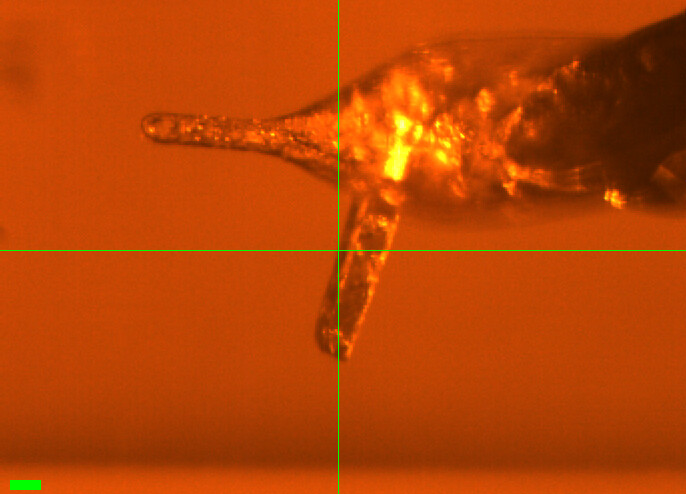
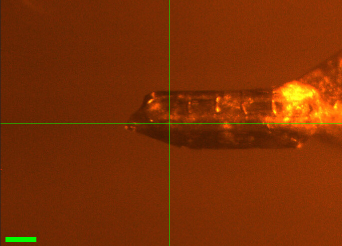
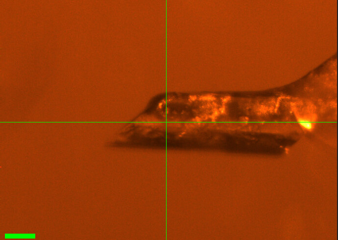
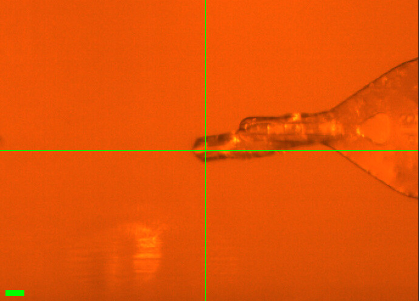
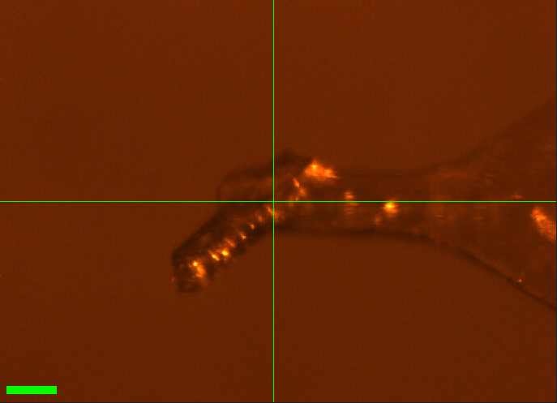
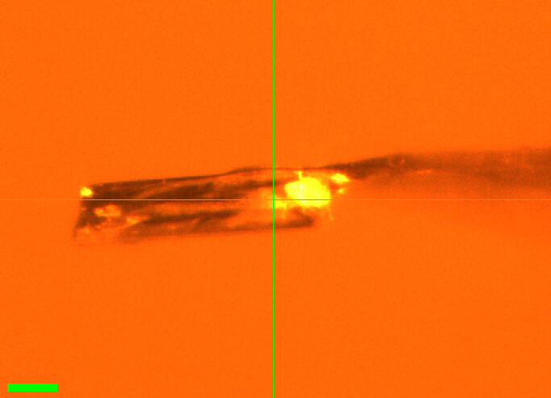

!!! danger "Under Construction"

    This page was auto-transcribed from handwritten notebooks and log files. We are currently reviewing for correctness and adding missing information (see TODO comments in markdown source). Use with caution.

# 2026-10-14 @ CHESS 7b2

Second CHESS beam time of the 2026-3 run cycle.

## Goals

- Temperature-dependent data on DHFR crystals (vector scans, 180˚ per temperature step, 280–320 K)

## Participants

Steve M and Neti B from Ando lab; support from Mike P, John I, and Tricia C at CHESS.

<!-- TODO: The handwriting changes partway through p. 57 (from "observed condensation drops..." onward), and the later notes are written in the first person ("I will make sure to check for drops", "I am moving on"). Confirm who mounted and collected crystals DHFR_3 onward (Neti?), so the per-crystal sections can say who did what. -->

## Data

Root directory at CHESS: `/nfs/chess/raw/2026-3/id7b2/meisburger/20261014`

Root directory on OSN: `s3://diffuse-chess-public/20261014`

## Beamline setup

!!! failure "Failed to control temperature"

    During beamtime, we struggled with the cryostream controller, and ultimately ended the beamtime early when it became unusable. When troubleshooting during setup, the cold stream head was swapped out. Unfortunately, we neglected to align it to the goniometer before starting data collection and didn't notice this until after data collection ended. Based on the misaligned position, the capillary was (mostly? partly?) bathed in sheath flow, which is at room temperature. Thus, the temperature values recorded below are the setpoint of the controller, but not the crystal temperature (which is likely close to room temp. for all datasets). The ambient T datasets are usable, but all the others are suspect. We plan to repeat these experiments in two weeks.

parameter | value | notes
--- | --- | ---
X-ray energy | 14 keV @ 0.01% bandwidth | Si 111 channel cut mono inserted
Beam size | 100 µm x 100 µm | Slit-defined, no CRL. Not changed during the beamtime.
Flux | 6.5 x 10^10^ ph/s | I2 ~72,900 / s, ICol ~270,700 / s; see SPEC `ct` output below
Background reduction | On-axis mirror with Mo tube |
Centering camera | on-axis camera | New long working distance camera (as on 2026-09-30). Scalebar in screenshots: green bar, lower left.
Beamstop | Semi-transparent Mo beamstop |
Data collection software | "MX Collect" (python) & SPEC | Modified by Mike P to use the new camera
Temperature control | Oxford cryostream, end-on |

<!-- TODO: Flux. The notebook (p. 55) gives 6.5 x 10^10 ph/s, written over a crossed-out 2.5 x 10^10 ph/s. Scaling the I2 reading below (72,925 /s) by the I2 calibration of earlier entries (I2 = 46,016 -> 3.9 x 10^10 on 2026-09-30; I2 = 114,356 -> 9.7 x 10^10 on 2026-06-22) gives ~6.2 x 10^10 ph/s. Confirm which value to report. -->

<!-- TODO: Pixel size of the new on-axis camera (µm / pixel at each zoom ratio), and confirm that the green scale bar is still 100 µm. The bar is visibly shorter in DHFR_3.png and DHFR_5.png than in the other screenshots, so they were probably taken at a different zoom. -->

Steve M and Neti B arrived at ~9–10 AM. The DHFR crystals had been looped the day before by Neti; Steve transported them to CHESS on the evening of 10/13, and they were stored in the cold room overnight. Mike P, John I, and Tricia C aligned the station.

Steve adjusted the mirror and the s3h calibration, and recovered a lot of flux (up ~1.6x from 3.9 x 10^10^ ph/s on 2026-09-30):

```
From id7b2.classe.cornell.edu
Wed Oct 14 15:21:43 2026

Output of macro ct

Wed Oct 14 15:21:44 2026

     Seconds = 1
       Diode = 36 (36/s)
          I2 = 72925 (72925/s)
        ICol = 270685 (270685/s)
        Gate = 0 (0/s)
       QuadX = 0 (0/s)
       QuadY = 0.000132 (0.000132/s)
       newI1 = 152599 (152599/s)
       newI0 = 234765 (234765/s)
```

## Samples

Name | Sample | Well composition | Drop composition | Notes
--- | --- | --- | --- | ---
DHFR-Folate-NADP | E. coli dihydrofolate reductase with folate and NADP+ <!-- TODO: protein batch, concentration, and ligand concentrations for these crystals (same prep as 2026-09-30?) --> | <!-- TODO --> | <!-- TODO --> | Looped by Neti B on 10/13 and stored in the cold room at CHESS overnight. <!-- TODO: tray number/date, wells each crystal came from, and Neti's notebook number / page. The crystal numbers used today (1–8, 11, 25) refer to Neti's loop numbering. --> |

## Data collection

Collected a 1 s exposure with nothing in the beam to document the background scatter. Slits 100 x 100 µm.

Subdirectory: `setup`

| prefix   | φ0 (deg.) | ∆φ (deg.) | images | ∆t (s) | tf (%) | d (mm) | E (keV) |
|----------|-----------|-----------|--------|--------|--------|--------|---------|
| air_1751 |         0 |       0.1 |      1 |      1 |    100 |    185 |      14 |
| air_1752 |         0 |       0.1 |      1 |      1 |    100 |    185 |      14 |

<!-- TODO: Two air shots were recorded (air_1751 at 15:24 and air_1752 at 15:32), but neither is mentioned in the notebook. Why the second one? Is one of them preferred? -->

### 1. DHFR-Folate-NADP (dose test)

Starting the DHFR samples with crystal #25 (the plan was to go in reverse order). No screenshot was recorded.

Regular (not vector) scans, 360˚. Slits 100 x 100 µm. Temperature 300 K (per xia2 metadata).

Subdirectory: `DHFR/DHFR_25`

| prefix              | φ0 (deg.) | φ1 (deg.) | ∆φ (deg.) | images | ∆t (s) | tf (%) | d (mm) | E (keV) |
|---------------------|-----------|-----------|-----------|--------|--------|--------|--------|---------|
| DHFR_25_300K_1753\* |         0 |       360 |       0.1 |   3600 |   0.01 |    100 |    185 |      14 |
| DHFR_25_300K_1754   |         0 |       360 |       0.1 |   3600 |   0.01 |    100 |    185 |      14 |

!!! warning "first scan at the tip of the crystal"

    \* `DHFR_25_300K_1753` was collected at the tip of the crystal. The crystal was then moved to a new spot for `DHFR_25_300K_1754`. Only 1754 was processed.

<!-- TODO: The margin note next to DHFR_25_300K_1753 (p. 56) reads "tip of xtal." with "forgot to open shutter" crossed out. Confirm that 1753 was exposed (shutter open) and whether it is usable. -->

!!! warning "no background"

    No background scan was collected for this crystal.

B-factor decayed by ~4 Å<sup>2</sup> over the 36 s data collection. So the lifetime (without vector, at 100% transmission) is approximately 18 s. Our strategy will be to collect 180˚ from each crystal and vector over a ~500 µm distance if possible, maintaining 100% transmission.

<!-- TODO: The notebook says "~4 Ų over 36 s ... lifetime approx. 18 s". Which B-factor criterion gives 18 s (e.g. 2 Ų tolerance)? Add the per-scan B-factor decay if available. -->

??? info "xia2 processing"

    |                 | DHFR_25_300K_1754                       |
    |-----------------|-----------------------------------------|
    | scan            | 1754                                    |
    | Mosaic spread   | 0.105                                   |
    | Resolution      | 1.22                                    |
    | Unit Cell       | [34.42, 45.71, 99.09, 90.0, 90.0, 90.0] |
    | Image range     | [1, 3600]                               |
    | Completeness    | 100.0                                   |
    | Multiplicity    | 12.6                                    |
    | I/sigma         | 10.0                                    |
    | Rpim            | 0.026                                   |
    | Wilson B factor | 14.44                                   |
    | Space group     | P 21 21 21                              |
    | temperature     | 300                                     |

### 2. DHFR-Folate-NADP (multi-T)

Crystal #4. No screenshot was recorded.

Vector scan (spinx translation: 419.2 µm). Slits 100 x 100 µm.

Plan: 295, 310, 295, 280, 295 K temperature series, with 5 minute wait time after each temperature change. (A 320 K step and a final 295 K step were added at the end.)

Subdirectory: `DHFR/DHFR_4`

| prefix              | φ0 (deg.) | φ1 (deg.) | ∆φ (deg.) | images | ∆t (s) | tf (%) | d (mm) | E (keV) |
|---------------------|-----------|-----------|-----------|--------|--------|--------|--------|---------|
| DHFR_4_295K_1755    |         0 |       180 |       0.1 |   1800 |   0.01 |    100 |    185 |      14 |
| DHFR_4_295K_bg_1756 |         0 |       180 |         1 |    180 |    0.1 |    100 |    185 |      14 |

---

Ramped to 310 K and waited 5 min.

| prefix              | φ0 (deg.) | φ1 (deg.) | ∆φ (deg.) | images | ∆t (s) | tf (%) | d (mm) | E (keV) |
|---------------------|-----------|-----------|-----------|--------|--------|--------|--------|---------|
| DHFR_4_310K_1757    |         0 |       180 |       0.1 |   1800 |   0.01 |    100 |    185 |      14 |
| DHFR_4_310K_bg_1758 |         0 |       180 |         1 |    180 |    0.1 |    100 |    185 |      14 |

---

Changed temperature to 295 K, waited 5 min.

| prefix              | φ0 (deg.) | φ1 (deg.) | ∆φ (deg.) | images | ∆t (s) | tf (%) | d (mm) | E (keV) |
|---------------------|-----------|-----------|-----------|--------|--------|--------|--------|---------|
| DHFR_4_295K_1759    |         0 |       180 |       0.1 |   1800 |   0.01 |    100 |    185 |      14 |
| DHFR_4_295K_bg_1760 |         0 |       180 |         1 |    180 |    0.1 |    100 |    185 |      14 |

---

Changed temperature to 280 K, waited 5 min.

| prefix              | φ0 (deg.) | φ1 (deg.) | ∆φ (deg.) | images | ∆t (s) | tf (%) | d (mm) | E (keV) |
|---------------------|-----------|-----------|-----------|--------|--------|--------|--------|---------|
| DHFR_4_280K_1761    |         0 |       180 |       0.1 |   1800 |   0.01 |    100 |    185 |      14 |
| DHFR_4_280K_bg_1762 |         0 |       180 |         1 |    180 |    0.1 |    100 |    185 |      14 |

---

Changed temperature to 295 K, waited 5 min.

| prefix              | φ0 (deg.) | φ1 (deg.) | ∆φ (deg.) | images | ∆t (s) | tf (%) | d (mm) | E (keV) |
|---------------------|-----------|-----------|-----------|--------|--------|--------|--------|---------|
| DHFR_4_295K_1763    |         0 |       180 |       0.1 |   1800 |   0.01 |    100 |    185 |      14 |
| DHFR_4_295K_bg_1764 |         0 |       180 |         1 |    180 |    0.1 |    100 |    185 |      14 |

---

Changed temperature to 320 K, waited 5 min.

| prefix              | φ0 (deg.) | φ1 (deg.) | ∆φ (deg.) | images | ∆t (s) | tf (%) | d (mm) | E (keV) |
|---------------------|-----------|-----------|-----------|--------|--------|--------|--------|---------|
| DHFR_4_320K_1765    |         0 |       180 |       0.1 |   1800 |   0.01 |    100 |    185 |      14 |
| DHFR_4_320K_bg_1766 |         0 |       180 |         1 |    180 |    0.1 |    100 |    185 |      14 |

---

Changed temperature to 295 K.

| prefix              | φ0 (deg.) | φ1 (deg.) | ∆φ (deg.) | images | ∆t (s) | tf (%) | d (mm) | E (keV) |
|---------------------|-----------|-----------|-----------|--------|--------|--------|--------|---------|
| DHFR_4_295K_1767    |         0 |       180 |       0.1 |   1800 |   0.01 |    100 |    185 |      14 |
| DHFR_4_295K_bg_1768 |         0 |       180 |         1 |    180 |    0.1 |    100 |    185 |      14 |

!!! warning "condensation"

    Condensation drops were observed on the plastic capillary after the 320 K step. `DHFR_4_320K_1765` and `DHFR_4_295K_1767` may be affected.

<!-- TODO: When exactly was condensation first seen — during 1765 (320 K) or after it, before 1767? Was the capillary dried/wiped before 1767? -->

<!-- TODO: The notebook (p. 57) does not list the 320 K background (DHFR_4_320K_bg_1766) and labels 1766–1768 together as "DHFR_4_295K". The scan log has 1766 = 320K_bg, 1767 = 295K, 1768 = 295K_bg (used here). -->

<!-- TODO: xia2 results are missing for the final 295 K scan (DHFR_4_295K_1767). -->

??? info "xia2 processing"

    |                 | DHFR_4_295K_1755                        | DHFR_4_310K_1757                        | DHFR_4_295K_1759                        | DHFR_4_280K_1761                        | DHFR_4_295K_1763                        | DHFR_4_320K_1765                        |
    |-----------------|-----------------------------------------|-----------------------------------------|-----------------------------------------|-----------------------------------------|-----------------------------------------|-----------------------------------------|
    | scan            | 1755                                    | 1757                                    | 1759                                    | 1761                                    | 1763                                    | 1765                                    |
    | Mosaic spread   | 0.022                                   | 0.022                                   | 0.021                                   | 0.024                                   | 0.023                                   | 0.024                                   |
    | Resolution      | 1.16                                    | 1.16                                    | 1.19                                    | 1.21                                    | 1.22                                    | 1.21                                    |
    | Unit Cell       | [34.45, 45.79, 98.95, 90.0, 90.0, 90.0] | [34.45, 45.79, 98.96, 90.0, 90.0, 90.0] | [34.45, 45.77, 98.99, 90.0, 90.0, 90.0] | [34.42, 45.67, 99.02, 90.0, 90.0, 90.0] | [34.42, 45.69, 99.06, 90.0, 90.0, 90.0] | [34.45, 45.78, 99.02, 90.0, 90.0, 90.0] |
    | Image range     | [1, 1800]                               | [1, 1800]                               | [1, 1800]                               | [1, 1800]                               | [1, 1800]                               | [1, 1800]                               |
    | Completeness    | 95.0                                    | 95.0                                    | 96.6                                    | 96.9                                    | 97.0                                    | 96.9                                    |
    | Multiplicity    | 6.3                                     | 6.3                                     | 6.4                                     | 6.5                                     | 6.5                                     | 6.5                                     |
    | I/sigma         | 7.7                                     | 7.6                                     | 5.7                                     | 8.2                                     | 7.8                                     | 8.5                                     |
    | Rpim            | 0.048                                   | 0.048                                   | 0.06                                    | 0.046                                   | 0.048                                   | 0.042                                   |
    | Wilson B factor | 13.93                                   | 14.01                                   | 13.99                                   | 14.34                                   | 14.69                                   | 14.79                                   |
    | Space group     | P 21 21 21                              | P 21 21 21                              | P 21 21 21                              | P 21 21 21                              | P 21 21 21                              | P 21 21 21                              |
    | temperature     | 295                                     | 310                                     | 295                                     | 280                                     | 295                                     | 320                                     |

### 3. DHFR-Folate-NADP (multi-T)

!!! quote inline end ""

    

Crystal #3. Might be 2 crystals (the screenshot shows a second rod sticking out below the main crystal). Mounted the crystal and waited 5 min. Checked for condensation; none after this.

Vector scan (spinx translation: 172.8 µm). Slits 100 x 100 µm.

Subdirectory: `DHFR/DHFR_3`

Took a screenshot of the crystal.

<div style="clear: both;"></div>

| prefix              | φ0 (deg.) | φ1 (deg.) | ∆φ (deg.) | images | ∆t (s) | tf (%) | d (mm) | E (keV) |
|---------------------|-----------|-----------|-----------|--------|--------|--------|--------|---------|
| DHFR_3_295K_1769    |         0 |       180 |       0.1 |   1800 |   0.01 |    100 |    185 |      14 |
| DHFR_3_295K_bg_1770 |         0 |       180 |         1 |    180 |    0.1 |    100 |    185 |      14 |

xia2: unit cell [34.3, 45.4, 99.2, 90, 90, 90], 1.24 Å.

---

| prefix              | φ0 (deg.) | φ1 (deg.) | ∆φ (deg.) | images | ∆t (s) | tf (%) | d (mm) | E (keV) |
|---------------------|-----------|-----------|-----------|--------|--------|--------|--------|---------|
| DHFR_3_310K_1771    |         0 |       180 |       0.1 |   1800 |   0.01 |    100 |    185 |      14 |
| DHFR_3_310K_bg_1772 |         0 |       180 |         1 |    180 |    0.1 |    100 |    185 |      14 |

!!! warning "poor diffraction at 310 K"

    The diffraction at 310 K (`DHFR_3_310K_1771`) looked bad, so we moved on. Only the 295 K scan was processed. The crystal may also contain a second lattice (see screenshot).

<!-- TODO: The notebook does not mention the temperature change to 310 K before 1771 (the prefix was first written as "390K"/"310K" and corrected). Confirm the temperature and wait time. Was xia2 attempted on DHFR_3_310K_1771? -->

??? info "xia2 processing"

    |                 | DHFR_3_295K_1769                        |
    |-----------------|-----------------------------------------|
    | scan            | 1769                                    |
    | Mosaic spread   | 0.05                                    |
    | Resolution      | 1.24                                    |
    | Unit Cell       | [34.32, 45.37, 99.24, 90.0, 90.0, 90.0] |
    | Image range     | [1, 1800]                               |
    | Completeness    | 100.0                                   |
    | Multiplicity    | 6.4                                     |
    | I/sigma         | 12.0                                    |
    | Rpim            | 0.034                                   |
    | Wilson B factor | 15.76                                   |
    | Space group     | P 21 21 21                              |
    | temperature     | 295                                     |

### 4. DHFR-Folate-NADP

!!! quote inline end ""

    

Crystal #2. Took a photo (`DHFR-2.PNG` in the notebook; `DHFR_2.png` here). The cryostream was coming down from 310 K to 295 K.

Vector scan (spinx translation: 374.3 µm). Slits 100 x 100 µm.

Subdirectory: `DHFR/DHFR_2`

<div style="clear: both;"></div>

| prefix              | φ0 (deg.) | φ1 (deg.) | ∆φ (deg.) | images | ∆t (s) | tf (%) | d (mm) | E (keV) |
|---------------------|-----------|-----------|-----------|--------|--------|--------|--------|---------|
| DHFR_2_295K_1773\*  |         0 |       180 |       0.1 |   1800 |   0.01 |    100 |    185 |      14 |
| DHFR_2_295K_1774    |         0 |       180 |       0.1 |   1800 |   0.01 |    100 |    185 |      14 |
| DHFR_2_295K_bg_1775 |         0 |       180 |         1 |    180 |    0.1 |    100 |    185 |      14 |

!!! warning "repeated scan"

    \* `DHFR_2_295K_1773` was repeated as `DHFR_2_295K_1774` 42 s later (the notebook scan number was corrected from 1773 to 1774). Use 1774.

<!-- TODO: Why was DHFR_2_295K_1773 repeated? Was it aborted, or collected before the cryostream had settled at 295 K? -->

!!! warning "poor statistics"

    xia2: mosaicity 0.32˚ and resolution 1.67 Å, much worse than the other DHFR crystals measured today (first 295 K scan: mosaicity 0.02–0.08˚, resolution 1.16–1.24 Å). Rpim 0.094.

A 310 K scan (`DHFR_2_310K`) was planned but crossed out in the notebook and not collected.

??? info "xia2 processing"

    |                 | DHFR_2_295K_1774                       |
    |-----------------|----------------------------------------|
    | scan            | 1774                                   |
    | Mosaic spread   | 0.321                                  |
    | Resolution      | 1.67                                   |
    | Unit Cell       | [34.27, 45.17, 99.2, 90.0, 90.0, 90.0] |
    | Image range     | [1, 1800]                              |
    | Completeness    | 99.4                                   |
    | Multiplicity    | 6.6                                    |
    | I/sigma         | 8.2                                    |
    | Rpim            | 0.094                                  |
    | Wilson B factor | 18.54                                  |
    | Space group     | P 21 21 21                             |
    | temperature     | 295                                    |

<!-- TODO: The scan log shows a ~1 h 45 min gap between DHFR_2_295K_bg_1775 (19:01) and DHFR_1_295K_1776 (20:47). What happened (break, cryostream issue, etc.)? -->

### 5. DHFR-Folate-NADP

!!! quote inline end ""

    

Crystal #1. Took a photo.

Vector scan (spinx translation: 350.4 µm). Slits 100 x 100 µm.

Subdirectory: `DHFR/DHFR_1`

<div style="clear: both;"></div>

| prefix              | φ0 (deg.) | φ1 (deg.) | ∆φ (deg.) | images | ∆t (s) | tf (%) | d (mm) | E (keV) |
|---------------------|-----------|-----------|-----------|--------|--------|--------|--------|---------|
| DHFR_1_295K_1776    |         0 |       180 |       0.1 |   1800 |   0.01 |    100 |    185 |      14 |
| DHFR_1_295K_bg_1777 |         0 |       180 |         1 |    180 |    0.1 |    100 |    185 |      14 |

Great crystal. xia2: [34.30, 45.17, 99.25], mosaicity 0.079˚. There is some radiation damage?

---

Changed temperature to 310 K. No condensation yet. There are a few drops on the capillary, but probably not condensation.

| prefix              | φ0 (deg.) | φ1 (deg.) | ∆φ (deg.) | images | ∆t (s) | tf (%) | d (mm) | E (keV) |
|---------------------|-----------|-----------|-----------|--------|--------|--------|--------|---------|
| DHFR_1_310K_1778    |         0 |       180 |       0.1 |   1800 |   0.01 |    100 |    185 |      14 |
| DHFR_1_310K_bg_1779 |         0 |       180 |         1 |    180 |    0.1 |    100 |    185 |      14 |

!!! warning "very mosaic at 310 K"

    The diffraction at 310 K looked very mosaic, so we moved on to another crystal. xia2: mosaicity 0.86˚ (vs 0.079˚ at 295 K), resolution 1.76 Å (vs 1.17 Å), Wilson B 26.1 Å<sup>2</sup> (vs 14.7 Å<sup>2</sup>), and the unit cell shrank (a, b = 34.07, 44.73 Å vs 34.28, 45.19 Å).

??? info "xia2 processing"

    |                 | DHFR_1_295K_1776                        | DHFR_1_310K_1778                        |
    |-----------------|-----------------------------------------|-----------------------------------------|
    | scan            | 1776                                    | 1778                                    |
    | Mosaic spread   | 0.079                                   | 0.863                                   |
    | Resolution      | 1.17                                    | 1.76                                    |
    | Unit Cell       | [34.28, 45.19, 99.21, 90.0, 90.0, 90.0] | [34.07, 44.73, 99.02, 90.0, 90.0, 90.0] |
    | Image range     | [1, 1800]                               | [1, 1800]                               |
    | Completeness    | 95.6                                    | 98.3                                    |
    | Multiplicity    | 6.3                                     | 6.6                                     |
    | I/sigma         | 13.3                                    | 8.3                                     |
    | Rpim            | 0.024                                   | 0.059                                   |
    | Wilson B factor | 14.71                                   | 26.13                                   |
    | Space group     | P 21 21 21                              | P 21 21 21                              |
    | temperature     | 295                                     | 310                                     |

### 6. DHFR-Folate-NADP (multi-T)

!!! quote inline end ""

    

Crystal #5. Took a photo: it is a thin crystal.

Vector scan (spinx translation: 443.1 µm). Slits 100 x 100 µm.

Subdirectory: `DHFR/DHFR_5`

<div style="clear: both;"></div>

| prefix              | φ0 (deg.) | φ1 (deg.) | ∆φ (deg.) | images | ∆t (s) | tf (%) | d (mm) | E (keV) |
|---------------------|-----------|-----------|-----------|--------|--------|--------|--------|---------|
| DHFR_5_295k_1780    |         0 |       180 |       0.1 |   1800 |   0.01 |    100 |    185 |      14 |
| DHFR_5_295k_bg_1781 |         0 |       180 |         1 |    180 |    0.1 |    100 |    185 |      14 |

xia2: [34.4, 45.6, 99.1], mosaicity 0.02˚.

---

Cooled to 280 K.

| prefix              | φ0 (deg.) | φ1 (deg.) | ∆φ (deg.) | images | ∆t (s) | tf (%) | d (mm) | E (keV) |
|---------------------|-----------|-----------|-----------|--------|--------|--------|--------|---------|
| DHFR_5_280k_1782    |         0 |       180 |       0.1 |   1800 |   0.01 |    100 |    185 |      14 |
| DHFR_5_280k_bg_1783 |         0 |       180 |         1 |    180 |    0.1 |    100 |    185 |      14 |

Good scattering. xia2: [34.4, 45.5, 99.14].

---

Heated back to 295 K. No condensation yet.

| prefix              | φ0 (deg.) | φ1 (deg.) | ∆φ (deg.) | images | ∆t (s) | tf (%) | d (mm) | E (keV) |
|---------------------|-----------|-----------|-----------|--------|--------|--------|--------|---------|
| DHFR_5_295K_1784    |         0 |       180 |       0.1 |   1800 |   0.01 |    100 |    185 |      14 |
| DHFR_5_295K_bg_1785 |         0 |       180 |         1 |    180 |    0.1 |    100 |    185 |      14 |

---

Good scattering. Heated to 310 K. No condensation yet.

| prefix              | φ0 (deg.) | φ1 (deg.) | ∆φ (deg.) | images | ∆t (s) | tf (%) | d (mm) | E (keV) |
|---------------------|-----------|-----------|-----------|--------|--------|--------|--------|---------|
| DHFR_5_310K_1786    |         0 |       180 |       0.1 |   1800 |   0.01 |    100 |    185 |      14 |
| DHFR_5_310K_bg_1787 |         0 |       180 |         1 |    180 |    0.1 |    100 |    185 |      14 |

---

Good scattering. Going down to 295 K. Condensation seen (not too much, though).

| prefix              | φ0 (deg.) | φ1 (deg.) | ∆φ (deg.) | images | ∆t (s) | tf (%) | d (mm) | E (keV) |
|---------------------|-----------|-----------|-----------|--------|--------|--------|--------|---------|
| DHFR_5_295K_1788    |         0 |       180 |       0.1 |   1800 |   0.01 |    100 |    185 |      14 |
| DHFR_5_295K_bg_1789 |         0 |       180 |         1 |    180 |    0.1 |    100 |    185 |      14 |

Good scattering.

!!! warning "file naming"

    The first two temperature steps use a lowercase "k" in the prefix (`DHFR_5_295k_1780`, `DHFR_5_280k_1782` and their backgrounds), unlike all other scans (`..._295K_...`).

!!! warning "high Rpim"

    Although the diffraction looked good, xia2 reports Rpim 0.17–0.27 for this crystal, several times higher than the other DHFR crystals measured today (0.024–0.06, excluding DHFR_2 at 0.094). Resolution also degrades across the series at 295 K: 1.23 Å (1780) → 1.72 Å (1784).

!!! warning "condensation"

    Some condensation was observed after the 310 K step, before `DHFR_5_295K_1788`.

<!-- TODO: The notebook (p. 58) numbers the last two steps as 310K_1784 / 310K_bg_1785 and 295K_1786 / 295K_1787. The scan log has 310K = 1786/1787 and 295K = 1788/1789 (used here); 1784/1785 are the second 295 K step. -->

<!-- TODO: xia2 results are missing for DHFR_5_310K_1786 and DHFR_5_295K_1788. Also check why Rpim is so high for this crystal (thin crystal? wrong space group / indexing?). -->

??? info "xia2 processing"

    |                 | DHFR_5_295k_1780                        | DHFR_5_280k_1782                       | DHFR_5_295K_1784                        |
    |-----------------|-----------------------------------------|----------------------------------------|-----------------------------------------|
    | scan            | 1780                                    | 1782                                   | 1784                                    |
    | Mosaic spread   | 0.019                                   | 0.021                                  | 0.03                                    |
    | Resolution      | 1.23                                    | 1.4                                    | 1.72                                    |
    | Unit Cell       | [34.43, 45.63, 99.05, 90.0, 90.0, 90.0] | [34.4, 45.52, 99.13, 90.0, 90.0, 90.0] | [34.42, 45.63, 99.14, 90.0, 90.0, 90.0] |
    | Image range     | [1, 1800]                               | [1, 1800]                              | [1, 1800]                               |
    | Completeness    | 99.8                                    | 100.0                                  | 100.0                                   |
    | Multiplicity    | 5.6                                     | 6.0                                    | 6.0                                     |
    | I/sigma         | 7.3                                     | 12.7                                   | 22.1                                    |
    | Rpim            | 0.172                                   | 0.269                                  | 0.189                                   |
    | Wilson B factor | 15.47                                   | 15.05                                  | 16.38                                   |
    | Space group     | P 21 21 21                              | P 21 21 21                             | P 21 21 21                              |
    | temperature     | 295                                     | 280                                    | 295                                     |

### 7. DHFR-Folate-NADP

!!! quote inline end ""

    

Crystal #6. Collected at 280 K.

Vector scan (spinx translation: 161.6 µm). Slits 100 x 100 µm.

Subdirectory: `DHFR/DHFR_6`

<div style="clear: both;"></div>

| prefix           | φ0 (deg.) | φ1 (deg.) | ∆φ (deg.) | images | ∆t (s) | tf (%) | d (mm) | E (keV) |
|------------------|-----------|-----------|-----------|--------|--------|--------|--------|---------|
| DHFR_6_280K_1790 |         0 |       180 |       0.1 |   1800 |   0.01 |    100 |    185 |      14 |
| DHFR_6_280K_1791 |         0 |       180 |       0.1 |   1800 |   0.01 |    100 |    185 |      14 |

!!! warning "poor diffraction"

    Really bad diffraction. No background scan was collected, and no xia2 results are available.

<!-- TODO: The notebook (p. 59) lists a single scan, "DHFR_6_280K_1788". The scan log has two scans, DHFR_6_280K_1790 and DHFR_6_280K_1791 (48 s apart). Why was it repeated? -->

<!-- TODO: The screenshot DHFR_6.png is not mentioned in the notebook. Confirm it shows crystal #6. -->

### 8. DHFR-Folate-NADP

!!! quote inline end ""

    

Crystal #7. Collected at 280 K, 360˚.

Vector scan (spinx translation: 272.1 µm). Slits 100 x 100 µm.

Subdirectory: `DHFR/DHFR_7`

<div style="clear: both;"></div>

| prefix              | φ0 (deg.) | φ1 (deg.) | ∆φ (deg.) | images | ∆t (s) | tf (%) | d (mm) | E (keV) |
|---------------------|-----------|-----------|-----------|--------|--------|--------|--------|---------|
| DHFR_7_280K_1792    |         0 |       360 |       0.1 |   3600 |   0.01 |    100 |    185 |      14 |
| DHFR_7_280K_bg_1793 |         0 |       360 |         1 |    360 |    0.1 |    100 |    185 |      14 |

<!-- TODO: The notebook (p. 59) says "forgot to open the shutter" for DHFR_7, but DHFR_7_280K_1792 processed well (98% complete, 1.27 Å). Was the shutter mistake on an earlier attempt that wasn't saved, or on the background (1793)? Also confirm the screenshot DHFR_7.png (not mentioned in the notebook) shows crystal #7. -->

??? info "xia2 processing"

    |                 | DHFR_7_280K_1792                        |
    |-----------------|-----------------------------------------|
    | scan            | 1792                                    |
    | Mosaic spread   | 0.08                                    |
    | Resolution      | 1.27                                    |
    | Unit Cell       | [34.36, 45.21, 99.38, 90.0, 90.0, 90.0] |
    | Image range     | [1, 3600]                               |
    | Completeness    | 98.0                                    |
    | Multiplicity    | 13.2                                    |
    | I/sigma         | 11.2                                    |
    | Rpim            | 0.025                                   |
    | Wilson B factor | 16.46                                   |
    | Space group     | P 21 21 21                              |
    | temperature     | 280                                     |

### 9. DHFR-Folate-NADP

Crystal #8. Collected at 280 K, 360˚. No screenshot was recorded.

Vector scan (spinx translation: 350.4 µm). Slits 100 x 100 µm.

Subdirectory: `DHFR/DHFR_8`

| prefix              | φ0 (deg.) | φ1 (deg.) | ∆φ (deg.) | images | ∆t (s) | tf (%) | d (mm) | E (keV) |
|---------------------|-----------|-----------|-----------|--------|--------|--------|--------|---------|
| DHFR_8_280K_1794    |         0 |       360 |       0.1 |   3600 |   0.01 |    100 |    185 |      14 |
| DHFR_8_280K_bg_1795 |         0 |       360 |         1 |    360 |    0.1 |    100 |    185 |      14 |
| DHFR_8_280K_bg_1796 |         0 |       360 |         1 |    360 |    0.1 |    100 |    185 |      14 |

!!! warning "temperature uncertain"

    The temperature was off: the cryostream was not at 280 K during this crystal, despite the 280K prefix. The actual temperature is unknown.

!!! warning "two background scans"

    Two background scans were collected. The notebook marks `DHFR_8_280K_bg_1796` as the correct background.

<!-- TODO: The notebook (p. 59) says "Temperature is off. not at 280", followed by an overwritten number ("260"?) and "or ... maybe not sure". What was the actual temperature? Is the cryostream log available? -->

<!-- TODO: What was wrong with DHFR_8_280K_bg_1795? The notebook also draws an arrow from the "correct bg" note up toward the DHFR_7 section — does 1796 apply to DHFR_7 as well? -->

<!-- TODO: xia2 results are missing for DHFR_8_280K_1794. -->

### 10. DHFR-Folate-NADP

Crystal #11. Collected at 280 K, 360˚. No screenshot was recorded.

Vector scan (spinx translation: 395.2 µm). Slits 100 x 100 µm.

Subdirectory: `DHFR/DHFR_11`

| prefix            | φ0 (deg.) | φ1 (deg.) | ∆φ (deg.) | images | ∆t (s) | tf (%) | d (mm) | E (keV) |
|-------------------|-----------|-----------|-----------|--------|--------|--------|--------|---------|
| DHFR_11_280K_1797 |         0 |       360 |       0.1 |   3600 |   0.01 |    100 |    185 |      14 |

!!! warning "no background; temperature uncertain"

    No background scan was collected. The cryostream controller faulted several times around this time, so the temperature may not have been 280 K.

<!-- TODO: The notebook (p. 59) records this crystal as "DHFR_9, collected at 280K", but the scan log has `DHFR/DHFR_11` / `DHFR_11_280K_1797` and no DHFR_9. Which crystal (loop number) was it? -->

<!-- TODO: xia2 results are missing for DHFR_11_280K_1797. -->

---

The cryostream controller faulted several times. Called it a night after DHFR_11 (last scan at 23:27).

!!! success "Done!"
