# 2026-10-28 @ CHESS 7b2

!!! danger "Under Construction"

    This page was auto-transcribed from handwritten notebooks and log files. We are currently reviewing for correctness and adding missing information (see TODO comments in markdown source). Use with caution.

Third CHESS beam time of the 2026-3 run cycle.

## Goals

- Temperature-dependent data on DHFR crystals
- Screen the cross-linked DNA crystals made by Alex, and compare them with the ones Steve & Xiaokun made (see [2026-03-11](20260311-chess.md))

## Participants

Steve M, Neti B, Alex W (main), and Bella A (training) from Ando lab; support from Mike P, John I, and Tricia C at CHESS.

<div class="grid cards" markdown>

- 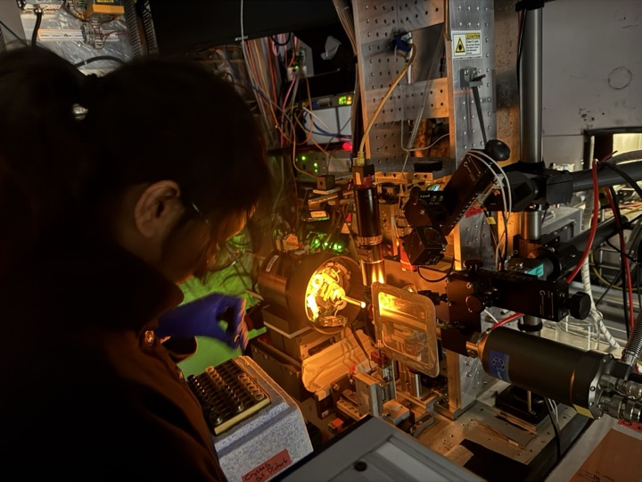<br>
<!-- TODO: caption (taken 10/29 at 2:37 PM) -->

</div>

## Data

Root directory at CHESS: `/nfs/chess/raw/2026-3/id7b2/meisburger/20261028`

Root directory on OSN: `s3://diffuse-chess-public/20261028`

## Beamline setup

parameter | value | notes
--- | --- | ---
X-ray energy | 14 keV @ 0.01% bandwidth | Si 111 mono
Beam size | 100 µm x 100 µm | Slit-defined, no CRL
Flux | 3.8 x 10^10^ ph/s | Re-measured, see below
Background reduction | On-axis mirror with Mo tube |
Centering camera | On-axis long working distance camera | New this run
Beamstop | Semi-transparent Mo |
Data collection software | "MX Collect" (python) | Modified by Mike P to use new camera. Auto-processing scripts (xia2).
Temperature control | Cryostream, end-on |

## Samples

Name | Sample | Well composition | Drop composition | Notes
--- | --- | --- | --- | ---
Lysozyme | Hen egg-white lysozyme | 0.7 M NaCl, 20 mM NaOAc pH 4.6 (well D2) |  | Tray set up by Bella |
DNA |  |  |  | Looped in the humidity chamber |
DHFR | E. coli dihydrofolate reductase, 31.5 mg/mL + 6.35 mM NADP | 20 mM imidazole, 100 mM MnCl~2~, 15% PEG 400 | 1.5 µL well solution + 1.5 µL protein solution + 1 µL of 10^-3^ or 10^-4^ dilution of seed stock | Tray set up 10/12/26 (Neti's notebook #4, p. 40). Stored in a 4 °C block at the beamline |

<!-- TODO: fill in the missing sample details from the lab notebooks (compositions, tray dates, notebook pages) for lysozyme and DNA. Lysozyme: the first mention on p. 62 could be read as 200 mM NaOAc; 20 mM is used here. -->

## Cold stream test (2026-10-27)

!!! quote inline end ""

    [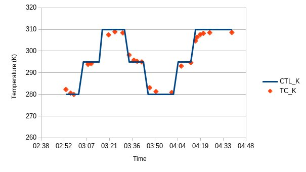](20261028-chess/20261027_tc_plot.jpg)

10/27/26: Steve & Neti arrive at CHESS to play around with the cold stream.

- Estella Y provided us with a thermocouple (with very thin wire).
- John mounted the air stream. Note: it takes about 5 mins since the thermocouple measures the temp of the base, not the air.
- We plan to measure temperature using the thermocouple, do a few ramps and make sure that it works properly.
- Doing a ramp experiment.

Thermocouple: Evolution Sensors and Controls, [T1X-WBWX-40G-EX-0.25-PFXX-40-MPCX](https://evosensors.com/products/t1x-wbwx-40g-ex-0-25-pfxx-40-mpcx) (T-type, 40 Ga).


Plotted in a spreadsheet, saved in setup directory on RAW for tomorrow's beamtime: [20261027_tc_meas.ods](https://nyu1.osn.mghpcc.org/diffuse-chess-public/20261028/setup/20261027_tc_meas.ods)

<div style="clear: both;"></div>

<div class="grid cards" markdown>

- 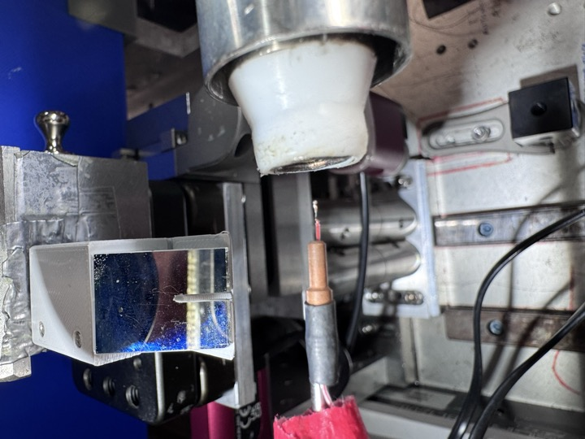<br>
No RT tube (3:24 PM).

- 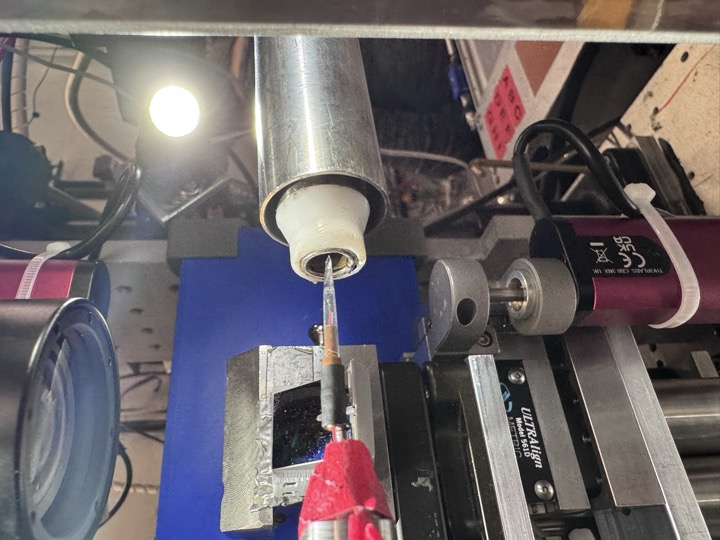<br>
Added RT tube (3:29 PM).

- 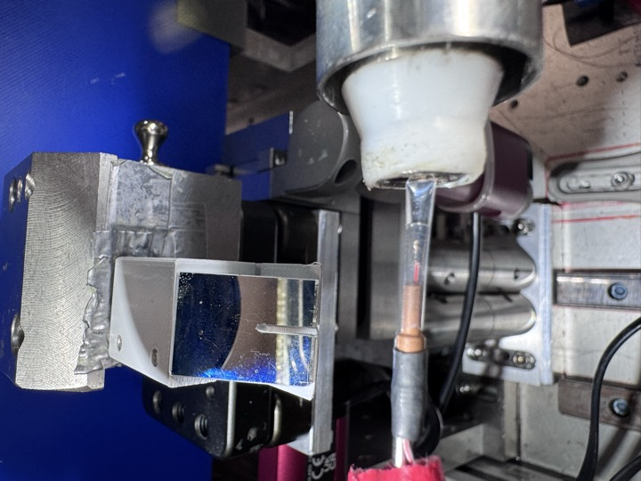<br>
Added RT tube (3:29 PM).

</div>

## Setup and flux measurement (2026-10-28)

Steve M and Neti B arrived at ~10:30 AM. Beam alignment was difficult this morning, so the station was not ready until 3:30. Steve aligned the cold stream with a nylon loop (+ centering tool), then backed it off and set it to 295 K (room temp) for the first ~calibration samples (lysozyme, DHFR).

In the end, lysozyme was the only calibration sample. We skipped a dose test on DHFR, since we did one last time: we used the same exposure times as last time, and the flux is lower, so it shouldn't be a problem. The DNA crystals were an addition (see Goals).

```
From id7b2.classe.cornell.edu
Wed Oct 28 16:10:34 2026

Output of macro ct

Wed Oct 28 16:10:35 2026

     Seconds = 1
       Diode = 43 (43/s)
          I2 = 44768 (44768/s)
        ICol = 170069 (170069/s)
        Gate = 0 (0/s)
       QuadX = 0 (0/s)
       QuadY = 0.000128 (0.000128/s)
       newI1 = 147796 (147796/s)
       newI0 = 200354 (200354/s)
```

Notes on the printout: 14 keV, 100 x 100 µm, no atten, CRL out, CUT in. I2 @ 50 nA/V.

**3.8 x 10^10^ ph/sec**. This is 58% of what we had last time.

## Data collection

All scans were collected at 14 keV with 100 x 100 µm slits (see Beamline setup).

<!-- TODO: the air scatter snapshots (air_2760, air_2761) are not in the notebook. Add context, or remove them if they were left over from troubleshooting. -->

Subdirectory: `setup`

| prefix   |   φ0 (deg.) |   ∆φ (deg.) |   images |   ∆t (s) |   tf (%) |   d (mm) |
|----------|-------------|-------------|----------|----------|----------|----------|
| air_2760 |           0 |           0 |        1 |        1 |      100 |      185 |
| air_2761 |           0 |           0 |        1 |       10 |      100 |      185 |

4:30 PM, we started collecting data.

### 1. Lysozyme

!!! quote inline end ""

    [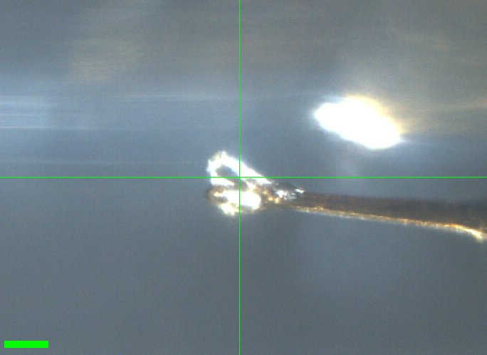](20261028-chess/Lys_1.jpg)<br>
    Scale bar = 100 µm

Neti looped a crystal from the lysozyme tray set up by Bella [well D2]. Neti took a screenshot of the crystal. [D2, 0.7 M NaCl, 20 mM NaOAc pH 4.6]

Subdirectory: `Lysozyme/Lys_1`

<div style="clear: both;"></div>

| prefix        |   φ0 (deg.) |   φ1 (deg.) |   ∆φ (deg.) |   images |   ∆t (s) |   tf (%) |   d (mm) |
|---------------|-------------|-------------|-------------|----------|----------|----------|----------|
| lys_1_2762    |           0 |         360 |         0.1 |     3600 |     0.01 |      100 |      185 |
| lys_1_bg_2763 |           0 |         360 |         1   |      360 |     0.1  |      100 |      185 |

<!-- TODO: the screenshot is saved twice in raw, as Lysozyme/Lys_1.png and Lysozyme/Lys_1/Lys_1.png (identical files). How did that happen? -->

??? info "xia2 processing"

    |                 | lys_1_2762                             |
    |-----------------|----------------------------------------|
    | scan            | 2762                                   |
    | Mosaic spread   | 0.018                                  |
    | Resolution      | 1.18                                   |
    | Unit Cell       | [79.07, 79.07, 38.1, 90.0, 90.0, 90.0] |
    | Image range     | [1, 3600]                              |
    | Completeness    | 100.0                                  |
    | Multiplicity    | 24.3                                   |
    | I/sigma         | 12.8                                   |
    | Rpim            | 0.019                                  |
    | Wilson B factor | 16.99                                  |
    | Space group     | P 43 21 2                              |
    | temperature     | ambient                                |
    | Reports | [xia2.html](https://nyu1.osn.mghpcc.org/diffuse-chess-public/processing/20261028_xia2/Lysozyme/Lys_1/lys_1_2762/all/xia2.html)<br>[dials.scale.html](https://nyu1.osn.mghpcc.org/diffuse-chess-public/processing/20261028_xia2/Lysozyme/Lys_1/lys_1_2762/all/LogFiles/AUTOMATIC_DEFAULT_SCALE.html) |
    | Logs | [index.log](https://nyu1.osn.mghpcc.org/diffuse-chess-public/processing/20261028_xia2/Lysozyme/Lys_1/lys_1_2762/all/LogFiles/AUTOMATIC_DEFAULT_NATIVE_SWEEP1_INDEX.log)<br>[integrate.log](https://nyu1.osn.mghpcc.org/diffuse-chess-public/processing/20261028_xia2/Lysozyme/Lys_1/lys_1_2762/all/LogFiles/AUTOMATIC_DEFAULT_NATIVE_SWEEP1_INTEGRATE.log)<br>[refine.log](https://nyu1.osn.mghpcc.org/diffuse-chess-public/processing/20261028_xia2/Lysozyme/Lys_1/lys_1_2762/all/LogFiles/AUTOMATIC_DEFAULT_NATIVE_SWEEP1_REFINE.log)<br>[truncate.log](https://nyu1.osn.mghpcc.org/diffuse-chess-public/processing/20261028_xia2/Lysozyme/Lys_1/lys_1_2762/all/LogFiles/AUTOMATIC_DEFAULT_NATIVE_truncate.log)<br>[scale.log](https://nyu1.osn.mghpcc.org/diffuse-chess-public/processing/20261028_xia2/Lysozyme/Lys_1/lys_1_2762/all/LogFiles/AUTOMATIC_DEFAULT_SCALE.log)<br>[xtriage.log](https://nyu1.osn.mghpcc.org/diffuse-chess-public/processing/20261028_xia2/Lysozyme/Lys_1/lys_1_2762/all/LogFiles/Xtriage.log) |
    | MTZ | [free.mtz](https://nyu1.osn.mghpcc.org/diffuse-chess-public/processing/20261028_xia2/Lysozyme/Lys_1/lys_1_2762/all/DEFAULT/scale/AUTOMATIC_DEFAULT_free.mtz)<br>[scaled_unmerged.mtz](https://nyu1.osn.mghpcc.org/diffuse-chess-public/processing/20261028_xia2/Lysozyme/Lys_1/lys_1_2762/all/DEFAULT/scale/AUTOMATIC_DEFAULT_scaled_unmerged.mtz) |

### 2. Lysozyme

!!! quote inline end ""

    [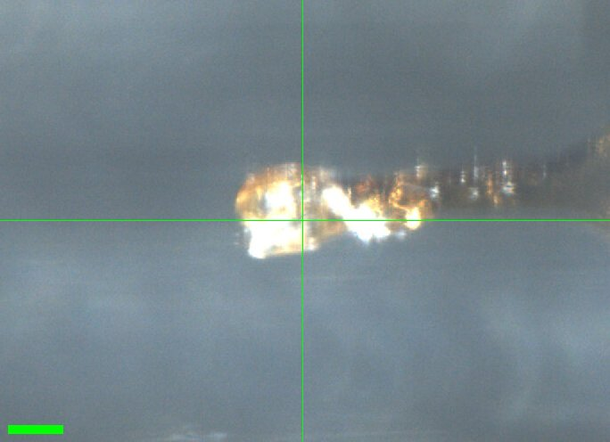](20261028-chess/Lys_2.jpg)<br>
    Scale bar = 100 µm

Bella looped a crystal [lysozyme tray set up by her (well D2)], took a screenshot. [D2, 0.7 M NaCl, 20 mM NaOAc, pH 4.6]

Subdirectory: `Lysozyme/Lys_2`

<div style="clear: both;"></div>

| prefix     |   φ0 (deg.) |   φ1 (deg.) |   ∆φ (deg.) |   images |   ∆t (s) |   tf (%) |   d (mm) |
|------------|-------------|-------------|-------------|----------|----------|----------|----------|
| lys_2_2764 |           0 |         360 |         0.1 |     3600 |     0.01 |      100 |      185 |

<!-- TODO: Lysozyme/Lys_2/ contains Lys_1.png and Lys_2.png, which are identical files (both show this crystal). How did that happen? -->

??? info "xia2 processing"

    |                 | lys_2_2764                              |
    |-----------------|-----------------------------------------|
    | scan            | 2764                                    |
    | Mosaic spread   | 0.064                                   |
    | Resolution      | 1.31                                    |
    | Unit Cell       | [79.09, 79.09, 38.07, 90.0, 90.0, 90.0] |
    | Image range     | [1, 3600]                               |
    | Completeness    | 100.0                                   |
    | Multiplicity    | 26.2                                    |
    | I/sigma         | 9.0                                     |
    | Rpim            | 0.032                                   |
    | Wilson B factor | 16.1                                    |
    | Space group     | P 43 21 2                               |
    | temperature     | ambient                                 |
    | Reports | [xia2.html](https://nyu1.osn.mghpcc.org/diffuse-chess-public/processing/20261028_xia2/Lysozyme/Lys_2/lys_2_2764/all/xia2.html)<br>[dials.scale.html](https://nyu1.osn.mghpcc.org/diffuse-chess-public/processing/20261028_xia2/Lysozyme/Lys_2/lys_2_2764/all/LogFiles/AUTOMATIC_DEFAULT_SCALE.html) |
    | Logs | [index.log](https://nyu1.osn.mghpcc.org/diffuse-chess-public/processing/20261028_xia2/Lysozyme/Lys_2/lys_2_2764/all/LogFiles/AUTOMATIC_DEFAULT_NATIVE_SWEEP1_INDEX.log)<br>[integrate.log](https://nyu1.osn.mghpcc.org/diffuse-chess-public/processing/20261028_xia2/Lysozyme/Lys_2/lys_2_2764/all/LogFiles/AUTOMATIC_DEFAULT_NATIVE_SWEEP1_INTEGRATE.log)<br>[refine.log](https://nyu1.osn.mghpcc.org/diffuse-chess-public/processing/20261028_xia2/Lysozyme/Lys_2/lys_2_2764/all/LogFiles/AUTOMATIC_DEFAULT_NATIVE_SWEEP1_REFINE.log)<br>[truncate.log](https://nyu1.osn.mghpcc.org/diffuse-chess-public/processing/20261028_xia2/Lysozyme/Lys_2/lys_2_2764/all/LogFiles/AUTOMATIC_DEFAULT_NATIVE_truncate.log)<br>[scale.log](https://nyu1.osn.mghpcc.org/diffuse-chess-public/processing/20261028_xia2/Lysozyme/Lys_2/lys_2_2764/all/LogFiles/AUTOMATIC_DEFAULT_SCALE.log)<br>[xtriage.log](https://nyu1.osn.mghpcc.org/diffuse-chess-public/processing/20261028_xia2/Lysozyme/Lys_2/lys_2_2764/all/LogFiles/Xtriage.log) |
    | MTZ | [free.mtz](https://nyu1.osn.mghpcc.org/diffuse-chess-public/processing/20261028_xia2/Lysozyme/Lys_2/lys_2_2764/all/DEFAULT/scale/AUTOMATIC_DEFAULT_free.mtz)<br>[scaled_unmerged.mtz](https://nyu1.osn.mghpcc.org/diffuse-chess-public/processing/20261028_xia2/Lysozyme/Lys_2/lys_2_2764/all/DEFAULT/scale/AUTOMATIC_DEFAULT_scaled_unmerged.mtz) |

### 3. DNA

!!! quote inline end ""

    [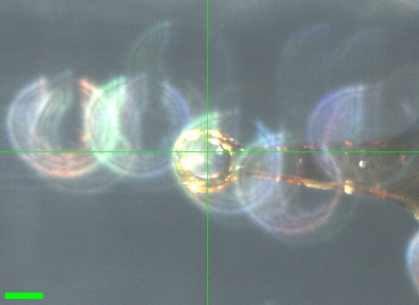](20261028-chess/DNA_1.jpg)<br>
    Scale bar = 100 µm

Alex looped a DNA crystal in the humidity chamber.

Subdirectory: `DNA/DNA_1`

<div style="clear: both;"></div>

| prefix     |   φ0 (deg.) |   φ1 (deg.) |   ∆φ (deg.) |   images |   ∆t (s) |   tf (%) |   d (mm) |
|------------|-------------|-------------|-------------|----------|----------|----------|----------|
| DNA_1_2765 |           0 |         180 |         0.1 |     1800 |     0.01 |      100 |      185 |

??? info "xia2 processing"

    |                 | DNA_1_2765                                    |
    |-----------------|-----------------------------------------------|
    | scan            | 2765                                          |
    | Mosaic spread   | 0.253                                         |
    | Resolution      | 0.0                                           |
    | Unit Cell       | [72.58, 72.54, 72.54, 101.94, 101.99, 101.93] |
    | Image range     | [1, 1800]                                     |
    | Completeness    | 52.8                                          |
    | Multiplicity    | 1.5                                           |
    | I/sigma         | 0.0                                           |
    | Rpim            | -565.974                                      |
    | Wilson B factor | -2.56                                         |
    | Space group     | P 1                                           |
    | temperature     | ambient                                       |
    | Reports | [xia2.html](https://nyu1.osn.mghpcc.org/diffuse-chess-public/processing/20261028_xia2/DNA/DNA_1/DNA_1_2765/all/xia2.html)<br>[dials.scale.html](https://nyu1.osn.mghpcc.org/diffuse-chess-public/processing/20261028_xia2/DNA/DNA_1/DNA_1_2765/all/LogFiles/AUTOMATIC_DEFAULT_SCALE.html) |
    | Logs | [index.log](https://nyu1.osn.mghpcc.org/diffuse-chess-public/processing/20261028_xia2/DNA/DNA_1/DNA_1_2765/all/LogFiles/AUTOMATIC_DEFAULT_NATIVE_SWEEP1_INDEX.log)<br>[integrate.log](https://nyu1.osn.mghpcc.org/diffuse-chess-public/processing/20261028_xia2/DNA/DNA_1/DNA_1_2765/all/LogFiles/AUTOMATIC_DEFAULT_NATIVE_SWEEP1_INTEGRATE.log)<br>[lattice.log](https://nyu1.osn.mghpcc.org/diffuse-chess-public/processing/20261028_xia2/DNA/DNA_1/DNA_1_2765/all/LogFiles/AUTOMATIC_DEFAULT_NATIVE_SWEEP1_LATTICE.log)<br>[refine.log](https://nyu1.osn.mghpcc.org/diffuse-chess-public/processing/20261028_xia2/DNA/DNA_1/DNA_1_2765/all/LogFiles/AUTOMATIC_DEFAULT_NATIVE_SWEEP1_REFINE.log)<br>[truncate.log](https://nyu1.osn.mghpcc.org/diffuse-chess-public/processing/20261028_xia2/DNA/DNA_1/DNA_1_2765/all/LogFiles/AUTOMATIC_DEFAULT_NATIVE_truncate.log)<br>[scale.log](https://nyu1.osn.mghpcc.org/diffuse-chess-public/processing/20261028_xia2/DNA/DNA_1/DNA_1_2765/all/LogFiles/AUTOMATIC_DEFAULT_SCALE.log)<br>[symmetry.log](https://nyu1.osn.mghpcc.org/diffuse-chess-public/processing/20261028_xia2/DNA/DNA_1/DNA_1_2765/all/LogFiles/AUTOMATIC_DEFAULT_SYMMETRY.log)<br>[xtriage.log](https://nyu1.osn.mghpcc.org/diffuse-chess-public/processing/20261028_xia2/DNA/DNA_1/DNA_1_2765/all/LogFiles/Xtriage.log) |
    | MTZ | [free.mtz](https://nyu1.osn.mghpcc.org/diffuse-chess-public/processing/20261028_xia2/DNA/DNA_1/DNA_1_2765/all/DEFAULT/scale/AUTOMATIC_DEFAULT_free.mtz)<br>[scaled_unmerged.mtz](https://nyu1.osn.mghpcc.org/diffuse-chess-public/processing/20261028_xia2/DNA/DNA_1/DNA_1_2765/all/DEFAULT/scale/AUTOMATIC_DEFAULT_scaled_unmerged.mtz) |

### 4. DNA

!!! quote inline end ""

    [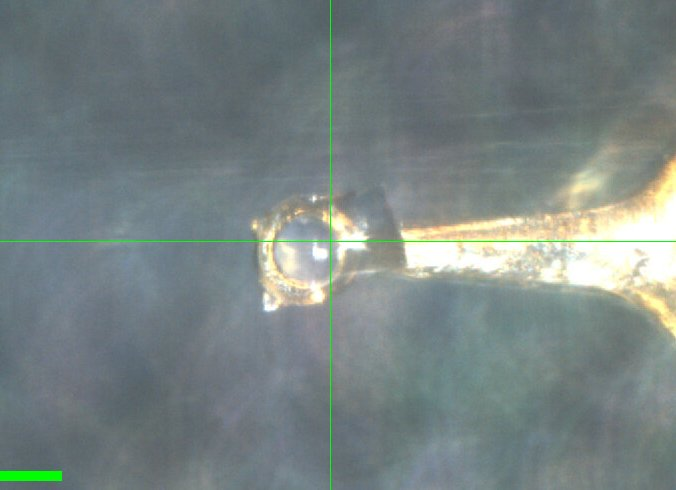](20261028-chess/DNA_2.jpg)<br>
    Scale bar = 100 µm

Subdirectory: `DNA/DNA_2`

<div style="clear: both;"></div>

| prefix        |   φ0 (deg.) |   φ1 (deg.) |   ∆φ (deg.) |   images |   ∆t (s) |   tf (%) |   d (mm) |
|---------------|-------------|-------------|-------------|----------|----------|----------|----------|
| DNA_2_2766    |           0 |         180 |         0.1 |     1800 |     0.01 |      100 |      185 |
| DNA_2_bg_2767 |           0 |         180 |         1   |      180 |     0.1  |      100 |      185 |
| DNA_2_2768    |           0 |         360 |         0.1 |     3600 |     0.05 |      100 |      185 |
| DNA_2_bg_2769 |           0 |         360 |         1   |      360 |     0.5  |      100 |      185 |

<!-- TODO: reprocess the DNA scans (DNA_1_2765, DNA_2_2766, DNA_2_2768) with the correct space group, then update the xia2 tables. Autoprocessing ran without a space group and gave P 1, with bogus statistics for 2765 and 2768 (resolution 0, negative Rpim). -->

<!-- TODO: verify against the notebook (p. 62): it gives d = 180 mm for DNA_2_bg_2769; the scan log has 185 mm. -->

??? info "xia2 processing"

    |                 | DNA_2_2766                                  | DNA_2_2768                                    |
    |-----------------|---------------------------------------------|-----------------------------------------------|
    | scan            | 2766                                        | 2768                                          |
    | Mosaic spread   | 0.057                                       | 0.135                                         |
    | Resolution      | 4.28                                        | 0.0                                           |
    | Unit Cell       | [70.72, 70.77, 70.74, 101.99, 102.0, 102.0] | [70.52, 70.52, 70.52, 101.98, 101.99, 101.99] |
    | Image range     | [1, 1800]                                   | [1, 3600]                                     |
    | Completeness    | 99.0                                        | 67.6                                          |
    | Multiplicity    | 1.8                                         | 3.2                                           |
    | I/sigma         | 1.1                                         | 0.0                                           |
    | Rpim            | 0.229                                       | -30.446                                       |
    | Wilson B factor | 103.75                                      | -3.27                                         |
    | Space group     | P 1                                         | P 1                                           |
    | temperature     | ambient                                     | ambient                                       |
    | Reports | [xia2.html](https://nyu1.osn.mghpcc.org/diffuse-chess-public/processing/20261028_xia2/DNA/DNA_2/DNA_2_2766/all/xia2.html)<br>[dials.scale.html](https://nyu1.osn.mghpcc.org/diffuse-chess-public/processing/20261028_xia2/DNA/DNA_2/DNA_2_2766/all/LogFiles/AUTOMATIC_DEFAULT_SCALE.html) | [xia2.html](https://nyu1.osn.mghpcc.org/diffuse-chess-public/processing/20261028_xia2/DNA/DNA_2/DNA_2_2768/all/xia2.html)<br>[dials.scale.html](https://nyu1.osn.mghpcc.org/diffuse-chess-public/processing/20261028_xia2/DNA/DNA_2/DNA_2_2768/all/LogFiles/AUTOMATIC_DEFAULT_SCALE.html) |
    | Logs | [index.log](https://nyu1.osn.mghpcc.org/diffuse-chess-public/processing/20261028_xia2/DNA/DNA_2/DNA_2_2766/all/LogFiles/AUTOMATIC_DEFAULT_NATIVE_SWEEP1_INDEX.log)<br>[integrate.log](https://nyu1.osn.mghpcc.org/diffuse-chess-public/processing/20261028_xia2/DNA/DNA_2/DNA_2_2766/all/LogFiles/AUTOMATIC_DEFAULT_NATIVE_SWEEP1_INTEGRATE.log)<br>[lattice.log](https://nyu1.osn.mghpcc.org/diffuse-chess-public/processing/20261028_xia2/DNA/DNA_2/DNA_2_2766/all/LogFiles/AUTOMATIC_DEFAULT_NATIVE_SWEEP1_LATTICE.log)<br>[refine.log](https://nyu1.osn.mghpcc.org/diffuse-chess-public/processing/20261028_xia2/DNA/DNA_2/DNA_2_2766/all/LogFiles/AUTOMATIC_DEFAULT_NATIVE_SWEEP1_REFINE.log)<br>[truncate.log](https://nyu1.osn.mghpcc.org/diffuse-chess-public/processing/20261028_xia2/DNA/DNA_2/DNA_2_2766/all/LogFiles/AUTOMATIC_DEFAULT_NATIVE_truncate.log)<br>[scale.log](https://nyu1.osn.mghpcc.org/diffuse-chess-public/processing/20261028_xia2/DNA/DNA_2/DNA_2_2766/all/LogFiles/AUTOMATIC_DEFAULT_SCALE.log)<br>[symmetry.log](https://nyu1.osn.mghpcc.org/diffuse-chess-public/processing/20261028_xia2/DNA/DNA_2/DNA_2_2766/all/LogFiles/AUTOMATIC_DEFAULT_SYMMETRY.log)<br>[xtriage.log](https://nyu1.osn.mghpcc.org/diffuse-chess-public/processing/20261028_xia2/DNA/DNA_2/DNA_2_2766/all/LogFiles/Xtriage.log) | [index.log](https://nyu1.osn.mghpcc.org/diffuse-chess-public/processing/20261028_xia2/DNA/DNA_2/DNA_2_2768/all/LogFiles/AUTOMATIC_DEFAULT_NATIVE_SWEEP1_INDEX.log)<br>[integrate.log](https://nyu1.osn.mghpcc.org/diffuse-chess-public/processing/20261028_xia2/DNA/DNA_2/DNA_2_2768/all/LogFiles/AUTOMATIC_DEFAULT_NATIVE_SWEEP1_INTEGRATE.log)<br>[lattice.log](https://nyu1.osn.mghpcc.org/diffuse-chess-public/processing/20261028_xia2/DNA/DNA_2/DNA_2_2768/all/LogFiles/AUTOMATIC_DEFAULT_NATIVE_SWEEP1_LATTICE.log)<br>[refine.log](https://nyu1.osn.mghpcc.org/diffuse-chess-public/processing/20261028_xia2/DNA/DNA_2/DNA_2_2768/all/LogFiles/AUTOMATIC_DEFAULT_NATIVE_SWEEP1_REFINE.log)<br>[truncate.log](https://nyu1.osn.mghpcc.org/diffuse-chess-public/processing/20261028_xia2/DNA/DNA_2/DNA_2_2768/all/LogFiles/AUTOMATIC_DEFAULT_NATIVE_truncate.log)<br>[scale.log](https://nyu1.osn.mghpcc.org/diffuse-chess-public/processing/20261028_xia2/DNA/DNA_2/DNA_2_2768/all/LogFiles/AUTOMATIC_DEFAULT_SCALE.log)<br>[symmetry.log](https://nyu1.osn.mghpcc.org/diffuse-chess-public/processing/20261028_xia2/DNA/DNA_2/DNA_2_2768/all/LogFiles/AUTOMATIC_DEFAULT_SYMMETRY.log)<br>[xtriage.log](https://nyu1.osn.mghpcc.org/diffuse-chess-public/processing/20261028_xia2/DNA/DNA_2/DNA_2_2768/all/LogFiles/Xtriage.log) |
    | MTZ | [free.mtz](https://nyu1.osn.mghpcc.org/diffuse-chess-public/processing/20261028_xia2/DNA/DNA_2/DNA_2_2766/all/DEFAULT/scale/AUTOMATIC_DEFAULT_free.mtz)<br>[scaled_unmerged.mtz](https://nyu1.osn.mghpcc.org/diffuse-chess-public/processing/20261028_xia2/DNA/DNA_2/DNA_2_2766/all/DEFAULT/scale/AUTOMATIC_DEFAULT_scaled_unmerged.mtz) | [free.mtz](https://nyu1.osn.mghpcc.org/diffuse-chess-public/processing/20261028_xia2/DNA/DNA_2/DNA_2_2768/all/DEFAULT/scale/AUTOMATIC_DEFAULT_free.mtz)<br>[scaled_unmerged.mtz](https://nyu1.osn.mghpcc.org/diffuse-chess-public/processing/20261028_xia2/DNA/DNA_2/DNA_2_2768/all/DEFAULT/scale/AUTOMATIC_DEFAULT_scaled_unmerged.mtz) |

---

Break for dinner, resume with DHFR in the evening.

Steve, Neti, and Alex returned at ~10 PM. Steve installed orange light illumination for centering. Cold stream aligned.

### 5. DHFR

!!! quote inline end ""

    [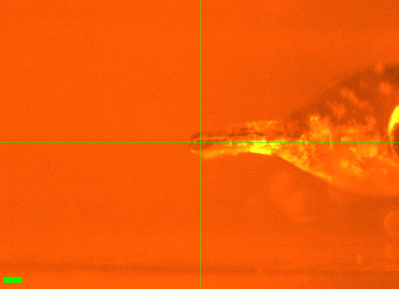](20261028-chess/DHFR_1.jpg)<br>
    Scale bar = 100 µm

Neti mounted DHFR_1 (well A1) at 295 K (from 4 °C block). Wait 10 mins for temperature to equilibrate. ~500 µm crystal.

Vector scan along length (spinx translation: 329.6 µm).

Subdirectory: `DHFR/DHFR_1`

<div style="clear: both;"></div>

| prefix              |   φ0 (deg.) |   φ1 (deg.) |   ∆φ (deg.) |   images |   ∆t (s) |   tf (%) |   d (mm) |
|---------------------|-------------|-------------|-------------|----------|----------|----------|----------|
| DHFR_1_295K_2770    |           0 |         180 |         0.1 |     1800 |     0.01 |      100 |      185 |
| DHFR_1_295K_bg_2771 |           0 |         180 |         1   |      180 |     0.1  |      100 |      185 |

<!-- TODO: verify against the notebook (p. 62): the background is written as "295_bg_2770"; the scan log has DHFR_1_295K_bg_2771. -->

xia2 `DHFR_1_295K_2770`: 1.19 Å, Rpim 0.027, cell 34.26, 45.13, 99.12 Å, mosaicity 0.069˚, Wilson B 14.3 Å<sup>2</sup>

Ramp to 280 K @ 120 K/hr, wait five minutes more to equilibrate.

| prefix              |   φ0 (deg.) |   φ1 (deg.) |   ∆φ (deg.) |   images |   ∆t (s) |   tf (%) |   d (mm) |
|---------------------|-------------|-------------|-------------|----------|----------|----------|----------|
| DHFR_1_280K_2772    |           0 |         180 |         0.1 |     1800 |     0.01 |      100 |      185 |
| DHFR_1_280K_bg_2773 |           0 |         180 |         1   |      180 |     0.1  |      100 |      185 |

xia2 `DHFR_1_280K_2772`: 1.40 Å, Rpim 0.049, cell 34.03, 44.52, 98.76 Å, mosaicity 0.242˚, Wilson B 16.1 Å<sup>2</sup>

Ramp to 295 K @ 120 K/hr, then wait 5 mins.

| prefix              |   φ0 (deg.) |   φ1 (deg.) |   ∆φ (deg.) |   images |   ∆t (s) |   tf (%) |   d (mm) |
|---------------------|-------------|-------------|-------------|----------|----------|----------|----------|
| DHFR_1_295K_2774    |           0 |         180 |         0.1 |     1800 |     0.01 |      100 |      185 |
| DHFR_1_295K_bg_2775 |           0 |         180 |         1   |      180 |     0.1  |      100 |      185 |

xia2 `DHFR_1_295K_2774`: failed (No suitable indexing solution could be found)

!!! warning "bad diffraction"

    Bad diffraction, crystal dehydrated. Failed to index. Ending this temp. series. We think the capillary was too long, leading to poor T uniformity?

??? info "xia2 processing"

    |                 | DHFR_1_295K_2770                        | DHFR_1_280K_2772                        |
    |-----------------|-----------------------------------------|-----------------------------------------|
    | scan            | 2770                                    | 2772                                    |
    | Mosaic spread   | 0.069                                   | 0.242                                   |
    | Resolution      | 1.19                                    | 1.4                                     |
    | Unit Cell       | [34.26, 45.13, 99.12, 90.0, 90.0, 90.0] | [34.03, 44.52, 98.76, 90.0, 90.0, 90.0] |
    | Image range     | [1, 1800]                               | [1, 1800]                               |
    | Completeness    | 99.0                                    | 99.8                                    |
    | Multiplicity    | 6.2                                     | 6.6                                     |
    | I/sigma         | 12.0                                    | 8.4                                     |
    | Rpim            | 0.027                                   | 0.049                                   |
    | Wilson B factor | 14.3                                    | 16.08                                   |
    | Space group     | P 21 21 21                              | P 21 21 21                              |
    | temperature     | 295                                     | 280                                     |
    | Reports | [xia2.html](https://nyu1.osn.mghpcc.org/diffuse-chess-public/processing/20261028_xia2/DHFR/DHFR_1/DHFR_1_295K_2770/all/xia2.html)<br>[dials.scale.html](https://nyu1.osn.mghpcc.org/diffuse-chess-public/processing/20261028_xia2/DHFR/DHFR_1/DHFR_1_295K_2770/all/LogFiles/AUTOMATIC_DEFAULT_SCALE.html) | [xia2.html](https://nyu1.osn.mghpcc.org/diffuse-chess-public/processing/20261028_xia2/DHFR/DHFR_1/DHFR_1_280K_2772/all/xia2.html)<br>[dials.scale.html](https://nyu1.osn.mghpcc.org/diffuse-chess-public/processing/20261028_xia2/DHFR/DHFR_1/DHFR_1_280K_2772/all/LogFiles/AUTOMATIC_DEFAULT_SCALE.html) |
    | Logs | [index.log](https://nyu1.osn.mghpcc.org/diffuse-chess-public/processing/20261028_xia2/DHFR/DHFR_1/DHFR_1_295K_2770/all/LogFiles/AUTOMATIC_DEFAULT_NATIVE_SWEEP1_INDEX.log)<br>[integrate.log](https://nyu1.osn.mghpcc.org/diffuse-chess-public/processing/20261028_xia2/DHFR/DHFR_1/DHFR_1_295K_2770/all/LogFiles/AUTOMATIC_DEFAULT_NATIVE_SWEEP1_INTEGRATE.log)<br>[refine.log](https://nyu1.osn.mghpcc.org/diffuse-chess-public/processing/20261028_xia2/DHFR/DHFR_1/DHFR_1_295K_2770/all/LogFiles/AUTOMATIC_DEFAULT_NATIVE_SWEEP1_REFINE.log)<br>[truncate.log](https://nyu1.osn.mghpcc.org/diffuse-chess-public/processing/20261028_xia2/DHFR/DHFR_1/DHFR_1_295K_2770/all/LogFiles/AUTOMATIC_DEFAULT_NATIVE_truncate.log)<br>[scale.log](https://nyu1.osn.mghpcc.org/diffuse-chess-public/processing/20261028_xia2/DHFR/DHFR_1/DHFR_1_295K_2770/all/LogFiles/AUTOMATIC_DEFAULT_SCALE.log)<br>[xtriage.log](https://nyu1.osn.mghpcc.org/diffuse-chess-public/processing/20261028_xia2/DHFR/DHFR_1/DHFR_1_295K_2770/all/LogFiles/Xtriage.log) | [index.log](https://nyu1.osn.mghpcc.org/diffuse-chess-public/processing/20261028_xia2/DHFR/DHFR_1/DHFR_1_280K_2772/all/LogFiles/AUTOMATIC_DEFAULT_NATIVE_SWEEP1_INDEX.log)<br>[integrate.log](https://nyu1.osn.mghpcc.org/diffuse-chess-public/processing/20261028_xia2/DHFR/DHFR_1/DHFR_1_280K_2772/all/LogFiles/AUTOMATIC_DEFAULT_NATIVE_SWEEP1_INTEGRATE.log)<br>[refine.log](https://nyu1.osn.mghpcc.org/diffuse-chess-public/processing/20261028_xia2/DHFR/DHFR_1/DHFR_1_280K_2772/all/LogFiles/AUTOMATIC_DEFAULT_NATIVE_SWEEP1_REFINE.log)<br>[truncate.log](https://nyu1.osn.mghpcc.org/diffuse-chess-public/processing/20261028_xia2/DHFR/DHFR_1/DHFR_1_280K_2772/all/LogFiles/AUTOMATIC_DEFAULT_NATIVE_truncate.log)<br>[scale.log](https://nyu1.osn.mghpcc.org/diffuse-chess-public/processing/20261028_xia2/DHFR/DHFR_1/DHFR_1_280K_2772/all/LogFiles/AUTOMATIC_DEFAULT_SCALE.log)<br>[xtriage.log](https://nyu1.osn.mghpcc.org/diffuse-chess-public/processing/20261028_xia2/DHFR/DHFR_1/DHFR_1_280K_2772/all/LogFiles/Xtriage.log) |
    | MTZ | [free.mtz](https://nyu1.osn.mghpcc.org/diffuse-chess-public/processing/20261028_xia2/DHFR/DHFR_1/DHFR_1_295K_2770/all/DEFAULT/scale/AUTOMATIC_DEFAULT_free.mtz)<br>[scaled_unmerged.mtz](https://nyu1.osn.mghpcc.org/diffuse-chess-public/processing/20261028_xia2/DHFR/DHFR_1/DHFR_1_295K_2770/all/DEFAULT/scale/AUTOMATIC_DEFAULT_scaled_unmerged.mtz) | [free.mtz](https://nyu1.osn.mghpcc.org/diffuse-chess-public/processing/20261028_xia2/DHFR/DHFR_1/DHFR_1_280K_2772/all/DEFAULT/scale/AUTOMATIC_DEFAULT_free.mtz)<br>[scaled_unmerged.mtz](https://nyu1.osn.mghpcc.org/diffuse-chess-public/processing/20261028_xia2/DHFR/DHFR_1/DHFR_1_280K_2772/all/DEFAULT/scale/AUTOMATIC_DEFAULT_scaled_unmerged.mtz) |

### 6. DHFR

!!! quote inline end ""

    [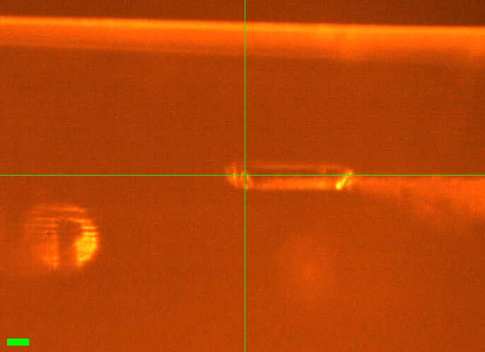](20261028-chess/DHFR_2.jpg)<br>
    Scale bar = 100 µm

Neti mounted DHFR #2 (well A1) @ 295 K, wait 10 mins to collect. Crystal is ~500 µm long and chunky (~100 µm dia). Snapshot saved.

Vector scan along length (spinx translation: 388.4 µm).

Subdirectory: `DHFR/DHFR_2`

<div style="clear: both;"></div>

| prefix              |   φ0 (deg.) |   φ1 (deg.) |   ∆φ (deg.) |   images |   ∆t (s) |   tf (%) |   d (mm) |
|---------------------|-------------|-------------|-------------|----------|----------|----------|----------|
| DHFR_2_295K_2776    |           0 |         180 |         0.1 |     1800 |     0.01 |      100 |      185 |
| DHFR_2_295K_bg_2777 |           0 |         180 |         1   |      180 |     0.1  |      100 |      185 |

xia2 `DHFR_2_295K_2776`: 1.13 Å, Rpim 0.036, cell 34.33, 45.53, 98.97 Å, mosaicity 0.012˚, Wilson B 14.1 Å<sup>2</sup>

Ramp to 310 K @ 120 K/hr, then wait 5 mins.

| prefix              |   φ0 (deg.) |   φ1 (deg.) |   ∆φ (deg.) |   images |   ∆t (s) |   tf (%) |   d (mm) |
|---------------------|-------------|-------------|-------------|----------|----------|----------|----------|
| DHFR_2_310K_2778    |           0 |         180 |         0.1 |     1800 |     0.01 |      100 |      185 |
| DHFR_2_310K_bg_2779 |           0 |         180 |         1   |      180 |     0.1  |      100 |      185 |

xia2 `DHFR_2_310K_2778`: 1.35 Å, Rpim 0.033, cell 34.29, 45.19, 99.29 Å, mosaicity 0.138˚, Wilson B 17.9 Å<sup>2</sup>

Ramp to 295 K @ 120 K/hr, then wait 5 mins. Some droplets of condensation appeared on the capillary.

| prefix              |   φ0 (deg.) |   φ1 (deg.) |   ∆φ (deg.) |   images |   ∆t (s) |   tf (%) |   d (mm) |
|---------------------|-------------|-------------|-------------|----------|----------|----------|----------|
| DHFR_2_295K_2780    |           0 |         180 |         0.1 |     1800 |     0.01 |      100 |      185 |
| DHFR_2_295K_bg_2781 |           0 |         180 |         1   |      180 |     0.1  |      100 |      185 |

xia2 `DHFR_2_295K_2780`: 1.18 Å, Rpim 0.030, cell 34.37, 45.62, 98.89 Å, mosaicity 0.052˚, Wilson B 14.5 Å<sup>2</sup>

!!! quote inline end "10/29 cookie break!"

    

Ramp to 280 K @ 120 K/hr, then wait 5 mins.

<div style="clear: both;"></div>

| prefix              |   φ0 (deg.) |   φ1 (deg.) |   ∆φ (deg.) |   images |   ∆t (s) |   tf (%) |   d (mm) |
|---------------------|-------------|-------------|-------------|----------|----------|----------|----------|
| DHFR_2_280K_2782    |           0 |         180 |         0.1 |     1800 |     0.01 |      100 |      185 |
| DHFR_2_280K_bg_2783 |           0 |         180 |         1   |      180 |     0.1  |      100 |      185 |

xia2 `DHFR_2_280K_2782`: 1.20 Å, Rpim 0.034, cell 34.26, 45.39, 98.95 Å, mosaicity 0.079˚, Wilson B 13.7 Å<sup>2</sup>

Ramp to 295 K @ 120 K/hr, then wait 5 mins.

| prefix              |   φ0 (deg.) |   φ1 (deg.) |   ∆φ (deg.) |   images |   ∆t (s) |   tf (%) |   d (mm) |
|---------------------|-------------|-------------|-------------|----------|----------|----------|----------|
| DHFR_2_295K_2784    |           0 |         180 |         0.1 |     1800 |     0.01 |      100 |      185 |
| DHFR_2_295K_bg_2785 |           0 |         180 |         1   |      180 |     0.1  |      100 |      185 |

xia2 `DHFR_2_295K_2784`: 1.20 Å, Rpim 0.029, cell 34.32, 45.46, 99.00 Å, mosaicity 0.051˚, Wilson B 14.5 Å<sup>2</sup>

??? info "xia2 processing"

    |                 | DHFR_2_295K_2776                        | DHFR_2_310K_2778                        | DHFR_2_295K_2780                        | DHFR_2_280K_2782                        | DHFR_2_295K_2784                       |
    |-----------------|-----------------------------------------|-----------------------------------------|-----------------------------------------|-----------------------------------------|----------------------------------------|
    | scan            | 2776                                    | 2778                                    | 2780                                    | 2782                                    | 2784                                   |
    | Mosaic spread   | 0.012                                   | 0.138                                   | 0.052                                   | 0.079                                   | 0.051                                  |
    | Resolution      | 1.13                                    | 1.35                                    | 1.18                                    | 1.2                                     | 1.2                                    |
    | Unit Cell       | [34.33, 45.53, 98.97, 90.0, 90.0, 90.0] | [34.29, 45.19, 99.29, 90.0, 90.0, 90.0] | [34.37, 45.62, 98.89, 90.0, 90.0, 90.0] | [34.26, 45.39, 98.95, 90.0, 90.0, 90.0] | [34.32, 45.46, 99.0, 90.0, 90.0, 90.0] |
    | Image range     | [1, 1800]                               | [1, 1800]                               | [1, 1800]                               | [1, 1800]                               | [1, 1800]                              |
    | Completeness    | 93.1                                    | 98.8                                    | 96.7                                    | 97.2                                    | 97.2                                   |
    | Multiplicity    | 6.1                                     | 6.7                                     | 6.3                                     | 6.4                                     | 6.4                                    |
    | I/sigma         | 9.9                                     | 11.0                                    | 12.0                                    | 11.0                                    | 12.6                                   |
    | Rpim            | 0.036                                   | 0.033                                   | 0.03                                    | 0.034                                   | 0.029                                  |
    | Wilson B factor | 14.09                                   | 17.86                                   | 14.47                                   | 13.73                                   | 14.53                                  |
    | Space group     | P 21 21 21                              | P 21 21 21                              | P 21 21 21                              | P 21 21 21                              | P 21 21 21                             |
    | temperature     | 295                                     | 310                                     | 295                                     | 280                                     | 295                                    |
    | Reports | [xia2.html](https://nyu1.osn.mghpcc.org/diffuse-chess-public/processing/20261028_xia2/DHFR/DHFR_2/DHFR_2_295K_2776/all/xia2.html)<br>[dials.scale.html](https://nyu1.osn.mghpcc.org/diffuse-chess-public/processing/20261028_xia2/DHFR/DHFR_2/DHFR_2_295K_2776/all/LogFiles/AUTOMATIC_DEFAULT_SCALE.html) | [xia2.html](https://nyu1.osn.mghpcc.org/diffuse-chess-public/processing/20261028_xia2/DHFR/DHFR_2/DHFR_2_310K_2778/all/xia2.html)<br>[dials.scale.html](https://nyu1.osn.mghpcc.org/diffuse-chess-public/processing/20261028_xia2/DHFR/DHFR_2/DHFR_2_310K_2778/all/LogFiles/AUTOMATIC_DEFAULT_SCALE.html) | [xia2.html](https://nyu1.osn.mghpcc.org/diffuse-chess-public/processing/20261028_xia2/DHFR/DHFR_2/DHFR_2_295K_2780/all/xia2.html)<br>[dials.scale.html](https://nyu1.osn.mghpcc.org/diffuse-chess-public/processing/20261028_xia2/DHFR/DHFR_2/DHFR_2_295K_2780/all/LogFiles/AUTOMATIC_DEFAULT_SCALE.html) | [xia2.html](https://nyu1.osn.mghpcc.org/diffuse-chess-public/processing/20261028_xia2/DHFR/DHFR_2/DHFR_2_280K_2782/all/xia2.html)<br>[dials.scale.html](https://nyu1.osn.mghpcc.org/diffuse-chess-public/processing/20261028_xia2/DHFR/DHFR_2/DHFR_2_280K_2782/all/LogFiles/AUTOMATIC_DEFAULT_SCALE.html) | [xia2.html](https://nyu1.osn.mghpcc.org/diffuse-chess-public/processing/20261028_xia2/DHFR/DHFR_2/DHFR_2_295K_2784/all/xia2.html)<br>[dials.scale.html](https://nyu1.osn.mghpcc.org/diffuse-chess-public/processing/20261028_xia2/DHFR/DHFR_2/DHFR_2_295K_2784/all/LogFiles/AUTOMATIC_DEFAULT_SCALE.html) |
    | Logs | [index.log](https://nyu1.osn.mghpcc.org/diffuse-chess-public/processing/20261028_xia2/DHFR/DHFR_2/DHFR_2_295K_2776/all/LogFiles/AUTOMATIC_DEFAULT_NATIVE_SWEEP1_INDEX.log)<br>[integrate.log](https://nyu1.osn.mghpcc.org/diffuse-chess-public/processing/20261028_xia2/DHFR/DHFR_2/DHFR_2_295K_2776/all/LogFiles/AUTOMATIC_DEFAULT_NATIVE_SWEEP1_INTEGRATE.log)<br>[refine.log](https://nyu1.osn.mghpcc.org/diffuse-chess-public/processing/20261028_xia2/DHFR/DHFR_2/DHFR_2_295K_2776/all/LogFiles/AUTOMATIC_DEFAULT_NATIVE_SWEEP1_REFINE.log)<br>[truncate.log](https://nyu1.osn.mghpcc.org/diffuse-chess-public/processing/20261028_xia2/DHFR/DHFR_2/DHFR_2_295K_2776/all/LogFiles/AUTOMATIC_DEFAULT_NATIVE_truncate.log)<br>[scale.log](https://nyu1.osn.mghpcc.org/diffuse-chess-public/processing/20261028_xia2/DHFR/DHFR_2/DHFR_2_295K_2776/all/LogFiles/AUTOMATIC_DEFAULT_SCALE.log)<br>[xtriage.log](https://nyu1.osn.mghpcc.org/diffuse-chess-public/processing/20261028_xia2/DHFR/DHFR_2/DHFR_2_295K_2776/all/LogFiles/Xtriage.log) | [index.log](https://nyu1.osn.mghpcc.org/diffuse-chess-public/processing/20261028_xia2/DHFR/DHFR_2/DHFR_2_310K_2778/all/LogFiles/AUTOMATIC_DEFAULT_NATIVE_SWEEP1_INDEX.log)<br>[integrate.log](https://nyu1.osn.mghpcc.org/diffuse-chess-public/processing/20261028_xia2/DHFR/DHFR_2/DHFR_2_310K_2778/all/LogFiles/AUTOMATIC_DEFAULT_NATIVE_SWEEP1_INTEGRATE.log)<br>[refine.log](https://nyu1.osn.mghpcc.org/diffuse-chess-public/processing/20261028_xia2/DHFR/DHFR_2/DHFR_2_310K_2778/all/LogFiles/AUTOMATIC_DEFAULT_NATIVE_SWEEP1_REFINE.log)<br>[truncate.log](https://nyu1.osn.mghpcc.org/diffuse-chess-public/processing/20261028_xia2/DHFR/DHFR_2/DHFR_2_310K_2778/all/LogFiles/AUTOMATIC_DEFAULT_NATIVE_truncate.log)<br>[scale.log](https://nyu1.osn.mghpcc.org/diffuse-chess-public/processing/20261028_xia2/DHFR/DHFR_2/DHFR_2_310K_2778/all/LogFiles/AUTOMATIC_DEFAULT_SCALE.log)<br>[xtriage.log](https://nyu1.osn.mghpcc.org/diffuse-chess-public/processing/20261028_xia2/DHFR/DHFR_2/DHFR_2_310K_2778/all/LogFiles/Xtriage.log) | [index.log](https://nyu1.osn.mghpcc.org/diffuse-chess-public/processing/20261028_xia2/DHFR/DHFR_2/DHFR_2_295K_2780/all/LogFiles/AUTOMATIC_DEFAULT_NATIVE_SWEEP1_INDEX.log)<br>[integrate.log](https://nyu1.osn.mghpcc.org/diffuse-chess-public/processing/20261028_xia2/DHFR/DHFR_2/DHFR_2_295K_2780/all/LogFiles/AUTOMATIC_DEFAULT_NATIVE_SWEEP1_INTEGRATE.log)<br>[refine.log](https://nyu1.osn.mghpcc.org/diffuse-chess-public/processing/20261028_xia2/DHFR/DHFR_2/DHFR_2_295K_2780/all/LogFiles/AUTOMATIC_DEFAULT_NATIVE_SWEEP1_REFINE.log)<br>[truncate.log](https://nyu1.osn.mghpcc.org/diffuse-chess-public/processing/20261028_xia2/DHFR/DHFR_2/DHFR_2_295K_2780/all/LogFiles/AUTOMATIC_DEFAULT_NATIVE_truncate.log)<br>[scale.log](https://nyu1.osn.mghpcc.org/diffuse-chess-public/processing/20261028_xia2/DHFR/DHFR_2/DHFR_2_295K_2780/all/LogFiles/AUTOMATIC_DEFAULT_SCALE.log)<br>[xtriage.log](https://nyu1.osn.mghpcc.org/diffuse-chess-public/processing/20261028_xia2/DHFR/DHFR_2/DHFR_2_295K_2780/all/LogFiles/Xtriage.log) | [index.log](https://nyu1.osn.mghpcc.org/diffuse-chess-public/processing/20261028_xia2/DHFR/DHFR_2/DHFR_2_280K_2782/all/LogFiles/AUTOMATIC_DEFAULT_NATIVE_SWEEP1_INDEX.log)<br>[integrate.log](https://nyu1.osn.mghpcc.org/diffuse-chess-public/processing/20261028_xia2/DHFR/DHFR_2/DHFR_2_280K_2782/all/LogFiles/AUTOMATIC_DEFAULT_NATIVE_SWEEP1_INTEGRATE.log)<br>[refine.log](https://nyu1.osn.mghpcc.org/diffuse-chess-public/processing/20261028_xia2/DHFR/DHFR_2/DHFR_2_280K_2782/all/LogFiles/AUTOMATIC_DEFAULT_NATIVE_SWEEP1_REFINE.log)<br>[truncate.log](https://nyu1.osn.mghpcc.org/diffuse-chess-public/processing/20261028_xia2/DHFR/DHFR_2/DHFR_2_280K_2782/all/LogFiles/AUTOMATIC_DEFAULT_NATIVE_truncate.log)<br>[scale.log](https://nyu1.osn.mghpcc.org/diffuse-chess-public/processing/20261028_xia2/DHFR/DHFR_2/DHFR_2_280K_2782/all/LogFiles/AUTOMATIC_DEFAULT_SCALE.log)<br>[xtriage.log](https://nyu1.osn.mghpcc.org/diffuse-chess-public/processing/20261028_xia2/DHFR/DHFR_2/DHFR_2_280K_2782/all/LogFiles/Xtriage.log) | [index.log](https://nyu1.osn.mghpcc.org/diffuse-chess-public/processing/20261028_xia2/DHFR/DHFR_2/DHFR_2_295K_2784/all/LogFiles/AUTOMATIC_DEFAULT_NATIVE_SWEEP1_INDEX.log)<br>[integrate.log](https://nyu1.osn.mghpcc.org/diffuse-chess-public/processing/20261028_xia2/DHFR/DHFR_2/DHFR_2_295K_2784/all/LogFiles/AUTOMATIC_DEFAULT_NATIVE_SWEEP1_INTEGRATE.log)<br>[refine.log](https://nyu1.osn.mghpcc.org/diffuse-chess-public/processing/20261028_xia2/DHFR/DHFR_2/DHFR_2_295K_2784/all/LogFiles/AUTOMATIC_DEFAULT_NATIVE_SWEEP1_REFINE.log)<br>[truncate.log](https://nyu1.osn.mghpcc.org/diffuse-chess-public/processing/20261028_xia2/DHFR/DHFR_2/DHFR_2_295K_2784/all/LogFiles/AUTOMATIC_DEFAULT_NATIVE_truncate.log)<br>[scale.log](https://nyu1.osn.mghpcc.org/diffuse-chess-public/processing/20261028_xia2/DHFR/DHFR_2/DHFR_2_295K_2784/all/LogFiles/AUTOMATIC_DEFAULT_SCALE.log)<br>[xtriage.log](https://nyu1.osn.mghpcc.org/diffuse-chess-public/processing/20261028_xia2/DHFR/DHFR_2/DHFR_2_295K_2784/all/LogFiles/Xtriage.log) |
    | MTZ | [free.mtz](https://nyu1.osn.mghpcc.org/diffuse-chess-public/processing/20261028_xia2/DHFR/DHFR_2/DHFR_2_295K_2776/all/DEFAULT/scale/AUTOMATIC_DEFAULT_free.mtz)<br>[scaled_unmerged.mtz](https://nyu1.osn.mghpcc.org/diffuse-chess-public/processing/20261028_xia2/DHFR/DHFR_2/DHFR_2_295K_2776/all/DEFAULT/scale/AUTOMATIC_DEFAULT_scaled_unmerged.mtz) | [free.mtz](https://nyu1.osn.mghpcc.org/diffuse-chess-public/processing/20261028_xia2/DHFR/DHFR_2/DHFR_2_310K_2778/all/DEFAULT/scale/AUTOMATIC_DEFAULT_free.mtz)<br>[scaled_unmerged.mtz](https://nyu1.osn.mghpcc.org/diffuse-chess-public/processing/20261028_xia2/DHFR/DHFR_2/DHFR_2_310K_2778/all/DEFAULT/scale/AUTOMATIC_DEFAULT_scaled_unmerged.mtz) | [free.mtz](https://nyu1.osn.mghpcc.org/diffuse-chess-public/processing/20261028_xia2/DHFR/DHFR_2/DHFR_2_295K_2780/all/DEFAULT/scale/AUTOMATIC_DEFAULT_free.mtz)<br>[scaled_unmerged.mtz](https://nyu1.osn.mghpcc.org/diffuse-chess-public/processing/20261028_xia2/DHFR/DHFR_2/DHFR_2_295K_2780/all/DEFAULT/scale/AUTOMATIC_DEFAULT_scaled_unmerged.mtz) | [free.mtz](https://nyu1.osn.mghpcc.org/diffuse-chess-public/processing/20261028_xia2/DHFR/DHFR_2/DHFR_2_280K_2782/all/DEFAULT/scale/AUTOMATIC_DEFAULT_free.mtz)<br>[scaled_unmerged.mtz](https://nyu1.osn.mghpcc.org/diffuse-chess-public/processing/20261028_xia2/DHFR/DHFR_2/DHFR_2_280K_2782/all/DEFAULT/scale/AUTOMATIC_DEFAULT_scaled_unmerged.mtz) | [free.mtz](https://nyu1.osn.mghpcc.org/diffuse-chess-public/processing/20261028_xia2/DHFR/DHFR_2/DHFR_2_295K_2784/all/DEFAULT/scale/AUTOMATIC_DEFAULT_free.mtz)<br>[scaled_unmerged.mtz](https://nyu1.osn.mghpcc.org/diffuse-chess-public/processing/20261028_xia2/DHFR/DHFR_2/DHFR_2_295K_2784/all/DEFAULT/scale/AUTOMATIC_DEFAULT_scaled_unmerged.mtz) |

### 7. DHFR

!!! quote inline end ""

    [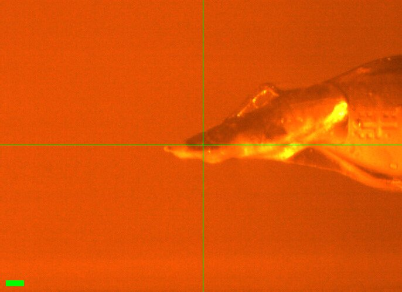](20261028-chess/DHFR_4.jpg)<br>
    Scale bar = 100 µm

    <br>
    Notebook sketch (p. 64)

Neti mounted DHFR #4 (well A5) (numbers are not sequential, they represent sample numbers in her notebook). This one was mounted in a spine-style reusable base. #1, 2 were wiry brass bases, which we suspect have large thermal mass near crystal position. Spine might be better? (less condensation?) The loop is an angled-type EV (see sketch).

Mounted at 295 K. Wait 10 mins to equilibrate.

Vector scan (spinx translation: 659.1 µm).

Subdirectory: `DHFR/DHFR_4`

<div style="clear: both;"></div>

| prefix                   |   φ0 (deg.) |   φ1 (deg.) |   ∆φ (deg.) |   images |   ∆t (s) |   tf (%) |   d (mm) |
|--------------------------|-------------|-------------|-------------|----------|----------|----------|----------|
| DHFR_4_295K_2786         |           0 |         180 |         0.1 |     1800 |     0.01 |      100 |      185 |
| DHFR_4_295K_bg_2787      |           0 |         180 |         1   |      180 |     0.1  |      100 |      185 |

xia2 `DHFR_4_295K_2786`: 1.10 Å, Rpim 0.029, cell 34.34, 45.54, 98.97 Å, mosaicity 0.037˚, Wilson B 13.9 Å<sup>2</sup>

Ramp to 310 K @ 120 K/hr, then wait 5 mins.

| prefix                   |   φ0 (deg.) |   φ1 (deg.) |   ∆φ (deg.) |   images |   ∆t (s) |   tf (%) |   d (mm) |
|--------------------------|-------------|-------------|-------------|----------|----------|----------|----------|
| DHFR_4_310K_2788         |           0 |         180 |         0.1 |     1800 |     0.01 |      100 |      185 |
| DHFR_4_310K_bg_2789      |           0 |         180 |         1   |      180 |     0.1  |      100 |      185 |

xia2 `DHFR_4_310K_2788`: 1.19 Å, Rpim 0.026, cell 34.32, 45.31, 99.17 Å, mosaicity 0.061˚, Wilson B 15.6 Å<sup>2</sup>

Ramp to 295 K @ 120 K/hr, then wait 5 min.

| prefix                   |   φ0 (deg.) |   φ1 (deg.) |   ∆φ (deg.) |   images |   ∆t (s) |   tf (%) |   d (mm) |
|--------------------------|-------------|-------------|-------------|----------|----------|----------|----------|
| DHFR_4_295K_2790         |           0 |         180 |         0.1 |     1800 |     0.01 |      100 |      185 |
| DHFR_4_295K_bg_2791      |           0 |         180 |         1   |      180 |     0.1  |      100 |      185 |

xia2 `DHFR_4_295K_2790`: 1.10 Å, Rpim 0.029, cell 34.36, 45.58, 99.00 Å, mosaicity 0.044˚, Wilson B 14.2 Å<sup>2</sup>

Ramp to 280 K @ 120 K/hr, then wait 5 min. Some condensation observed when cooling down to 280 K.

| prefix                   |   φ0 (deg.) |   φ1 (deg.) |   ∆φ (deg.) |   images |   ∆t (s) |   tf (%) |   d (mm) |
|--------------------------|-------------|-------------|-------------|----------|----------|----------|----------|
| DHFR_4_280K_2792\*       |           0 |         180 |         1   |      180 |     0.1  |      100 |      185 |
| DHFR_4_280K_correct_2793 |           0 |         180 |         0.1 |     1800 |     0.01 |      100 |      185 |
| DHFR_4_280K_bg_2794      |           0 |         180 |         1   |      180 |     0.1  |      100 |      185 |

xia2 `DHFR_4_280K_2792`: 1.15 Å, Rpim 0.033, cell 34.27, 45.45, 98.88 Å, mosaicity 0.056˚, Wilson B 13.3 Å<sup>2</sup>

xia2 `DHFR_4_280K_correct_2793`: 1.10 Å, Rpim 0.033, cell 34.26, 45.44, 98.88 Å, mosaicity 0.068˚, Wilson B 13.5 Å<sup>2</sup>

!!! warning "wrong settings"

    \* Accidentally collected at wrong settings. Repeated as `DHFR_4_280K_correct_2793`.

<!-- TODO: verify against the notebook (p. 64): it gives Δt = 1 s for DHFR_4_280K_bg_2794; the scan log has 0.1 s. -->

Ramp back to 295 K @ 120 K/hr, then wait 5 min.

| prefix                   |   φ0 (deg.) |   φ1 (deg.) |   ∆φ (deg.) |   images |   ∆t (s) |   tf (%) |   d (mm) |
|--------------------------|-------------|-------------|-------------|----------|----------|----------|----------|
| DHFR_4_295K_2795         |           0 |         180 |         0.1 |     1800 |     0.01 |      100 |      185 |
| DHFR_4_295K_bg_2796      |           0 |         180 |         1   |      180 |     0.1  |      100 |      185 |

xia2 `DHFR_4_295K_2795`: 1.12 Å, Rpim 0.025, cell 34.35, 45.55, 99.03 Å, mosaicity 0.045˚, Wilson B 14.4 Å<sup>2</sup>

??? info "xia2 processing"

    |                 | DHFR_4_295K_2786                        | DHFR_4_310K_2788                        | DHFR_4_295K_2790                       | DHFR_4_280K_2792                        | DHFR_4_280K_correct_2793                | DHFR_4_295K_2795                        |
    |-----------------|-----------------------------------------|-----------------------------------------|----------------------------------------|-----------------------------------------|-----------------------------------------|-----------------------------------------|
    | scan            | 2786                                    | 2788                                    | 2790                                   | 2792                                    | 2793                                    | 2795                                    |
    | Mosaic spread   | 0.037                                   | 0.061                                   | 0.044                                  | 0.056                                   | 0.068                                   | 0.045                                   |
    | Resolution      | 1.1                                     | 1.19                                    | 1.1                                    | 1.15                                    | 1.1                                     | 1.12                                    |
    | Unit Cell       | [34.34, 45.54, 98.97, 90.0, 90.0, 90.0] | [34.32, 45.31, 99.17, 90.0, 90.0, 90.0] | [34.36, 45.58, 99.0, 90.0, 90.0, 90.0] | [34.27, 45.45, 98.88, 90.0, 90.0, 90.0] | [34.26, 45.44, 98.88, 90.0, 90.0, 90.0] | [34.35, 45.55, 99.03, 90.0, 90.0, 90.0] |
    | Image range     | [1, 1800]                               | [1, 1800]                               | [1, 1800]                              | [1, 180]                                | [1, 1800]                               | [1, 1800]                               |
    | Completeness    | 97.3                                    | 99.8                                    | 97.3                                   | 99.2                                    | 97.1                                    | 98.3                                    |
    | Multiplicity    | 5.5                                     | 6.2                                     | 5.5                                    | 5.9                                     | 5.5                                     | 5.7                                     |
    | I/sigma         | 11.1                                    | 12.4                                    | 11.1                                   | 10.0                                    | 9.0                                     | 12.2                                    |
    | Rpim            | 0.029                                   | 0.026                                   | 0.029                                  | 0.033                                   | 0.033                                   | 0.025                                   |
    | Wilson B factor | 13.91                                   | 15.6                                    | 14.17                                  | 13.28                                   | 13.51                                   | 14.36                                   |
    | Space group     | P 21 21 21                              | P 21 21 21                              | P 21 21 21                             | P 21 21 21                              | P 21 21 21                              | P 21 21 21                              |
    | temperature     | 295                                     | 310                                     | 295                                    | 280                                     | 280                                     | 295                                     |
    | Reports | [xia2.html](https://nyu1.osn.mghpcc.org/diffuse-chess-public/processing/20261028_xia2/DHFR/DHFR_4/DHFR_4_295K_2786/all/xia2.html)<br>[dials.scale.html](https://nyu1.osn.mghpcc.org/diffuse-chess-public/processing/20261028_xia2/DHFR/DHFR_4/DHFR_4_295K_2786/all/LogFiles/AUTOMATIC_DEFAULT_SCALE.html) | [xia2.html](https://nyu1.osn.mghpcc.org/diffuse-chess-public/processing/20261028_xia2/DHFR/DHFR_4/DHFR_4_310K_2788/all/xia2.html)<br>[dials.scale.html](https://nyu1.osn.mghpcc.org/diffuse-chess-public/processing/20261028_xia2/DHFR/DHFR_4/DHFR_4_310K_2788/all/LogFiles/AUTOMATIC_DEFAULT_SCALE.html) | [xia2.html](https://nyu1.osn.mghpcc.org/diffuse-chess-public/processing/20261028_xia2/DHFR/DHFR_4/DHFR_4_295K_2790/all/xia2.html)<br>[dials.scale.html](https://nyu1.osn.mghpcc.org/diffuse-chess-public/processing/20261028_xia2/DHFR/DHFR_4/DHFR_4_295K_2790/all/LogFiles/AUTOMATIC_DEFAULT_SCALE.html) | [xia2.html](https://nyu1.osn.mghpcc.org/diffuse-chess-public/processing/20261028_xia2/DHFR/DHFR_4/DHFR_4_280K_2792/all/xia2.html)<br>[dials.scale.html](https://nyu1.osn.mghpcc.org/diffuse-chess-public/processing/20261028_xia2/DHFR/DHFR_4/DHFR_4_280K_2792/all/LogFiles/AUTOMATIC_DEFAULT_SCALE.html) | [xia2.html](https://nyu1.osn.mghpcc.org/diffuse-chess-public/processing/20261028_xia2/DHFR/DHFR_4/DHFR_4_280K_correct_2793/all/xia2.html)<br>[dials.scale.html](https://nyu1.osn.mghpcc.org/diffuse-chess-public/processing/20261028_xia2/DHFR/DHFR_4/DHFR_4_280K_correct_2793/all/LogFiles/AUTOMATIC_DEFAULT_SCALE.html) | [xia2.html](https://nyu1.osn.mghpcc.org/diffuse-chess-public/processing/20261028_xia2/DHFR/DHFR_4/DHFR_4_295K_2795/all/xia2.html)<br>[dials.scale.html](https://nyu1.osn.mghpcc.org/diffuse-chess-public/processing/20261028_xia2/DHFR/DHFR_4/DHFR_4_295K_2795/all/LogFiles/AUTOMATIC_DEFAULT_SCALE.html) |
    | Logs | [index.log](https://nyu1.osn.mghpcc.org/diffuse-chess-public/processing/20261028_xia2/DHFR/DHFR_4/DHFR_4_295K_2786/all/LogFiles/AUTOMATIC_DEFAULT_NATIVE_SWEEP1_INDEX.log)<br>[integrate.log](https://nyu1.osn.mghpcc.org/diffuse-chess-public/processing/20261028_xia2/DHFR/DHFR_4/DHFR_4_295K_2786/all/LogFiles/AUTOMATIC_DEFAULT_NATIVE_SWEEP1_INTEGRATE.log)<br>[refine.log](https://nyu1.osn.mghpcc.org/diffuse-chess-public/processing/20261028_xia2/DHFR/DHFR_4/DHFR_4_295K_2786/all/LogFiles/AUTOMATIC_DEFAULT_NATIVE_SWEEP1_REFINE.log)<br>[truncate.log](https://nyu1.osn.mghpcc.org/diffuse-chess-public/processing/20261028_xia2/DHFR/DHFR_4/DHFR_4_295K_2786/all/LogFiles/AUTOMATIC_DEFAULT_NATIVE_truncate.log)<br>[scale.log](https://nyu1.osn.mghpcc.org/diffuse-chess-public/processing/20261028_xia2/DHFR/DHFR_4/DHFR_4_295K_2786/all/LogFiles/AUTOMATIC_DEFAULT_SCALE.log)<br>[xtriage.log](https://nyu1.osn.mghpcc.org/diffuse-chess-public/processing/20261028_xia2/DHFR/DHFR_4/DHFR_4_295K_2786/all/LogFiles/Xtriage.log) | [index.log](https://nyu1.osn.mghpcc.org/diffuse-chess-public/processing/20261028_xia2/DHFR/DHFR_4/DHFR_4_310K_2788/all/LogFiles/AUTOMATIC_DEFAULT_NATIVE_SWEEP1_INDEX.log)<br>[integrate.log](https://nyu1.osn.mghpcc.org/diffuse-chess-public/processing/20261028_xia2/DHFR/DHFR_4/DHFR_4_310K_2788/all/LogFiles/AUTOMATIC_DEFAULT_NATIVE_SWEEP1_INTEGRATE.log)<br>[refine.log](https://nyu1.osn.mghpcc.org/diffuse-chess-public/processing/20261028_xia2/DHFR/DHFR_4/DHFR_4_310K_2788/all/LogFiles/AUTOMATIC_DEFAULT_NATIVE_SWEEP1_REFINE.log)<br>[truncate.log](https://nyu1.osn.mghpcc.org/diffuse-chess-public/processing/20261028_xia2/DHFR/DHFR_4/DHFR_4_310K_2788/all/LogFiles/AUTOMATIC_DEFAULT_NATIVE_truncate.log)<br>[scale.log](https://nyu1.osn.mghpcc.org/diffuse-chess-public/processing/20261028_xia2/DHFR/DHFR_4/DHFR_4_310K_2788/all/LogFiles/AUTOMATIC_DEFAULT_SCALE.log)<br>[xtriage.log](https://nyu1.osn.mghpcc.org/diffuse-chess-public/processing/20261028_xia2/DHFR/DHFR_4/DHFR_4_310K_2788/all/LogFiles/Xtriage.log) | [index.log](https://nyu1.osn.mghpcc.org/diffuse-chess-public/processing/20261028_xia2/DHFR/DHFR_4/DHFR_4_295K_2790/all/LogFiles/AUTOMATIC_DEFAULT_NATIVE_SWEEP1_INDEX.log)<br>[integrate.log](https://nyu1.osn.mghpcc.org/diffuse-chess-public/processing/20261028_xia2/DHFR/DHFR_4/DHFR_4_295K_2790/all/LogFiles/AUTOMATIC_DEFAULT_NATIVE_SWEEP1_INTEGRATE.log)<br>[refine.log](https://nyu1.osn.mghpcc.org/diffuse-chess-public/processing/20261028_xia2/DHFR/DHFR_4/DHFR_4_295K_2790/all/LogFiles/AUTOMATIC_DEFAULT_NATIVE_SWEEP1_REFINE.log)<br>[truncate.log](https://nyu1.osn.mghpcc.org/diffuse-chess-public/processing/20261028_xia2/DHFR/DHFR_4/DHFR_4_295K_2790/all/LogFiles/AUTOMATIC_DEFAULT_NATIVE_truncate.log)<br>[scale.log](https://nyu1.osn.mghpcc.org/diffuse-chess-public/processing/20261028_xia2/DHFR/DHFR_4/DHFR_4_295K_2790/all/LogFiles/AUTOMATIC_DEFAULT_SCALE.log)<br>[xtriage.log](https://nyu1.osn.mghpcc.org/diffuse-chess-public/processing/20261028_xia2/DHFR/DHFR_4/DHFR_4_295K_2790/all/LogFiles/Xtriage.log) | [index.log](https://nyu1.osn.mghpcc.org/diffuse-chess-public/processing/20261028_xia2/DHFR/DHFR_4/DHFR_4_280K_2792/all/LogFiles/AUTOMATIC_DEFAULT_NATIVE_SWEEP1_INDEX.log)<br>[integrate.log](https://nyu1.osn.mghpcc.org/diffuse-chess-public/processing/20261028_xia2/DHFR/DHFR_4/DHFR_4_280K_2792/all/LogFiles/AUTOMATIC_DEFAULT_NATIVE_SWEEP1_INTEGRATE.log)<br>[refine.log](https://nyu1.osn.mghpcc.org/diffuse-chess-public/processing/20261028_xia2/DHFR/DHFR_4/DHFR_4_280K_2792/all/LogFiles/AUTOMATIC_DEFAULT_NATIVE_SWEEP1_REFINE.log)<br>[truncate.log](https://nyu1.osn.mghpcc.org/diffuse-chess-public/processing/20261028_xia2/DHFR/DHFR_4/DHFR_4_280K_2792/all/LogFiles/AUTOMATIC_DEFAULT_NATIVE_truncate.log)<br>[scale.log](https://nyu1.osn.mghpcc.org/diffuse-chess-public/processing/20261028_xia2/DHFR/DHFR_4/DHFR_4_280K_2792/all/LogFiles/AUTOMATIC_DEFAULT_SCALE.log)<br>[xtriage.log](https://nyu1.osn.mghpcc.org/diffuse-chess-public/processing/20261028_xia2/DHFR/DHFR_4/DHFR_4_280K_2792/all/LogFiles/Xtriage.log) | [index.log](https://nyu1.osn.mghpcc.org/diffuse-chess-public/processing/20261028_xia2/DHFR/DHFR_4/DHFR_4_280K_correct_2793/all/LogFiles/AUTOMATIC_DEFAULT_NATIVE_SWEEP1_INDEX.log)<br>[integrate.log](https://nyu1.osn.mghpcc.org/diffuse-chess-public/processing/20261028_xia2/DHFR/DHFR_4/DHFR_4_280K_correct_2793/all/LogFiles/AUTOMATIC_DEFAULT_NATIVE_SWEEP1_INTEGRATE.log)<br>[refine.log](https://nyu1.osn.mghpcc.org/diffuse-chess-public/processing/20261028_xia2/DHFR/DHFR_4/DHFR_4_280K_correct_2793/all/LogFiles/AUTOMATIC_DEFAULT_NATIVE_SWEEP1_REFINE.log)<br>[truncate.log](https://nyu1.osn.mghpcc.org/diffuse-chess-public/processing/20261028_xia2/DHFR/DHFR_4/DHFR_4_280K_correct_2793/all/LogFiles/AUTOMATIC_DEFAULT_NATIVE_truncate.log)<br>[scale.log](https://nyu1.osn.mghpcc.org/diffuse-chess-public/processing/20261028_xia2/DHFR/DHFR_4/DHFR_4_280K_correct_2793/all/LogFiles/AUTOMATIC_DEFAULT_SCALE.log)<br>[xtriage.log](https://nyu1.osn.mghpcc.org/diffuse-chess-public/processing/20261028_xia2/DHFR/DHFR_4/DHFR_4_280K_correct_2793/all/LogFiles/Xtriage.log) | [index.log](https://nyu1.osn.mghpcc.org/diffuse-chess-public/processing/20261028_xia2/DHFR/DHFR_4/DHFR_4_295K_2795/all/LogFiles/AUTOMATIC_DEFAULT_NATIVE_SWEEP1_INDEX.log)<br>[integrate.log](https://nyu1.osn.mghpcc.org/diffuse-chess-public/processing/20261028_xia2/DHFR/DHFR_4/DHFR_4_295K_2795/all/LogFiles/AUTOMATIC_DEFAULT_NATIVE_SWEEP1_INTEGRATE.log)<br>[refine.log](https://nyu1.osn.mghpcc.org/diffuse-chess-public/processing/20261028_xia2/DHFR/DHFR_4/DHFR_4_295K_2795/all/LogFiles/AUTOMATIC_DEFAULT_NATIVE_SWEEP1_REFINE.log)<br>[truncate.log](https://nyu1.osn.mghpcc.org/diffuse-chess-public/processing/20261028_xia2/DHFR/DHFR_4/DHFR_4_295K_2795/all/LogFiles/AUTOMATIC_DEFAULT_NATIVE_truncate.log)<br>[scale.log](https://nyu1.osn.mghpcc.org/diffuse-chess-public/processing/20261028_xia2/DHFR/DHFR_4/DHFR_4_295K_2795/all/LogFiles/AUTOMATIC_DEFAULT_SCALE.log)<br>[xtriage.log](https://nyu1.osn.mghpcc.org/diffuse-chess-public/processing/20261028_xia2/DHFR/DHFR_4/DHFR_4_295K_2795/all/LogFiles/Xtriage.log) |
    | MTZ | [free.mtz](https://nyu1.osn.mghpcc.org/diffuse-chess-public/processing/20261028_xia2/DHFR/DHFR_4/DHFR_4_295K_2786/all/DEFAULT/scale/AUTOMATIC_DEFAULT_free.mtz)<br>[scaled_unmerged.mtz](https://nyu1.osn.mghpcc.org/diffuse-chess-public/processing/20261028_xia2/DHFR/DHFR_4/DHFR_4_295K_2786/all/DEFAULT/scale/AUTOMATIC_DEFAULT_scaled_unmerged.mtz) | [free.mtz](https://nyu1.osn.mghpcc.org/diffuse-chess-public/processing/20261028_xia2/DHFR/DHFR_4/DHFR_4_310K_2788/all/DEFAULT/scale/AUTOMATIC_DEFAULT_free.mtz)<br>[scaled_unmerged.mtz](https://nyu1.osn.mghpcc.org/diffuse-chess-public/processing/20261028_xia2/DHFR/DHFR_4/DHFR_4_310K_2788/all/DEFAULT/scale/AUTOMATIC_DEFAULT_scaled_unmerged.mtz) | [free.mtz](https://nyu1.osn.mghpcc.org/diffuse-chess-public/processing/20261028_xia2/DHFR/DHFR_4/DHFR_4_295K_2790/all/DEFAULT/scale/AUTOMATIC_DEFAULT_free.mtz)<br>[scaled_unmerged.mtz](https://nyu1.osn.mghpcc.org/diffuse-chess-public/processing/20261028_xia2/DHFR/DHFR_4/DHFR_4_295K_2790/all/DEFAULT/scale/AUTOMATIC_DEFAULT_scaled_unmerged.mtz) | [free.mtz](https://nyu1.osn.mghpcc.org/diffuse-chess-public/processing/20261028_xia2/DHFR/DHFR_4/DHFR_4_280K_2792/all/DEFAULT/scale/AUTOMATIC_DEFAULT_free.mtz)<br>[scaled_unmerged.mtz](https://nyu1.osn.mghpcc.org/diffuse-chess-public/processing/20261028_xia2/DHFR/DHFR_4/DHFR_4_280K_2792/all/DEFAULT/scale/AUTOMATIC_DEFAULT_scaled_unmerged.mtz) | [free.mtz](https://nyu1.osn.mghpcc.org/diffuse-chess-public/processing/20261028_xia2/DHFR/DHFR_4/DHFR_4_280K_correct_2793/all/DEFAULT/scale/AUTOMATIC_DEFAULT_free.mtz)<br>[scaled_unmerged.mtz](https://nyu1.osn.mghpcc.org/diffuse-chess-public/processing/20261028_xia2/DHFR/DHFR_4/DHFR_4_280K_correct_2793/all/DEFAULT/scale/AUTOMATIC_DEFAULT_scaled_unmerged.mtz) | [free.mtz](https://nyu1.osn.mghpcc.org/diffuse-chess-public/processing/20261028_xia2/DHFR/DHFR_4/DHFR_4_295K_2795/all/DEFAULT/scale/AUTOMATIC_DEFAULT_free.mtz)<br>[scaled_unmerged.mtz](https://nyu1.osn.mghpcc.org/diffuse-chess-public/processing/20261028_xia2/DHFR/DHFR_4/DHFR_4_295K_2795/all/DEFAULT/scale/AUTOMATIC_DEFAULT_scaled_unmerged.mtz) |

Steve left at ~2 AM. Neti and Alex continued collecting DHFR data overnight.

### 8. DHFR

!!! quote inline end ""

    No screenshot was recorded.

Neti mounted DHFR #3 (well A4), a large blade-shaped crystal on an EV loop. Let sit at 295 K for 10 mins.

Vector scan (spinx translation: 521.2 µm).

Subdirectory: `DHFR/DHFR_3`

<div style="clear: both;"></div>

| prefix              |   φ0 (deg.) |   φ1 (deg.) |   ∆φ (deg.) |   images |   ∆t (s) |   tf (%) |   d (mm) |
|---------------------|-------------|-------------|-------------|----------|----------|----------|----------|
| DHFR_3_295K_2797    |           0 |         180 |         0.1 |     1800 |     0.01 |      100 |      185 |
| DHFR_3_295K_bg_2798 |           0 |         180 |         1   |      180 |     0.1  |      100 |      185 |

!!! warning "poor diffraction"

    Poor diffraction (split peaks, failed to index).

### 9. DHFR

!!! quote inline end ""

    [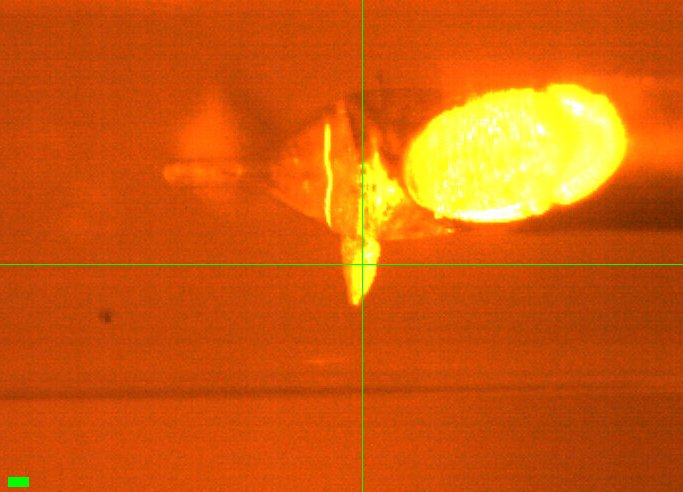](20261028-chess/DHFR_5.jpg)<br>
    Scale bar = 100 µm

    [](20261028-chess/DHFR_5_sketch.jpg)<br>
    Notebook sketch (p. 65)

Neti looped a crystal (DHFR_5, well B6) on an EV loop. The crystal was sitting 90° from the loop.

Vector scan (spinx translation: 48.1 µm).

Subdirectory: `DHFR/DHFR_5`

<div style="clear: both;"></div>

| prefix      |   φ0 (deg.) |   φ1 (deg.) |   ∆φ (deg.) |   images |   ∆t (s) |   tf (%) |   d (mm) |
|-------------|-------------|-------------|-------------|----------|----------|----------|----------|
| DHFR_5_2799 |           0 |         180 |         0.1 |     1800 |     0.01 |      100 |      185 |

!!! warning "poor diffraction"

    Poor diffraction. Will not pursue.

??? info "xia2 processing"

    |                 | DHFR_5_2799                             |
    |-----------------|-----------------------------------------|
    | scan            | 2799                                    |
    | Mosaic spread   | 0.569                                   |
    | Resolution      | 1.83                                    |
    | Unit Cell       | [34.82, 41.04, 101.0, 90.0, 90.0, 90.0] |
    | Image range     | [1, 1800]                               |
    | Completeness    | 99.9                                    |
    | Multiplicity    | 6.2                                     |
    | I/sigma         | 2.3                                     |
    | Rpim            | 0.231                                   |
    | Wilson B factor | 18.29                                   |
    | Space group     | P 21 21 21                              |
    | temperature     | ambient                                 |
    | Reports | [xia2.html](https://nyu1.osn.mghpcc.org/diffuse-chess-public/processing/20261028_xia2/DHFR/DHFR_5/DHFR_5_2799/all/xia2.html)<br>[dials.scale.html](https://nyu1.osn.mghpcc.org/diffuse-chess-public/processing/20261028_xia2/DHFR/DHFR_5/DHFR_5_2799/all/LogFiles/AUTOMATIC_DEFAULT_SCALE.html) |
    | Logs | [index.log](https://nyu1.osn.mghpcc.org/diffuse-chess-public/processing/20261028_xia2/DHFR/DHFR_5/DHFR_5_2799/all/LogFiles/AUTOMATIC_DEFAULT_NATIVE_SWEEP1_INDEX.log)<br>[integrate.log](https://nyu1.osn.mghpcc.org/diffuse-chess-public/processing/20261028_xia2/DHFR/DHFR_5/DHFR_5_2799/all/LogFiles/AUTOMATIC_DEFAULT_NATIVE_SWEEP1_INTEGRATE.log)<br>[refine.log](https://nyu1.osn.mghpcc.org/diffuse-chess-public/processing/20261028_xia2/DHFR/DHFR_5/DHFR_5_2799/all/LogFiles/AUTOMATIC_DEFAULT_NATIVE_SWEEP1_REFINE.log)<br>[truncate.log](https://nyu1.osn.mghpcc.org/diffuse-chess-public/processing/20261028_xia2/DHFR/DHFR_5/DHFR_5_2799/all/LogFiles/AUTOMATIC_DEFAULT_NATIVE_truncate.log)<br>[scale.log](https://nyu1.osn.mghpcc.org/diffuse-chess-public/processing/20261028_xia2/DHFR/DHFR_5/DHFR_5_2799/all/LogFiles/AUTOMATIC_DEFAULT_SCALE.log)<br>[xtriage.log](https://nyu1.osn.mghpcc.org/diffuse-chess-public/processing/20261028_xia2/DHFR/DHFR_5/DHFR_5_2799/all/LogFiles/Xtriage.log) |
    | MTZ | [free.mtz](https://nyu1.osn.mghpcc.org/diffuse-chess-public/processing/20261028_xia2/DHFR/DHFR_5/DHFR_5_2799/all/DEFAULT/scale/AUTOMATIC_DEFAULT_free.mtz)<br>[scaled_unmerged.mtz](https://nyu1.osn.mghpcc.org/diffuse-chess-public/processing/20261028_xia2/DHFR/DHFR_5/DHFR_5_2799/all/DEFAULT/scale/AUTOMATIC_DEFAULT_scaled_unmerged.mtz) |

### 10. DHFR

!!! quote inline end ""

    [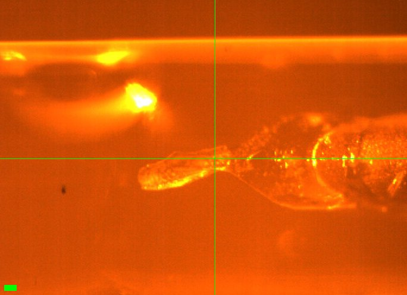](20261028-chess/DHFR_6.jpg)<br>
    Scale bar = 100 µm

DHFR_6 (well B6). There is a big drop very close to the crystal, affecting it. This is not the best data set [the first bit of data is not good diff.].

Vector scans (spinx translation: 518.5 µm).

Subdirectory: `DHFR/DHFR_6`

<div style="clear: both;"></div>

All temperatures were ramped @ 120 K/hr and once reached, stayed there for 5 mins.

| prefix              |   φ0 (deg.) |   φ1 (deg.) |   ∆φ (deg.) |   images |   ∆t (s) |   tf (%) |   d (mm) |
|---------------------|-------------|-------------|-------------|----------|----------|----------|----------|
| DHFR_6_295K_2800    |           0 |         180 |         0.1 |     1800 |     0.01 |      100 |      185 |
| DHFR_6_295K_bg_2801 |           0 |         180 |         1   |      180 |     0.1  |      100 |      185 |

xia2 `DHFR_6_295K_2800`: 1.20 Å, Rpim 0.035, cell 34.31, 45.40, 99.07 Å, mosaicity 0.051˚, Wilson B 14.2 Å<sup>2</sup>

Ramp to 310 K.

| prefix              |   φ0 (deg.) |   φ1 (deg.) |   ∆φ (deg.) |   images |   ∆t (s) |   tf (%) |   d (mm) |
|---------------------|-------------|-------------|-------------|----------|----------|----------|----------|
| DHFR_6_310K_2802    |           0 |         180 |         0.1 |     1800 |     0.01 |      100 |      185 |
| DHFR_6_310K_bg_2803 |           0 |         180 |         1   |      180 |     0.1  |      100 |      185 |

xia2 `DHFR_6_310K_2802`: 1.31 Å, Rpim 0.038, cell 34.29, 45.07, 99.39 Å, mosaicity 0.065˚, Wilson B 17.2 Å<sup>2</sup>

Ramp to 295 K.

| prefix              |   φ0 (deg.) |   φ1 (deg.) |   ∆φ (deg.) |   images |   ∆t (s) |   tf (%) |   d (mm) |
|---------------------|-------------|-------------|-------------|----------|----------|----------|----------|
| DHFR_6_295K_2804    |           0 |         180 |         0.1 |     1800 |     0.01 |      100 |      185 |
| DHFR_6_295K_bg_2805 |           0 |         180 |         1   |      180 |     0.1  |      100 |      185 |

xia2 `DHFR_6_295K_2804`: 1.24 Å, Rpim 0.034, cell 34.37, 45.57, 98.99 Å, mosaicity 0.083˚, Wilson B 14.4 Å<sup>2</sup>

Ramp to 280 K.

| prefix              |   φ0 (deg.) |   φ1 (deg.) |   ∆φ (deg.) |   images |   ∆t (s) |   tf (%) |   d (mm) |
|---------------------|-------------|-------------|-------------|----------|----------|----------|----------|
| DHFR_6_280K_2806    |           0 |         180 |         0.1 |     1800 |     0.01 |      100 |      185 |
| DHFR_6_280K_bg_2807 |           0 |         180 |         1   |      180 |     0.1  |      100 |      185 |

xia2 `DHFR_6_280K_2806`: 1.19 Å, Rpim 0.037, cell 34.26, 45.36, 98.92 Å, mosaicity 0.070˚, Wilson B 13.3 Å<sup>2</sup>

Ramp to 295 K.

| prefix              |   φ0 (deg.) |   φ1 (deg.) |   ∆φ (deg.) |   images |   ∆t (s) |   tf (%) |   d (mm) |
|---------------------|-------------|-------------|-------------|----------|----------|----------|----------|
| DHFR_6_295K_2808    |           0 |         180 |         0.1 |     1800 |     0.01 |      100 |      185 |
| DHFR_6_295K_bg_2809 |           0 |         180 |         1   |      180 |     0.1  |      100 |      185 |

xia2 `DHFR_6_295K_2808`: 1.26 Å, Rpim 0.034, cell 34.30, 45.26, 99.21 Å, mosaicity 0.082˚, Wilson B 15.2 Å<sup>2</sup>

??? info "xia2 processing"

    |                 | DHFR_6_295K_2800                       | DHFR_6_310K_2802                        | DHFR_6_295K_2804                        | DHFR_6_280K_2806                        | DHFR_6_295K_2808                       |
    |-----------------|----------------------------------------|-----------------------------------------|-----------------------------------------|-----------------------------------------|----------------------------------------|
    | scan            | 2800                                   | 2802                                    | 2804                                    | 2806                                    | 2808                                   |
    | Mosaic spread   | 0.051                                  | 0.065                                   | 0.083                                   | 0.07                                    | 0.082                                  |
    | Resolution      | 1.2                                    | 1.31                                    | 1.24                                    | 1.19                                    | 1.26                                   |
    | Unit Cell       | [34.31, 45.4, 99.07, 90.0, 90.0, 90.0] | [34.29, 45.07, 99.39, 90.0, 90.0, 90.0] | [34.37, 45.57, 98.99, 90.0, 90.0, 90.0] | [34.26, 45.36, 98.92, 90.0, 90.0, 90.0] | [34.3, 45.26, 99.21, 90.0, 90.0, 90.0] |
    | Image range     | [1, 1800]                              | [1, 1800]                               | [1, 1800]                               | [1, 1800]                               | [1, 1800]                              |
    | Completeness    | 99.8                                   | 100.0                                   | 99.9                                    | 99.6                                    | 100.0                                  |
    | Multiplicity    | 6.2                                    | 6.6                                     | 6.4                                     | 6.2                                     | 6.5                                    |
    | I/sigma         | 12.3                                   | 11.0                                    | 12.9                                    | 11.4                                    | 12.5                                   |
    | Rpim            | 0.035                                  | 0.038                                   | 0.034                                   | 0.037                                   | 0.034                                  |
    | Wilson B factor | 14.15                                  | 17.16                                   | 14.38                                   | 13.31                                   | 15.16                                  |
    | Space group     | P 21 21 21                             | P 21 21 21                              | P 21 21 21                              | P 21 21 21                              | P 21 21 21                             |
    | temperature     | 295                                    | 310                                     | 295                                     | 280                                     | 295                                    |
    | Reports | [xia2.html](https://nyu1.osn.mghpcc.org/diffuse-chess-public/processing/20261028_xia2/DHFR/DHFR_6/DHFR_6_295K_2800/all/xia2.html)<br>[dials.scale.html](https://nyu1.osn.mghpcc.org/diffuse-chess-public/processing/20261028_xia2/DHFR/DHFR_6/DHFR_6_295K_2800/all/LogFiles/AUTOMATIC_DEFAULT_SCALE.html) | [xia2.html](https://nyu1.osn.mghpcc.org/diffuse-chess-public/processing/20261028_xia2/DHFR/DHFR_6/DHFR_6_310K_2802/all/xia2.html)<br>[dials.scale.html](https://nyu1.osn.mghpcc.org/diffuse-chess-public/processing/20261028_xia2/DHFR/DHFR_6/DHFR_6_310K_2802/all/LogFiles/AUTOMATIC_DEFAULT_SCALE.html) | [xia2.html](https://nyu1.osn.mghpcc.org/diffuse-chess-public/processing/20261028_xia2/DHFR/DHFR_6/DHFR_6_295K_2804/all/xia2.html)<br>[dials.scale.html](https://nyu1.osn.mghpcc.org/diffuse-chess-public/processing/20261028_xia2/DHFR/DHFR_6/DHFR_6_295K_2804/all/LogFiles/AUTOMATIC_DEFAULT_SCALE.html) | [xia2.html](https://nyu1.osn.mghpcc.org/diffuse-chess-public/processing/20261028_xia2/DHFR/DHFR_6/DHFR_6_280K_2806/all/xia2.html)<br>[dials.scale.html](https://nyu1.osn.mghpcc.org/diffuse-chess-public/processing/20261028_xia2/DHFR/DHFR_6/DHFR_6_280K_2806/all/LogFiles/AUTOMATIC_DEFAULT_SCALE.html) | [xia2.html](https://nyu1.osn.mghpcc.org/diffuse-chess-public/processing/20261028_xia2/DHFR/DHFR_6/DHFR_6_295K_2808/all/xia2.html)<br>[dials.scale.html](https://nyu1.osn.mghpcc.org/diffuse-chess-public/processing/20261028_xia2/DHFR/DHFR_6/DHFR_6_295K_2808/all/LogFiles/AUTOMATIC_DEFAULT_SCALE.html) |
    | Logs | [index.log](https://nyu1.osn.mghpcc.org/diffuse-chess-public/processing/20261028_xia2/DHFR/DHFR_6/DHFR_6_295K_2800/all/LogFiles/AUTOMATIC_DEFAULT_NATIVE_SWEEP1_INDEX.log)<br>[integrate.log](https://nyu1.osn.mghpcc.org/diffuse-chess-public/processing/20261028_xia2/DHFR/DHFR_6/DHFR_6_295K_2800/all/LogFiles/AUTOMATIC_DEFAULT_NATIVE_SWEEP1_INTEGRATE.log)<br>[refine.log](https://nyu1.osn.mghpcc.org/diffuse-chess-public/processing/20261028_xia2/DHFR/DHFR_6/DHFR_6_295K_2800/all/LogFiles/AUTOMATIC_DEFAULT_NATIVE_SWEEP1_REFINE.log)<br>[truncate.log](https://nyu1.osn.mghpcc.org/diffuse-chess-public/processing/20261028_xia2/DHFR/DHFR_6/DHFR_6_295K_2800/all/LogFiles/AUTOMATIC_DEFAULT_NATIVE_truncate.log)<br>[scale.log](https://nyu1.osn.mghpcc.org/diffuse-chess-public/processing/20261028_xia2/DHFR/DHFR_6/DHFR_6_295K_2800/all/LogFiles/AUTOMATIC_DEFAULT_SCALE.log)<br>[xtriage.log](https://nyu1.osn.mghpcc.org/diffuse-chess-public/processing/20261028_xia2/DHFR/DHFR_6/DHFR_6_295K_2800/all/LogFiles/Xtriage.log) | [index.log](https://nyu1.osn.mghpcc.org/diffuse-chess-public/processing/20261028_xia2/DHFR/DHFR_6/DHFR_6_310K_2802/all/LogFiles/AUTOMATIC_DEFAULT_NATIVE_SWEEP1_INDEX.log)<br>[integrate.log](https://nyu1.osn.mghpcc.org/diffuse-chess-public/processing/20261028_xia2/DHFR/DHFR_6/DHFR_6_310K_2802/all/LogFiles/AUTOMATIC_DEFAULT_NATIVE_SWEEP1_INTEGRATE.log)<br>[refine.log](https://nyu1.osn.mghpcc.org/diffuse-chess-public/processing/20261028_xia2/DHFR/DHFR_6/DHFR_6_310K_2802/all/LogFiles/AUTOMATIC_DEFAULT_NATIVE_SWEEP1_REFINE.log)<br>[truncate.log](https://nyu1.osn.mghpcc.org/diffuse-chess-public/processing/20261028_xia2/DHFR/DHFR_6/DHFR_6_310K_2802/all/LogFiles/AUTOMATIC_DEFAULT_NATIVE_truncate.log)<br>[scale.log](https://nyu1.osn.mghpcc.org/diffuse-chess-public/processing/20261028_xia2/DHFR/DHFR_6/DHFR_6_310K_2802/all/LogFiles/AUTOMATIC_DEFAULT_SCALE.log)<br>[xtriage.log](https://nyu1.osn.mghpcc.org/diffuse-chess-public/processing/20261028_xia2/DHFR/DHFR_6/DHFR_6_310K_2802/all/LogFiles/Xtriage.log) | [index.log](https://nyu1.osn.mghpcc.org/diffuse-chess-public/processing/20261028_xia2/DHFR/DHFR_6/DHFR_6_295K_2804/all/LogFiles/AUTOMATIC_DEFAULT_NATIVE_SWEEP1_INDEX.log)<br>[integrate.log](https://nyu1.osn.mghpcc.org/diffuse-chess-public/processing/20261028_xia2/DHFR/DHFR_6/DHFR_6_295K_2804/all/LogFiles/AUTOMATIC_DEFAULT_NATIVE_SWEEP1_INTEGRATE.log)<br>[refine.log](https://nyu1.osn.mghpcc.org/diffuse-chess-public/processing/20261028_xia2/DHFR/DHFR_6/DHFR_6_295K_2804/all/LogFiles/AUTOMATIC_DEFAULT_NATIVE_SWEEP1_REFINE.log)<br>[truncate.log](https://nyu1.osn.mghpcc.org/diffuse-chess-public/processing/20261028_xia2/DHFR/DHFR_6/DHFR_6_295K_2804/all/LogFiles/AUTOMATIC_DEFAULT_NATIVE_truncate.log)<br>[scale.log](https://nyu1.osn.mghpcc.org/diffuse-chess-public/processing/20261028_xia2/DHFR/DHFR_6/DHFR_6_295K_2804/all/LogFiles/AUTOMATIC_DEFAULT_SCALE.log)<br>[xtriage.log](https://nyu1.osn.mghpcc.org/diffuse-chess-public/processing/20261028_xia2/DHFR/DHFR_6/DHFR_6_295K_2804/all/LogFiles/Xtriage.log) | [index.log](https://nyu1.osn.mghpcc.org/diffuse-chess-public/processing/20261028_xia2/DHFR/DHFR_6/DHFR_6_280K_2806/all/LogFiles/AUTOMATIC_DEFAULT_NATIVE_SWEEP1_INDEX.log)<br>[integrate.log](https://nyu1.osn.mghpcc.org/diffuse-chess-public/processing/20261028_xia2/DHFR/DHFR_6/DHFR_6_280K_2806/all/LogFiles/AUTOMATIC_DEFAULT_NATIVE_SWEEP1_INTEGRATE.log)<br>[refine.log](https://nyu1.osn.mghpcc.org/diffuse-chess-public/processing/20261028_xia2/DHFR/DHFR_6/DHFR_6_280K_2806/all/LogFiles/AUTOMATIC_DEFAULT_NATIVE_SWEEP1_REFINE.log)<br>[truncate.log](https://nyu1.osn.mghpcc.org/diffuse-chess-public/processing/20261028_xia2/DHFR/DHFR_6/DHFR_6_280K_2806/all/LogFiles/AUTOMATIC_DEFAULT_NATIVE_truncate.log)<br>[scale.log](https://nyu1.osn.mghpcc.org/diffuse-chess-public/processing/20261028_xia2/DHFR/DHFR_6/DHFR_6_280K_2806/all/LogFiles/AUTOMATIC_DEFAULT_SCALE.log)<br>[xtriage.log](https://nyu1.osn.mghpcc.org/diffuse-chess-public/processing/20261028_xia2/DHFR/DHFR_6/DHFR_6_280K_2806/all/LogFiles/Xtriage.log) | [index.log](https://nyu1.osn.mghpcc.org/diffuse-chess-public/processing/20261028_xia2/DHFR/DHFR_6/DHFR_6_295K_2808/all/LogFiles/AUTOMATIC_DEFAULT_NATIVE_SWEEP1_INDEX.log)<br>[integrate.log](https://nyu1.osn.mghpcc.org/diffuse-chess-public/processing/20261028_xia2/DHFR/DHFR_6/DHFR_6_295K_2808/all/LogFiles/AUTOMATIC_DEFAULT_NATIVE_SWEEP1_INTEGRATE.log)<br>[refine.log](https://nyu1.osn.mghpcc.org/diffuse-chess-public/processing/20261028_xia2/DHFR/DHFR_6/DHFR_6_295K_2808/all/LogFiles/AUTOMATIC_DEFAULT_NATIVE_SWEEP1_REFINE.log)<br>[truncate.log](https://nyu1.osn.mghpcc.org/diffuse-chess-public/processing/20261028_xia2/DHFR/DHFR_6/DHFR_6_295K_2808/all/LogFiles/AUTOMATIC_DEFAULT_NATIVE_truncate.log)<br>[scale.log](https://nyu1.osn.mghpcc.org/diffuse-chess-public/processing/20261028_xia2/DHFR/DHFR_6/DHFR_6_295K_2808/all/LogFiles/AUTOMATIC_DEFAULT_SCALE.log)<br>[xtriage.log](https://nyu1.osn.mghpcc.org/diffuse-chess-public/processing/20261028_xia2/DHFR/DHFR_6/DHFR_6_295K_2808/all/LogFiles/Xtriage.log) |
    | MTZ | [free.mtz](https://nyu1.osn.mghpcc.org/diffuse-chess-public/processing/20261028_xia2/DHFR/DHFR_6/DHFR_6_295K_2800/all/DEFAULT/scale/AUTOMATIC_DEFAULT_free.mtz)<br>[scaled_unmerged.mtz](https://nyu1.osn.mghpcc.org/diffuse-chess-public/processing/20261028_xia2/DHFR/DHFR_6/DHFR_6_295K_2800/all/DEFAULT/scale/AUTOMATIC_DEFAULT_scaled_unmerged.mtz) | [free.mtz](https://nyu1.osn.mghpcc.org/diffuse-chess-public/processing/20261028_xia2/DHFR/DHFR_6/DHFR_6_310K_2802/all/DEFAULT/scale/AUTOMATIC_DEFAULT_free.mtz)<br>[scaled_unmerged.mtz](https://nyu1.osn.mghpcc.org/diffuse-chess-public/processing/20261028_xia2/DHFR/DHFR_6/DHFR_6_310K_2802/all/DEFAULT/scale/AUTOMATIC_DEFAULT_scaled_unmerged.mtz) | [free.mtz](https://nyu1.osn.mghpcc.org/diffuse-chess-public/processing/20261028_xia2/DHFR/DHFR_6/DHFR_6_295K_2804/all/DEFAULT/scale/AUTOMATIC_DEFAULT_free.mtz)<br>[scaled_unmerged.mtz](https://nyu1.osn.mghpcc.org/diffuse-chess-public/processing/20261028_xia2/DHFR/DHFR_6/DHFR_6_295K_2804/all/DEFAULT/scale/AUTOMATIC_DEFAULT_scaled_unmerged.mtz) | [free.mtz](https://nyu1.osn.mghpcc.org/diffuse-chess-public/processing/20261028_xia2/DHFR/DHFR_6/DHFR_6_280K_2806/all/DEFAULT/scale/AUTOMATIC_DEFAULT_free.mtz)<br>[scaled_unmerged.mtz](https://nyu1.osn.mghpcc.org/diffuse-chess-public/processing/20261028_xia2/DHFR/DHFR_6/DHFR_6_280K_2806/all/DEFAULT/scale/AUTOMATIC_DEFAULT_scaled_unmerged.mtz) | [free.mtz](https://nyu1.osn.mghpcc.org/diffuse-chess-public/processing/20261028_xia2/DHFR/DHFR_6/DHFR_6_295K_2808/all/DEFAULT/scale/AUTOMATIC_DEFAULT_free.mtz)<br>[scaled_unmerged.mtz](https://nyu1.osn.mghpcc.org/diffuse-chess-public/processing/20261028_xia2/DHFR/DHFR_6/DHFR_6_295K_2808/all/DEFAULT/scale/AUTOMATIC_DEFAULT_scaled_unmerged.mtz) |

### 11. DHFR

!!! quote inline end ""

    [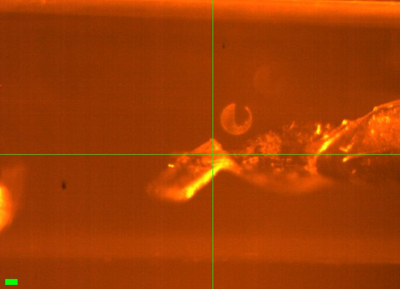](20261028-chess/DHFR_7.jpg)<br>
    Scale bar = 100 µm

DHFR_7 (well B2), EV loop with ~300 µm crystal oriented at an angle. 10 mins at 295 K before collecting data.

Vector scan (spinx translation: 369.3 µm).

Subdirectory: `DHFR/DHFR_7`

<div style="clear: both;"></div>

| prefix              |   φ0 (deg.) |   φ1 (deg.) |   ∆φ (deg.) |   images |   ∆t (s) |   tf (%) |   d (mm) |
|---------------------|-------------|-------------|-------------|----------|----------|----------|----------|
| DHFR_7_295K_2810\*  |           0 |         180 |         0.1 |     1800 |     0.01 |      100 |      185 |
| DHFR_7_295K_2811    |           0 |         180 |         0.1 |     1800 |     0.01 |      100 |      185 |
| DHFR_7_295K_bg_2812 |           0 |         180 |         1   |      180 |     0.1  |      100 |      185 |

xia2 `DHFR_7_295K_2810`: failed (No suitable indexing solution could be found)

xia2 `DHFR_7_295K_2811`: 1.24 Å, Rpim 0.035, cell 34.30, 45.34, 99.11 Å, mosaicity 0.065˚, Wilson B 15.1 Å<sup>2</sup>

!!! warning "shutter"

    \* lol forgot to open the shutter

Temperature dropped to 280 K at 120 K/hr. Stayed there for 5 mins. There was some condensation.

| prefix              |   φ0 (deg.) |   φ1 (deg.) |   ∆φ (deg.) |   images |   ∆t (s) |   tf (%) |   d (mm) |
|---------------------|-------------|-------------|-------------|----------|----------|----------|----------|
| DHFR_7_280K_2813    |           0 |         180 |         0.1 |     1800 |     0.01 |      100 |      185 |
| DHFR_7_280K_bg_2814 |           0 |         180 |         1   |      180 |     0.1  |      100 |      185 |

xia2 `DHFR_7_280K_2813`: 1.17 Å, Rpim 0.036, cell 34.26, 45.32, 99.02 Å, mosaicity 0.070˚, Wilson B 13.2 Å<sup>2</sup>

Temperature went up to 295 K at 120 K/hr, stayed there for 5 mins.

| prefix              |   φ0 (deg.) |   φ1 (deg.) |   ∆φ (deg.) |   images |   ∆t (s) |   tf (%) |   d (mm) |
|---------------------|-------------|-------------|-------------|----------|----------|----------|----------|
| DHFR_7_295K_2815    |           0 |         180 |         0.1 |     1800 |     0.01 |      100 |      185 |
| DHFR_7_295K_bg_2816 |           0 |         180 |         1   |      180 |     0.1  |      100 |      185 |

xia2 `DHFR_7_295K_2815`: 1.27 Å, Rpim 0.032, cell 34.28, 45.06, 99.28 Å, mosaicity 0.078˚, Wilson B 15.8 Å<sup>2</sup>

Temperature went up to 310 K at 120 K/hr. Stayed there for 5 min.

| prefix              |   φ0 (deg.) |   φ1 (deg.) |   ∆φ (deg.) |   images |   ∆t (s) |   tf (%) |   d (mm) |
|---------------------|-------------|-------------|-------------|----------|----------|----------|----------|
| DHFR_7_310K_2817    |           0 |         180 |         0.1 |     1800 |     0.01 |      100 |      185 |
| DHFR_7_310K_bg_2818 |           0 |         180 |         1   |      180 |     0.1  |      100 |      185 |

xia2 `DHFR_7_310K_2817`: 1.38 Å, Rpim 0.037, cell 34.29, 44.98, 99.56 Å, mosaicity 0.086˚, Wilson B 19.1 Å<sup>2</sup>

Temp down to 295 K. Stayed there for 5 mins.

| prefix              |   φ0 (deg.) |   φ1 (deg.) |   ∆φ (deg.) |   images |   ∆t (s) |   tf (%) |   d (mm) |
|---------------------|-------------|-------------|-------------|----------|----------|----------|----------|
| DHFR_7_295K_2819    |           0 |         180 |         0.1 |     1800 |     0.01 |      100 |      185 |
| DHFR_7_295K_bg_2820 |           0 |         180 |         1   |      180 |     0.1  |      100 |      185 |

xia2 `DHFR_7_295K_2819`: 1.29 Å, Rpim 0.032, cell 34.35, 45.54, 99.02 Å, mosaicity 0.099˚, Wilson B 15.4 Å<sup>2</sup>

??? info "xia2 processing"

    |                 | DHFR_7_295K_2811                       | DHFR_7_280K_2813                        | DHFR_7_295K_2815                        | DHFR_7_310K_2817                        | DHFR_7_295K_2819                        |
    |-----------------|----------------------------------------|-----------------------------------------|-----------------------------------------|-----------------------------------------|-----------------------------------------|
    | scan            | 2811                                   | 2813                                    | 2815                                    | 2817                                    | 2819                                    |
    | Mosaic spread   | 0.065                                  | 0.07                                    | 0.078                                   | 0.086                                   | 0.099                                   |
    | Resolution      | 1.24                                   | 1.17                                    | 1.27                                    | 1.38                                    | 1.29                                    |
    | Unit Cell       | [34.3, 45.34, 99.11, 90.0, 90.0, 90.0] | [34.26, 45.32, 99.02, 90.0, 90.0, 90.0] | [34.28, 45.06, 99.28, 90.0, 90.0, 90.0] | [34.29, 44.98, 99.56, 90.0, 90.0, 90.0] | [34.35, 45.54, 99.02, 90.0, 90.0, 90.0] |
    | Image range     | [1, 1800]                              | [1, 1800]                               | [1, 1800]                               | [1, 1800]                               | [1, 1800]                               |
    | Completeness    | 100.0                                  | 99.7                                    | 100.0                                   | 100.0                                   | 100.0                                   |
    | Multiplicity    | 6.4                                    | 6.1                                     | 6.5                                     | 6.6                                     | 6.5                                     |
    | I/sigma         | 13.0                                   | 10.9                                    | 13.7                                    | 12.6                                    | 14.7                                    |
    | Rpim            | 0.035                                  | 0.036                                   | 0.032                                   | 0.037                                   | 0.032                                   |
    | Wilson B factor | 15.11                                  | 13.22                                   | 15.76                                   | 19.12                                   | 15.45                                   |
    | Space group     | P 21 21 21                             | P 21 21 21                              | P 21 21 21                              | P 21 21 21                              | P 21 21 21                              |
    | temperature     | 295                                    | 280                                     | 295                                     | 310                                     | 295                                     |
    | Reports | [xia2.html](https://nyu1.osn.mghpcc.org/diffuse-chess-public/processing/20261028_xia2/DHFR/DHFR_7/DHFR_7_295K_2811/all/xia2.html)<br>[dials.scale.html](https://nyu1.osn.mghpcc.org/diffuse-chess-public/processing/20261028_xia2/DHFR/DHFR_7/DHFR_7_295K_2811/all/LogFiles/AUTOMATIC_DEFAULT_SCALE.html) | [xia2.html](https://nyu1.osn.mghpcc.org/diffuse-chess-public/processing/20261028_xia2/DHFR/DHFR_7/DHFR_7_280K_2813/all/xia2.html)<br>[dials.scale.html](https://nyu1.osn.mghpcc.org/diffuse-chess-public/processing/20261028_xia2/DHFR/DHFR_7/DHFR_7_280K_2813/all/LogFiles/AUTOMATIC_DEFAULT_SCALE.html) | [xia2.html](https://nyu1.osn.mghpcc.org/diffuse-chess-public/processing/20261028_xia2/DHFR/DHFR_7/DHFR_7_295K_2815/all/xia2.html)<br>[dials.scale.html](https://nyu1.osn.mghpcc.org/diffuse-chess-public/processing/20261028_xia2/DHFR/DHFR_7/DHFR_7_295K_2815/all/LogFiles/AUTOMATIC_DEFAULT_SCALE.html) | [xia2.html](https://nyu1.osn.mghpcc.org/diffuse-chess-public/processing/20261028_xia2/DHFR/DHFR_7/DHFR_7_310K_2817/all/xia2.html)<br>[dials.scale.html](https://nyu1.osn.mghpcc.org/diffuse-chess-public/processing/20261028_xia2/DHFR/DHFR_7/DHFR_7_310K_2817/all/LogFiles/AUTOMATIC_DEFAULT_SCALE.html) | [xia2.html](https://nyu1.osn.mghpcc.org/diffuse-chess-public/processing/20261028_xia2/DHFR/DHFR_7/DHFR_7_295K_2819/all/xia2.html)<br>[dials.scale.html](https://nyu1.osn.mghpcc.org/diffuse-chess-public/processing/20261028_xia2/DHFR/DHFR_7/DHFR_7_295K_2819/all/LogFiles/AUTOMATIC_DEFAULT_SCALE.html) |
    | Logs | [index.log](https://nyu1.osn.mghpcc.org/diffuse-chess-public/processing/20261028_xia2/DHFR/DHFR_7/DHFR_7_295K_2811/all/LogFiles/AUTOMATIC_DEFAULT_NATIVE_SWEEP1_INDEX.log)<br>[integrate.log](https://nyu1.osn.mghpcc.org/diffuse-chess-public/processing/20261028_xia2/DHFR/DHFR_7/DHFR_7_295K_2811/all/LogFiles/AUTOMATIC_DEFAULT_NATIVE_SWEEP1_INTEGRATE.log)<br>[refine.log](https://nyu1.osn.mghpcc.org/diffuse-chess-public/processing/20261028_xia2/DHFR/DHFR_7/DHFR_7_295K_2811/all/LogFiles/AUTOMATIC_DEFAULT_NATIVE_SWEEP1_REFINE.log)<br>[truncate.log](https://nyu1.osn.mghpcc.org/diffuse-chess-public/processing/20261028_xia2/DHFR/DHFR_7/DHFR_7_295K_2811/all/LogFiles/AUTOMATIC_DEFAULT_NATIVE_truncate.log)<br>[scale.log](https://nyu1.osn.mghpcc.org/diffuse-chess-public/processing/20261028_xia2/DHFR/DHFR_7/DHFR_7_295K_2811/all/LogFiles/AUTOMATIC_DEFAULT_SCALE.log)<br>[xtriage.log](https://nyu1.osn.mghpcc.org/diffuse-chess-public/processing/20261028_xia2/DHFR/DHFR_7/DHFR_7_295K_2811/all/LogFiles/Xtriage.log) | [index.log](https://nyu1.osn.mghpcc.org/diffuse-chess-public/processing/20261028_xia2/DHFR/DHFR_7/DHFR_7_280K_2813/all/LogFiles/AUTOMATIC_DEFAULT_NATIVE_SWEEP1_INDEX.log)<br>[integrate.log](https://nyu1.osn.mghpcc.org/diffuse-chess-public/processing/20261028_xia2/DHFR/DHFR_7/DHFR_7_280K_2813/all/LogFiles/AUTOMATIC_DEFAULT_NATIVE_SWEEP1_INTEGRATE.log)<br>[refine.log](https://nyu1.osn.mghpcc.org/diffuse-chess-public/processing/20261028_xia2/DHFR/DHFR_7/DHFR_7_280K_2813/all/LogFiles/AUTOMATIC_DEFAULT_NATIVE_SWEEP1_REFINE.log)<br>[truncate.log](https://nyu1.osn.mghpcc.org/diffuse-chess-public/processing/20261028_xia2/DHFR/DHFR_7/DHFR_7_280K_2813/all/LogFiles/AUTOMATIC_DEFAULT_NATIVE_truncate.log)<br>[scale.log](https://nyu1.osn.mghpcc.org/diffuse-chess-public/processing/20261028_xia2/DHFR/DHFR_7/DHFR_7_280K_2813/all/LogFiles/AUTOMATIC_DEFAULT_SCALE.log)<br>[xtriage.log](https://nyu1.osn.mghpcc.org/diffuse-chess-public/processing/20261028_xia2/DHFR/DHFR_7/DHFR_7_280K_2813/all/LogFiles/Xtriage.log) | [index.log](https://nyu1.osn.mghpcc.org/diffuse-chess-public/processing/20261028_xia2/DHFR/DHFR_7/DHFR_7_295K_2815/all/LogFiles/AUTOMATIC_DEFAULT_NATIVE_SWEEP1_INDEX.log)<br>[integrate.log](https://nyu1.osn.mghpcc.org/diffuse-chess-public/processing/20261028_xia2/DHFR/DHFR_7/DHFR_7_295K_2815/all/LogFiles/AUTOMATIC_DEFAULT_NATIVE_SWEEP1_INTEGRATE.log)<br>[refine.log](https://nyu1.osn.mghpcc.org/diffuse-chess-public/processing/20261028_xia2/DHFR/DHFR_7/DHFR_7_295K_2815/all/LogFiles/AUTOMATIC_DEFAULT_NATIVE_SWEEP1_REFINE.log)<br>[truncate.log](https://nyu1.osn.mghpcc.org/diffuse-chess-public/processing/20261028_xia2/DHFR/DHFR_7/DHFR_7_295K_2815/all/LogFiles/AUTOMATIC_DEFAULT_NATIVE_truncate.log)<br>[scale.log](https://nyu1.osn.mghpcc.org/diffuse-chess-public/processing/20261028_xia2/DHFR/DHFR_7/DHFR_7_295K_2815/all/LogFiles/AUTOMATIC_DEFAULT_SCALE.log)<br>[xtriage.log](https://nyu1.osn.mghpcc.org/diffuse-chess-public/processing/20261028_xia2/DHFR/DHFR_7/DHFR_7_295K_2815/all/LogFiles/Xtriage.log) | [index.log](https://nyu1.osn.mghpcc.org/diffuse-chess-public/processing/20261028_xia2/DHFR/DHFR_7/DHFR_7_310K_2817/all/LogFiles/AUTOMATIC_DEFAULT_NATIVE_SWEEP1_INDEX.log)<br>[integrate.log](https://nyu1.osn.mghpcc.org/diffuse-chess-public/processing/20261028_xia2/DHFR/DHFR_7/DHFR_7_310K_2817/all/LogFiles/AUTOMATIC_DEFAULT_NATIVE_SWEEP1_INTEGRATE.log)<br>[refine.log](https://nyu1.osn.mghpcc.org/diffuse-chess-public/processing/20261028_xia2/DHFR/DHFR_7/DHFR_7_310K_2817/all/LogFiles/AUTOMATIC_DEFAULT_NATIVE_SWEEP1_REFINE.log)<br>[truncate.log](https://nyu1.osn.mghpcc.org/diffuse-chess-public/processing/20261028_xia2/DHFR/DHFR_7/DHFR_7_310K_2817/all/LogFiles/AUTOMATIC_DEFAULT_NATIVE_truncate.log)<br>[scale.log](https://nyu1.osn.mghpcc.org/diffuse-chess-public/processing/20261028_xia2/DHFR/DHFR_7/DHFR_7_310K_2817/all/LogFiles/AUTOMATIC_DEFAULT_SCALE.log)<br>[xtriage.log](https://nyu1.osn.mghpcc.org/diffuse-chess-public/processing/20261028_xia2/DHFR/DHFR_7/DHFR_7_310K_2817/all/LogFiles/Xtriage.log) | [index.log](https://nyu1.osn.mghpcc.org/diffuse-chess-public/processing/20261028_xia2/DHFR/DHFR_7/DHFR_7_295K_2819/all/LogFiles/AUTOMATIC_DEFAULT_NATIVE_SWEEP1_INDEX.log)<br>[integrate.log](https://nyu1.osn.mghpcc.org/diffuse-chess-public/processing/20261028_xia2/DHFR/DHFR_7/DHFR_7_295K_2819/all/LogFiles/AUTOMATIC_DEFAULT_NATIVE_SWEEP1_INTEGRATE.log)<br>[refine.log](https://nyu1.osn.mghpcc.org/diffuse-chess-public/processing/20261028_xia2/DHFR/DHFR_7/DHFR_7_295K_2819/all/LogFiles/AUTOMATIC_DEFAULT_NATIVE_SWEEP1_REFINE.log)<br>[truncate.log](https://nyu1.osn.mghpcc.org/diffuse-chess-public/processing/20261028_xia2/DHFR/DHFR_7/DHFR_7_295K_2819/all/LogFiles/AUTOMATIC_DEFAULT_NATIVE_truncate.log)<br>[scale.log](https://nyu1.osn.mghpcc.org/diffuse-chess-public/processing/20261028_xia2/DHFR/DHFR_7/DHFR_7_295K_2819/all/LogFiles/AUTOMATIC_DEFAULT_SCALE.log)<br>[xtriage.log](https://nyu1.osn.mghpcc.org/diffuse-chess-public/processing/20261028_xia2/DHFR/DHFR_7/DHFR_7_295K_2819/all/LogFiles/Xtriage.log) |
    | MTZ | [free.mtz](https://nyu1.osn.mghpcc.org/diffuse-chess-public/processing/20261028_xia2/DHFR/DHFR_7/DHFR_7_295K_2811/all/DEFAULT/scale/AUTOMATIC_DEFAULT_free.mtz)<br>[scaled_unmerged.mtz](https://nyu1.osn.mghpcc.org/diffuse-chess-public/processing/20261028_xia2/DHFR/DHFR_7/DHFR_7_295K_2811/all/DEFAULT/scale/AUTOMATIC_DEFAULT_scaled_unmerged.mtz) | [free.mtz](https://nyu1.osn.mghpcc.org/diffuse-chess-public/processing/20261028_xia2/DHFR/DHFR_7/DHFR_7_280K_2813/all/DEFAULT/scale/AUTOMATIC_DEFAULT_free.mtz)<br>[scaled_unmerged.mtz](https://nyu1.osn.mghpcc.org/diffuse-chess-public/processing/20261028_xia2/DHFR/DHFR_7/DHFR_7_280K_2813/all/DEFAULT/scale/AUTOMATIC_DEFAULT_scaled_unmerged.mtz) | [free.mtz](https://nyu1.osn.mghpcc.org/diffuse-chess-public/processing/20261028_xia2/DHFR/DHFR_7/DHFR_7_295K_2815/all/DEFAULT/scale/AUTOMATIC_DEFAULT_free.mtz)<br>[scaled_unmerged.mtz](https://nyu1.osn.mghpcc.org/diffuse-chess-public/processing/20261028_xia2/DHFR/DHFR_7/DHFR_7_295K_2815/all/DEFAULT/scale/AUTOMATIC_DEFAULT_scaled_unmerged.mtz) | [free.mtz](https://nyu1.osn.mghpcc.org/diffuse-chess-public/processing/20261028_xia2/DHFR/DHFR_7/DHFR_7_310K_2817/all/DEFAULT/scale/AUTOMATIC_DEFAULT_free.mtz)<br>[scaled_unmerged.mtz](https://nyu1.osn.mghpcc.org/diffuse-chess-public/processing/20261028_xia2/DHFR/DHFR_7/DHFR_7_310K_2817/all/DEFAULT/scale/AUTOMATIC_DEFAULT_scaled_unmerged.mtz) | [free.mtz](https://nyu1.osn.mghpcc.org/diffuse-chess-public/processing/20261028_xia2/DHFR/DHFR_7/DHFR_7_295K_2819/all/DEFAULT/scale/AUTOMATIC_DEFAULT_free.mtz)<br>[scaled_unmerged.mtz](https://nyu1.osn.mghpcc.org/diffuse-chess-public/processing/20261028_xia2/DHFR/DHFR_7/DHFR_7_295K_2819/all/DEFAULT/scale/AUTOMATIC_DEFAULT_scaled_unmerged.mtz) |

### 12. DHFR

!!! quote inline end ""

    [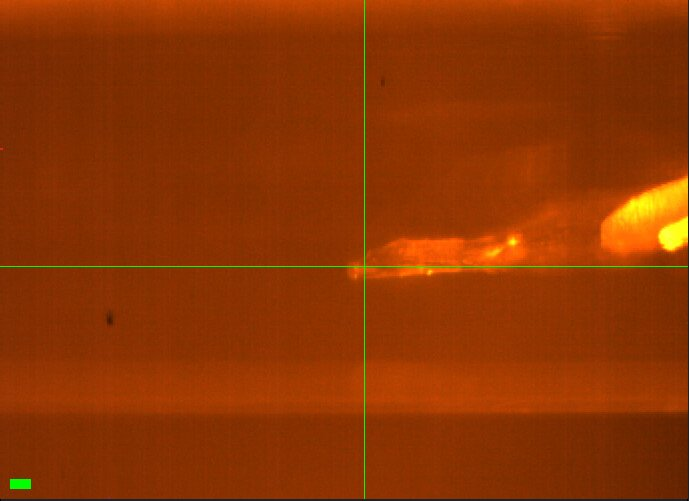](20261028-chess/DHFR_8.jpg)<br>
    Scale bar = 100 µm

DHFR_8 (well C1): large crystal, EV loop, not tilted. Temp at 295 K, left crystal there for 10 mins.

Vector scan (spinx translation: 505.1 µm).

Subdirectory: `DHFR/DHFR_8`

<div style="clear: both;"></div>

| prefix              |   φ0 (deg.) |   φ1 (deg.) |   ∆φ (deg.) |   images |   ∆t (s) |   tf (%) |   d (mm) |
|---------------------|-------------|-------------|-------------|----------|----------|----------|----------|
| DHFR_8_295K_2821    |           0 |         180 |         0.1 |     1800 |     0.01 |      100 |      185 |
| DHFR_8_295K_bg_2822 |           0 |         180 |         1   |      180 |     0.1  |      100 |      185 |

xia2 `DHFR_8_295K_2821`: 1.16 Å, Rpim 0.028, cell 34.27, 45.17, 99.09 Å, mosaicity 0.055˚, Wilson B 14.4 Å<sup>2</sup>

Temp up to 310 K. Left crystal there for 10 mins.

| prefix              |   φ0 (deg.) |   φ1 (deg.) |   ∆φ (deg.) |   images |   ∆t (s) |   tf (%) |   d (mm) |
|---------------------|-------------|-------------|-------------|----------|----------|----------|----------|
| DHFR_8_310K_2823    |           0 |         180 |         0.1 |     1800 |     0.01 |      100 |      185 |

xia2 `DHFR_8_310K_2823`: 2.48 Å, Rpim 0.085, cell 34.33, 42.35, 102.49 Å, mosaicity 1.069˚, Wilson B 53.4 Å<sup>2</sup>

!!! warning "bad diffraction"

    Really bad diffraction. Crystal probably dehydrated. Long sleeve.

??? info "xia2 processing"

    |                 | DHFR_8_295K_2821                        | DHFR_8_310K_2823                         |
    |-----------------|-----------------------------------------|------------------------------------------|
    | scan            | 2821                                    | 2823                                     |
    | Mosaic spread   | 0.055                                   | 1.069                                    |
    | Resolution      | 1.16                                    | 2.48                                     |
    | Unit Cell       | [34.27, 45.17, 99.09, 90.0, 90.0, 90.0] | [34.33, 42.35, 102.49, 90.0, 90.0, 90.0] |
    | Image range     | [1, 1800]                               | [1, 1800]                                |
    | Completeness    | 96.6                                    | 99.2                                     |
    | Multiplicity    | 6.2                                     | 6.4                                      |
    | I/sigma         | 12.1                                    | 7.3                                      |
    | Rpim            | 0.028                                   | 0.085                                    |
    | Wilson B factor | 14.42                                   | 53.41                                    |
    | Space group     | P 21 21 21                              | P 21 21 21                               |
    | temperature     | 295                                     | 310                                      |
    | Reports | [xia2.html](https://nyu1.osn.mghpcc.org/diffuse-chess-public/processing/20261028_xia2/DHFR/DHFR_8/DHFR_8_295K_2821/all/xia2.html)<br>[dials.scale.html](https://nyu1.osn.mghpcc.org/diffuse-chess-public/processing/20261028_xia2/DHFR/DHFR_8/DHFR_8_295K_2821/all/LogFiles/AUTOMATIC_DEFAULT_SCALE.html) | [xia2.html](https://nyu1.osn.mghpcc.org/diffuse-chess-public/processing/20261028_xia2/DHFR/DHFR_8/DHFR_8_310K_2823/all/xia2.html)<br>[dials.scale.html](https://nyu1.osn.mghpcc.org/diffuse-chess-public/processing/20261028_xia2/DHFR/DHFR_8/DHFR_8_310K_2823/all/LogFiles/AUTOMATIC_DEFAULT_SCALE.html) |
    | Logs | [index.log](https://nyu1.osn.mghpcc.org/diffuse-chess-public/processing/20261028_xia2/DHFR/DHFR_8/DHFR_8_295K_2821/all/LogFiles/AUTOMATIC_DEFAULT_NATIVE_SWEEP1_INDEX.log)<br>[integrate.log](https://nyu1.osn.mghpcc.org/diffuse-chess-public/processing/20261028_xia2/DHFR/DHFR_8/DHFR_8_295K_2821/all/LogFiles/AUTOMATIC_DEFAULT_NATIVE_SWEEP1_INTEGRATE.log)<br>[refine.log](https://nyu1.osn.mghpcc.org/diffuse-chess-public/processing/20261028_xia2/DHFR/DHFR_8/DHFR_8_295K_2821/all/LogFiles/AUTOMATIC_DEFAULT_NATIVE_SWEEP1_REFINE.log)<br>[truncate.log](https://nyu1.osn.mghpcc.org/diffuse-chess-public/processing/20261028_xia2/DHFR/DHFR_8/DHFR_8_295K_2821/all/LogFiles/AUTOMATIC_DEFAULT_NATIVE_truncate.log)<br>[scale.log](https://nyu1.osn.mghpcc.org/diffuse-chess-public/processing/20261028_xia2/DHFR/DHFR_8/DHFR_8_295K_2821/all/LogFiles/AUTOMATIC_DEFAULT_SCALE.log)<br>[xtriage.log](https://nyu1.osn.mghpcc.org/diffuse-chess-public/processing/20261028_xia2/DHFR/DHFR_8/DHFR_8_295K_2821/all/LogFiles/Xtriage.log) | [index.log](https://nyu1.osn.mghpcc.org/diffuse-chess-public/processing/20261028_xia2/DHFR/DHFR_8/DHFR_8_310K_2823/all/LogFiles/AUTOMATIC_DEFAULT_NATIVE_SWEEP1_INDEX.log)<br>[integrate.log](https://nyu1.osn.mghpcc.org/diffuse-chess-public/processing/20261028_xia2/DHFR/DHFR_8/DHFR_8_310K_2823/all/LogFiles/AUTOMATIC_DEFAULT_NATIVE_SWEEP1_INTEGRATE.log)<br>[refine.log](https://nyu1.osn.mghpcc.org/diffuse-chess-public/processing/20261028_xia2/DHFR/DHFR_8/DHFR_8_310K_2823/all/LogFiles/AUTOMATIC_DEFAULT_NATIVE_SWEEP1_REFINE.log)<br>[truncate.log](https://nyu1.osn.mghpcc.org/diffuse-chess-public/processing/20261028_xia2/DHFR/DHFR_8/DHFR_8_310K_2823/all/LogFiles/AUTOMATIC_DEFAULT_NATIVE_truncate.log)<br>[scale.log](https://nyu1.osn.mghpcc.org/diffuse-chess-public/processing/20261028_xia2/DHFR/DHFR_8/DHFR_8_310K_2823/all/LogFiles/AUTOMATIC_DEFAULT_SCALE.log)<br>[xtriage.log](https://nyu1.osn.mghpcc.org/diffuse-chess-public/processing/20261028_xia2/DHFR/DHFR_8/DHFR_8_310K_2823/all/LogFiles/Xtriage.log) |
    | MTZ | [free.mtz](https://nyu1.osn.mghpcc.org/diffuse-chess-public/processing/20261028_xia2/DHFR/DHFR_8/DHFR_8_295K_2821/all/DEFAULT/scale/AUTOMATIC_DEFAULT_free.mtz)<br>[scaled_unmerged.mtz](https://nyu1.osn.mghpcc.org/diffuse-chess-public/processing/20261028_xia2/DHFR/DHFR_8/DHFR_8_295K_2821/all/DEFAULT/scale/AUTOMATIC_DEFAULT_scaled_unmerged.mtz) | [free.mtz](https://nyu1.osn.mghpcc.org/diffuse-chess-public/processing/20261028_xia2/DHFR/DHFR_8/DHFR_8_310K_2823/all/DEFAULT/scale/AUTOMATIC_DEFAULT_free.mtz)<br>[scaled_unmerged.mtz](https://nyu1.osn.mghpcc.org/diffuse-chess-public/processing/20261028_xia2/DHFR/DHFR_8/DHFR_8_310K_2823/all/DEFAULT/scale/AUTOMATIC_DEFAULT_scaled_unmerged.mtz) |

I am going to sleep now. Good luck tomorrow.

---

### 2026-10-29

8:45 AM: Steve arrived and tuned up the beam. Flux is same as yesterday by ICol counts (16,000 / 0.1 s). The goal today is to collect on the remaining crystals. Our time has officially ended, but the next user cancelled so we're getting extra time. One issue: Mike, John, and Tricia need to do some dev work and setup test for next user, and this may interrupt our work (not a problem, but may be gaps in log for this reason).

Sample labeling note: the arrangement of pins in the cold block is approximately in numerical order, but there are some exceptions and repeated pin numbers. Probably Neti swapped out some bases during harvesting (her notes will confirm). For now, I'm going to assume the numbers are irrelevant and go by sample order. Under this assumption, the first 8 DHFR samples are labeled 1, 2, 3, 27, 4, 5, 7, 10. The remaining samples are: 9, 10, 11, 12, 13, 14, 15, 16. I'll label files accordingly (in this case, label and position agree!)

(Confirmed with Neti afterwards: the numbers written on the bases are arbitrary. Her sample numbers, and the numbers in this notebook, are sequential by location in the block.)

### 13. DHFR

!!! quote inline end ""

    [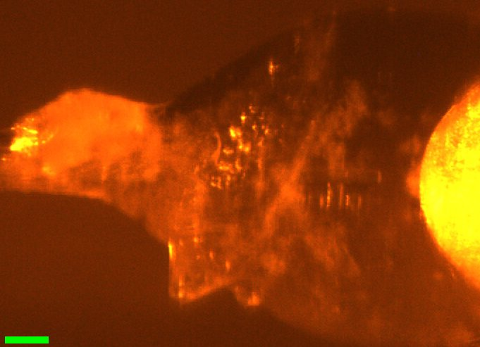](20261028-chess/DHFR_9.jpg)<br>
    Scale bar = 100 µm

    [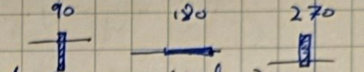](20261028-chess/DHFR_9_sketch.jpg)<br>
    Notebook sketch (p. 67)

9:02 AM: Steve mounted DHFR sample (position 9, label 9) (well C1). There appears to be a blade-shaped crystal in the neck of the loop, oriented diagonally. Saved snapshot @ "3x" zoom setting: DHFR_9.png.

Wait 10 mins to equilibrate at 295 K.

Vector scan diagonally (not super ideal...) (spinx translation: 215.9 µm).

Subdirectory: `DHFR/DHFR_9`

<div style="clear: both;"></div>

| prefix              |   φ0 (deg.) |   φ1 (deg.) |   ∆φ (deg.) |   images |   ∆t (s) |   tf (%) |   d (mm) |
|---------------------|-------------|-------------|-------------|----------|----------|----------|----------|
| DHFR_9_295K_2824    |          90 |         270 |         0.1 |     1800 |     0.01 |      100 |      185 |
| DHFR_9_295K_bg_2825 |          90 |         270 |         1   |      180 |     0.1  |      100 |      185 |

!!! warning "poor diffraction"

    Crummy diffraction (resol., spot shape), moving on.

??? info "xia2 processing"

    |                 | DHFR_9_295K_2824                        |
    |-----------------|-----------------------------------------|
    | scan            | 2824                                    |
    | Mosaic spread   | 0.247                                   |
    | Resolution      | 1.5                                     |
    | Unit Cell       | [34.27, 45.35, 99.05, 90.0, 90.0, 90.0] |
    | Image range     | [1, 1800]                               |
    | Completeness    | 99.5                                    |
    | Multiplicity    | 6.6                                     |
    | I/sigma         | 6.8                                     |
    | Rpim            | 0.063                                   |
    | Wilson B factor | 18.02                                   |
    | Space group     | P 21 21 21                              |
    | temperature     | 295                                     |
    | Reports | [xia2.html](https://nyu1.osn.mghpcc.org/diffuse-chess-public/processing/20261028_xia2/DHFR/DHFR_9/DHFR_9_295K_2824/all/xia2.html)<br>[dials.scale.html](https://nyu1.osn.mghpcc.org/diffuse-chess-public/processing/20261028_xia2/DHFR/DHFR_9/DHFR_9_295K_2824/all/LogFiles/AUTOMATIC_DEFAULT_SCALE.html) |
    | Logs | [index.log](https://nyu1.osn.mghpcc.org/diffuse-chess-public/processing/20261028_xia2/DHFR/DHFR_9/DHFR_9_295K_2824/all/LogFiles/AUTOMATIC_DEFAULT_NATIVE_SWEEP1_INDEX.log)<br>[integrate.log](https://nyu1.osn.mghpcc.org/diffuse-chess-public/processing/20261028_xia2/DHFR/DHFR_9/DHFR_9_295K_2824/all/LogFiles/AUTOMATIC_DEFAULT_NATIVE_SWEEP1_INTEGRATE.log)<br>[refine.log](https://nyu1.osn.mghpcc.org/diffuse-chess-public/processing/20261028_xia2/DHFR/DHFR_9/DHFR_9_295K_2824/all/LogFiles/AUTOMATIC_DEFAULT_NATIVE_SWEEP1_REFINE.log)<br>[truncate.log](https://nyu1.osn.mghpcc.org/diffuse-chess-public/processing/20261028_xia2/DHFR/DHFR_9/DHFR_9_295K_2824/all/LogFiles/AUTOMATIC_DEFAULT_NATIVE_truncate.log)<br>[scale.log](https://nyu1.osn.mghpcc.org/diffuse-chess-public/processing/20261028_xia2/DHFR/DHFR_9/DHFR_9_295K_2824/all/LogFiles/AUTOMATIC_DEFAULT_SCALE.log)<br>[xtriage.log](https://nyu1.osn.mghpcc.org/diffuse-chess-public/processing/20261028_xia2/DHFR/DHFR_9/DHFR_9_295K_2824/all/LogFiles/Xtriage.log) |
    | MTZ | [free.mtz](https://nyu1.osn.mghpcc.org/diffuse-chess-public/processing/20261028_xia2/DHFR/DHFR_9/DHFR_9_295K_2824/all/DEFAULT/scale/AUTOMATIC_DEFAULT_free.mtz)<br>[scaled_unmerged.mtz](https://nyu1.osn.mghpcc.org/diffuse-chess-public/processing/20261028_xia2/DHFR/DHFR_9/DHFR_9_295K_2824/all/DEFAULT/scale/AUTOMATIC_DEFAULT_scaled_unmerged.mtz) |

### 14. DHFR

!!! quote inline end ""

    [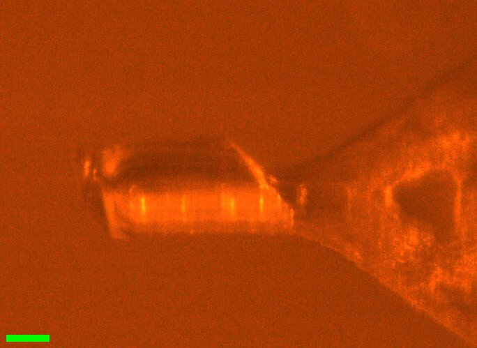](20261028-chess/DHFR_10.jpg)<br>
    Scale bar = 100 µm

9:17 AM: Steve mounted DHFR #10 (pos 10, label 10) (well C2). This one is ~300 µm long and very chunky (~100 x 100 xsection), sitting on an EV (500?) loop parallel to rotation axis. Snapshot saved @ "3x" zoom: DHFR_10.png. Wait 10 mins before collecting.

Vector scan (spinx translation: 276.8 µm).

Subdirectory: `DHFR/DHFR_10`

<div style="clear: both;"></div>

| prefix               |   φ0 (deg.) |   φ1 (deg.) |   ∆φ (deg.) |   images |   ∆t (s) |   tf (%) |   d (mm) |
|----------------------|-------------|-------------|-------------|----------|----------|----------|----------|
| DHFR_10_295K_2826    |           0 |         180 |         0.1 |     1800 |     0.01 |      100 |      185 |
| DHFR_10_295K_bg_2827 |           0 |         180 |         1   |      180 |     0.1  |      100 |      185 |

xia2 `DHFR_10_295K_2826`: 1.13 Å, Rpim 0.025, cell 34.29, 45.33, 99.05 Å, mosaicity 0.024˚, Wilson B 14.6 Å<sup>2</sup>

9:29 AM: Ramp to 280 K @ 120 K/hr, then wait 5 mins before collecting (12.5 mins total).

| prefix               |   φ0 (deg.) |   φ1 (deg.) |   ∆φ (deg.) |   images |   ∆t (s) |   tf (%) |   d (mm) |
|----------------------|-------------|-------------|-------------|----------|----------|----------|----------|
| DHFR_10_280K_2828    |           0 |         180 |         0.1 |     1800 |     0.01 |      100 |      185 |
| DHFR_10_280K_bg_2829 |           0 |         180 |         1   |      180 |     0.1  |      100 |      185 |

xia2 `DHFR_10_280K_2828`: 1.08 Å, Rpim 0.024, cell 34.23, 45.23, 98.97 Å, mosaicity 0.027˚, Wilson B 13.5 Å<sup>2</sup>

9:42 AM: Ramp to 295 @ 120 K/hr, then wait 5 min before collecting (12.5 mins total).

| prefix               |   φ0 (deg.) |   φ1 (deg.) |   ∆φ (deg.) |   images |   ∆t (s) |   tf (%) |   d (mm) |
|----------------------|-------------|-------------|-------------|----------|----------|----------|----------|
| DHFR_10_295K_2830    |           0 |         180 |         0.1 |     1800 |     0.01 |      100 |      185 |
| DHFR_10_295K_bg_2831\*|           0 |         180 |         1   |      180 |     0.1  |      100 |      185 |
| DHFR_10_295K_bg_2832 |           0 |         180 |         1   |      180 |     0.1  |      100 |      185 |

xia2 `DHFR_10_295K_2830`: 1.19 Å, Rpim 0.024, cell 34.25, 45.10, 99.11 Å, mosaicity 0.055˚, Wilson B 15.1 Å<sup>2</sup>

!!! warning "mistake"

    \* Accidentally run in 'vector' mode, closed shutter after a few seconds to prevent damage to crystal.

9:57 AM: Ramp to 310 K @ 120 K/hr, then wait 5 mins before collecting.

| prefix               |   φ0 (deg.) |   φ1 (deg.) |   ∆φ (deg.) |   images |   ∆t (s) |   tf (%) |   d (mm) |
|----------------------|-------------|-------------|-------------|----------|----------|----------|----------|
| DHFR_10_310K_2833    |           0 |         180 |         0.1 |     1800 |     0.01 |      100 |      185 |
| DHFR_10_310K_bg_2834 |           0 |         180 |         1   |      180 |     0.1  |      100 |      185 |

xia2 `DHFR_10_310K_2833`: failed (No suitable indexing solution could be found)

!!! warning "poor diffraction"

    Very poor diffraction, why? (too much dose maybe? or dehydration?)

End experiment. Ramp back to 295 @ 360 K/hr.

??? info "xia2 processing"

    |                 | DHFR_10_295K_2826                       | DHFR_10_280K_2828                       | DHFR_10_295K_2830                      |
    |-----------------|-----------------------------------------|-----------------------------------------|----------------------------------------|
    | scan            | 2826                                    | 2828                                    | 2830                                   |
    | Mosaic spread   | 0.024                                   | 0.027                                   | 0.055                                  |
    | Resolution      | 1.13                                    | 1.08                                    | 1.19                                   |
    | Unit Cell       | [34.29, 45.33, 99.05, 90.0, 90.0, 90.0] | [34.23, 45.23, 98.97, 90.0, 90.0, 90.0] | [34.25, 45.1, 99.11, 90.0, 90.0, 90.0] |
    | Image range     | [1, 1800]                               | [1, 1800]                               | [1, 1800]                              |
    | Completeness    | 91.8                                    | 85.2                                    | 96.2                                   |
    | Multiplicity    | 6.2                                     | 6.1                                     | 6.4                                    |
    | I/sigma         | 13.3                                    | 14.2                                    | 13.6                                   |
    | Rpim            | 0.025                                   | 0.024                                   | 0.024                                  |
    | Wilson B factor | 14.59                                   | 13.54                                   | 15.08                                  |
    | Space group     | P 21 21 21                              | P 21 21 21                              | P 21 21 21                             |
    | temperature     | 295                                     | 280                                     | 295                                    |
    | Reports | [xia2.html](https://nyu1.osn.mghpcc.org/diffuse-chess-public/processing/20261028_xia2/DHFR/DHFR_10/DHFR_10_295K_2826/all/xia2.html)<br>[dials.scale.html](https://nyu1.osn.mghpcc.org/diffuse-chess-public/processing/20261028_xia2/DHFR/DHFR_10/DHFR_10_295K_2826/all/LogFiles/AUTOMATIC_DEFAULT_SCALE.html) | [xia2.html](https://nyu1.osn.mghpcc.org/diffuse-chess-public/processing/20261028_xia2/DHFR/DHFR_10/DHFR_10_280K_2828/all/xia2.html)<br>[dials.scale.html](https://nyu1.osn.mghpcc.org/diffuse-chess-public/processing/20261028_xia2/DHFR/DHFR_10/DHFR_10_280K_2828/all/LogFiles/AUTOMATIC_DEFAULT_SCALE.html) | [xia2.html](https://nyu1.osn.mghpcc.org/diffuse-chess-public/processing/20261028_xia2/DHFR/DHFR_10/DHFR_10_295K_2830/all/xia2.html)<br>[dials.scale.html](https://nyu1.osn.mghpcc.org/diffuse-chess-public/processing/20261028_xia2/DHFR/DHFR_10/DHFR_10_295K_2830/all/LogFiles/AUTOMATIC_DEFAULT_SCALE.html) |
    | Logs | [index.log](https://nyu1.osn.mghpcc.org/diffuse-chess-public/processing/20261028_xia2/DHFR/DHFR_10/DHFR_10_295K_2826/all/LogFiles/AUTOMATIC_DEFAULT_NATIVE_SWEEP1_INDEX.log)<br>[integrate.log](https://nyu1.osn.mghpcc.org/diffuse-chess-public/processing/20261028_xia2/DHFR/DHFR_10/DHFR_10_295K_2826/all/LogFiles/AUTOMATIC_DEFAULT_NATIVE_SWEEP1_INTEGRATE.log)<br>[refine.log](https://nyu1.osn.mghpcc.org/diffuse-chess-public/processing/20261028_xia2/DHFR/DHFR_10/DHFR_10_295K_2826/all/LogFiles/AUTOMATIC_DEFAULT_NATIVE_SWEEP1_REFINE.log)<br>[truncate.log](https://nyu1.osn.mghpcc.org/diffuse-chess-public/processing/20261028_xia2/DHFR/DHFR_10/DHFR_10_295K_2826/all/LogFiles/AUTOMATIC_DEFAULT_NATIVE_truncate.log)<br>[scale.log](https://nyu1.osn.mghpcc.org/diffuse-chess-public/processing/20261028_xia2/DHFR/DHFR_10/DHFR_10_295K_2826/all/LogFiles/AUTOMATIC_DEFAULT_SCALE.log)<br>[xtriage.log](https://nyu1.osn.mghpcc.org/diffuse-chess-public/processing/20261028_xia2/DHFR/DHFR_10/DHFR_10_295K_2826/all/LogFiles/Xtriage.log) | [index.log](https://nyu1.osn.mghpcc.org/diffuse-chess-public/processing/20261028_xia2/DHFR/DHFR_10/DHFR_10_280K_2828/all/LogFiles/AUTOMATIC_DEFAULT_NATIVE_SWEEP1_INDEX.log)<br>[integrate.log](https://nyu1.osn.mghpcc.org/diffuse-chess-public/processing/20261028_xia2/DHFR/DHFR_10/DHFR_10_280K_2828/all/LogFiles/AUTOMATIC_DEFAULT_NATIVE_SWEEP1_INTEGRATE.log)<br>[refine.log](https://nyu1.osn.mghpcc.org/diffuse-chess-public/processing/20261028_xia2/DHFR/DHFR_10/DHFR_10_280K_2828/all/LogFiles/AUTOMATIC_DEFAULT_NATIVE_SWEEP1_REFINE.log)<br>[truncate.log](https://nyu1.osn.mghpcc.org/diffuse-chess-public/processing/20261028_xia2/DHFR/DHFR_10/DHFR_10_280K_2828/all/LogFiles/AUTOMATIC_DEFAULT_NATIVE_truncate.log)<br>[scale.log](https://nyu1.osn.mghpcc.org/diffuse-chess-public/processing/20261028_xia2/DHFR/DHFR_10/DHFR_10_280K_2828/all/LogFiles/AUTOMATIC_DEFAULT_SCALE.log)<br>[xtriage.log](https://nyu1.osn.mghpcc.org/diffuse-chess-public/processing/20261028_xia2/DHFR/DHFR_10/DHFR_10_280K_2828/all/LogFiles/Xtriage.log) | [index.log](https://nyu1.osn.mghpcc.org/diffuse-chess-public/processing/20261028_xia2/DHFR/DHFR_10/DHFR_10_295K_2830/all/LogFiles/AUTOMATIC_DEFAULT_NATIVE_SWEEP1_INDEX.log)<br>[integrate.log](https://nyu1.osn.mghpcc.org/diffuse-chess-public/processing/20261028_xia2/DHFR/DHFR_10/DHFR_10_295K_2830/all/LogFiles/AUTOMATIC_DEFAULT_NATIVE_SWEEP1_INTEGRATE.log)<br>[refine.log](https://nyu1.osn.mghpcc.org/diffuse-chess-public/processing/20261028_xia2/DHFR/DHFR_10/DHFR_10_295K_2830/all/LogFiles/AUTOMATIC_DEFAULT_NATIVE_SWEEP1_REFINE.log)<br>[truncate.log](https://nyu1.osn.mghpcc.org/diffuse-chess-public/processing/20261028_xia2/DHFR/DHFR_10/DHFR_10_295K_2830/all/LogFiles/AUTOMATIC_DEFAULT_NATIVE_truncate.log)<br>[scale.log](https://nyu1.osn.mghpcc.org/diffuse-chess-public/processing/20261028_xia2/DHFR/DHFR_10/DHFR_10_295K_2830/all/LogFiles/AUTOMATIC_DEFAULT_SCALE.log)<br>[xtriage.log](https://nyu1.osn.mghpcc.org/diffuse-chess-public/processing/20261028_xia2/DHFR/DHFR_10/DHFR_10_295K_2830/all/LogFiles/Xtriage.log) |
    | MTZ | [free.mtz](https://nyu1.osn.mghpcc.org/diffuse-chess-public/processing/20261028_xia2/DHFR/DHFR_10/DHFR_10_295K_2826/all/DEFAULT/scale/AUTOMATIC_DEFAULT_free.mtz)<br>[scaled_unmerged.mtz](https://nyu1.osn.mghpcc.org/diffuse-chess-public/processing/20261028_xia2/DHFR/DHFR_10/DHFR_10_295K_2826/all/DEFAULT/scale/AUTOMATIC_DEFAULT_scaled_unmerged.mtz) | [free.mtz](https://nyu1.osn.mghpcc.org/diffuse-chess-public/processing/20261028_xia2/DHFR/DHFR_10/DHFR_10_280K_2828/all/DEFAULT/scale/AUTOMATIC_DEFAULT_free.mtz)<br>[scaled_unmerged.mtz](https://nyu1.osn.mghpcc.org/diffuse-chess-public/processing/20261028_xia2/DHFR/DHFR_10/DHFR_10_280K_2828/all/DEFAULT/scale/AUTOMATIC_DEFAULT_scaled_unmerged.mtz) | [free.mtz](https://nyu1.osn.mghpcc.org/diffuse-chess-public/processing/20261028_xia2/DHFR/DHFR_10/DHFR_10_295K_2830/all/DEFAULT/scale/AUTOMATIC_DEFAULT_free.mtz)<br>[scaled_unmerged.mtz](https://nyu1.osn.mghpcc.org/diffuse-chess-public/processing/20261028_xia2/DHFR/DHFR_10/DHFR_10_295K_2830/all/DEFAULT/scale/AUTOMATIC_DEFAULT_scaled_unmerged.mtz) |

10:20 AM: Steve mounted DHFR samples 11, 12, 13, and 14 (wells C3, C5, C4, C4). All had issues, either crystal was very thin, or capillary too long, or too much liquid splashed on the surface. Skip those.

### 15. DHFR

!!! quote inline end ""

    [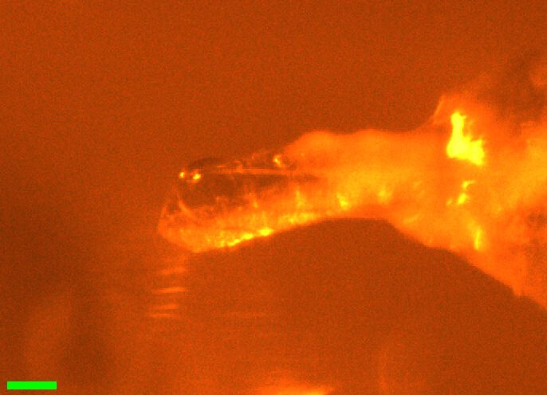](20261028-chess/DHFR_15.jpg)<br>
    Scale bar = 100 µm

10:25 AM: Steve mounted DHFR 15 (well C4). It's sitting on an EV (700?) loop at a slight angle, good for RS coverage. The capillary has a lot of water drops on it, not great for diffuse, but let's try anyway.

Let sit for 10 mins at 295 K.

Vector scan (spinx translation: 382.3 µm).

Subdirectory: `DHFR/DHFR_15`

<div style="clear: both;"></div>

| prefix               |   φ0 (deg.) |   φ1 (deg.) |   ∆φ (deg.) |   images |   ∆t (s) |   tf (%) |   d (mm) |
|----------------------|-------------|-------------|-------------|----------|----------|----------|----------|
| DHFR_15_295K_2835\*  |           0 |         180 |         0.1 |     1800 |     0.01 |      100 |      185 |
| DHFR_15_295K_2836    |           0 |         180 |         0.1 |     1800 |     0.01 |      100 |      185 |
| DHFR_15_295K_bg_2837 |           0 |         180 |         1   |      180 |     0.1  |      100 |      185 |

xia2 `DHFR_15_295K_2835`: failed (DIALS did not refine the data)

xia2 `DHFR_15_295K_2836`: 1.12 Å, Rpim 0.036, cell 34.36, 45.57, 98.93 Å, mosaicity 0.011˚, Wilson B 13.7 Å<sup>2</sup>

!!! warning "aborted scan"

    \* Aborted quickly (closed shutter, but let scan complete) because I hadn't waited the full 10 mins yet (mistake).

Clearly some crazy scattering from a water droplet, will make diffuse processing difficult (remove those frames?)

10:38 AM: Ramp from 295 → 280 K @ 120 K/hr, then wait 5 mins.

| prefix               |   φ0 (deg.) |   φ1 (deg.) |   ∆φ (deg.) |   images |   ∆t (s) |   tf (%) |   d (mm) |
|----------------------|-------------|-------------|-------------|----------|----------|----------|----------|
| DHFR_15_280K_2838    |           0 |         180 |         0.1 |     1800 |     0.01 |      100 |      185 |
| DHFR_15_280K_bg_2839 |           0 |         180 |         1   |      180 |     0.1  |      100 |      185 |

xia2 `DHFR_15_280K_2838`: 1.08 Å, Rpim 0.029, cell 34.30, 45.46, 98.89 Å, mosaicity 0.017˚, Wilson B 12.7 Å<sup>2</sup>

10:51 AM: Ramp from 280 K → 295 K @ 120 K/hr, then wait 5 mins (12.5 mins total).

| prefix               |   φ0 (deg.) |   φ1 (deg.) |   ∆φ (deg.) |   images |   ∆t (s) |   tf (%) |   d (mm) |
|----------------------|-------------|-------------|-------------|----------|----------|----------|----------|
| DHFR_15_295K_2840    |           0 |         180 |         0.1 |     1800 |     0.01 |      100 |      185 |
| DHFR_15_295K_bg_2841 |           0 |         180 |         1   |      180 |     0.1  |      100 |      185 |

xia2 `DHFR_15_295K_2840`: 1.13 Å, Rpim 0.030, cell 34.34, 45.50, 98.99 Å, mosaicity 0.012˚, Wilson B 14.0 Å<sup>2</sup>

11:07 AM: Ramp from 295 K → 310 K @ 120 K/hr, then wait 5 mins (12.5 mins total).

| prefix               |   φ0 (deg.) |   φ1 (deg.) |   ∆φ (deg.) |   images |   ∆t (s) |   tf (%) |   d (mm) |
|----------------------|-------------|-------------|-------------|----------|----------|----------|----------|
| DHFR_15_310K_2842    |           0 |         180 |         0.1 |     1800 |     0.01 |      100 |      185 |
| DHFR_15_310K_bg_2843 |           0 |         180 |         1   |      180 |     0.1  |      100 |      185 |

xia2 `DHFR_15_310K_2842`: 1.21 Å, Rpim 0.032, cell 34.36, 45.48, 99.11 Å, mosaicity 0.017˚, Wilson B 15.3 Å<sup>2</sup>

11:21 AM: Ramp back to 295 K @ 120 K/hr, then wait 5 mins.

| prefix               |   φ0 (deg.) |   φ1 (deg.) |   ∆φ (deg.) |   images |   ∆t (s) |   tf (%) |   d (mm) |
|----------------------|-------------|-------------|-------------|----------|----------|----------|----------|
| DHFR_15_295K_2844    |           0 |         180 |         0.1 |     1800 |     0.01 |      100 |      185 |
| DHFR_15_295K_bg_2845 |           0 |         180 |         1   |      180 |     0.1  |      100 |      185 |
| DHFR_15_295K_bg_2846\*|           0 |         180 |         1   |      180 |     0.1  |      100 |      185 |

xia2 `DHFR_15_295K_2844`: 1.15 Å, Rpim 0.031, cell 34.38, 45.59, 98.90 Å, mosaicity 0.022˚, Wilson B 13.9 Å<sup>2</sup>

\* An alternate background, shooting through the Kapton loop neck. Probably not usable.

Diffraction still great! I put this one back. Check last sample (16) next, and if it's a bad one consider another T for #15?

??? info "xia2 processing"

    |                 | DHFR_15_295K_2836                       | DHFR_15_280K_2838                      | DHFR_15_295K_2840                      | DHFR_15_310K_2842                       | DHFR_15_295K_2844                      |
    |-----------------|-----------------------------------------|----------------------------------------|----------------------------------------|-----------------------------------------|----------------------------------------|
    | scan            | 2836                                    | 2838                                   | 2840                                   | 2842                                    | 2844                                   |
    | Mosaic spread   | 0.011                                   | 0.017                                  | 0.012                                  | 0.017                                   | 0.022                                  |
    | Resolution      | 1.12                                    | 1.08                                   | 1.13                                   | 1.21                                    | 1.15                                   |
    | Unit Cell       | [34.36, 45.57, 98.93, 90.0, 90.0, 90.0] | [34.3, 45.46, 98.89, 90.0, 90.0, 90.0] | [34.34, 45.5, 98.99, 90.0, 90.0, 90.0] | [34.36, 45.48, 99.11, 90.0, 90.0, 90.0] | [34.38, 45.59, 98.9, 90.0, 90.0, 90.0] |
    | Image range     | [1, 1800]                               | [1, 1800]                              | [1, 1800]                              | [1, 1800]                               | [1, 1800]                              |
    | Completeness    | 97.6                                    | 94.2                                   | 98.2                                   | 99.9                                    | 99.0                                   |
    | Multiplicity    | 5.7                                     | 5.5                                    | 5.8                                    | 6.3                                     | 6.0                                    |
    | I/sigma         | 9.7                                     | 11.8                                   | 11.0                                   | 10.4                                    | 10.7                                   |
    | Rpim            | 0.036                                   | 0.029                                  | 0.03                                   | 0.032                                   | 0.031                                  |
    | Wilson B factor | 13.68                                   | 12.68                                  | 14.04                                  | 15.31                                   | 13.95                                  |
    | Space group     | P 21 21 21                              | P 21 21 21                             | P 21 21 21                             | P 21 21 21                              | P 21 21 21                             |
    | temperature     | 295                                     | 280                                    | 295                                    | 310                                     | 295                                    |
    | Reports | [xia2.html](https://nyu1.osn.mghpcc.org/diffuse-chess-public/processing/20261028_xia2/DHFR/DHFR_15/DHFR_15_295K_2836/all/xia2.html)<br>[dials.scale.html](https://nyu1.osn.mghpcc.org/diffuse-chess-public/processing/20261028_xia2/DHFR/DHFR_15/DHFR_15_295K_2836/all/LogFiles/AUTOMATIC_DEFAULT_SCALE.html) | [xia2.html](https://nyu1.osn.mghpcc.org/diffuse-chess-public/processing/20261028_xia2/DHFR/DHFR_15/DHFR_15_280K_2838/all/xia2.html)<br>[dials.scale.html](https://nyu1.osn.mghpcc.org/diffuse-chess-public/processing/20261028_xia2/DHFR/DHFR_15/DHFR_15_280K_2838/all/LogFiles/AUTOMATIC_DEFAULT_SCALE.html) | [xia2.html](https://nyu1.osn.mghpcc.org/diffuse-chess-public/processing/20261028_xia2/DHFR/DHFR_15/DHFR_15_295K_2840/all/xia2.html)<br>[dials.scale.html](https://nyu1.osn.mghpcc.org/diffuse-chess-public/processing/20261028_xia2/DHFR/DHFR_15/DHFR_15_295K_2840/all/LogFiles/AUTOMATIC_DEFAULT_SCALE.html) | [xia2.html](https://nyu1.osn.mghpcc.org/diffuse-chess-public/processing/20261028_xia2/DHFR/DHFR_15/DHFR_15_310K_2842/all/xia2.html)<br>[dials.scale.html](https://nyu1.osn.mghpcc.org/diffuse-chess-public/processing/20261028_xia2/DHFR/DHFR_15/DHFR_15_310K_2842/all/LogFiles/AUTOMATIC_DEFAULT_SCALE.html) | [xia2.html](https://nyu1.osn.mghpcc.org/diffuse-chess-public/processing/20261028_xia2/DHFR/DHFR_15/DHFR_15_295K_2844/all/xia2.html)<br>[dials.scale.html](https://nyu1.osn.mghpcc.org/diffuse-chess-public/processing/20261028_xia2/DHFR/DHFR_15/DHFR_15_295K_2844/all/LogFiles/AUTOMATIC_DEFAULT_SCALE.html) |
    | Logs | [index.log](https://nyu1.osn.mghpcc.org/diffuse-chess-public/processing/20261028_xia2/DHFR/DHFR_15/DHFR_15_295K_2836/all/LogFiles/AUTOMATIC_DEFAULT_NATIVE_SWEEP1_INDEX.log)<br>[integrate.log](https://nyu1.osn.mghpcc.org/diffuse-chess-public/processing/20261028_xia2/DHFR/DHFR_15/DHFR_15_295K_2836/all/LogFiles/AUTOMATIC_DEFAULT_NATIVE_SWEEP1_INTEGRATE.log)<br>[refine.log](https://nyu1.osn.mghpcc.org/diffuse-chess-public/processing/20261028_xia2/DHFR/DHFR_15/DHFR_15_295K_2836/all/LogFiles/AUTOMATIC_DEFAULT_NATIVE_SWEEP1_REFINE.log)<br>[truncate.log](https://nyu1.osn.mghpcc.org/diffuse-chess-public/processing/20261028_xia2/DHFR/DHFR_15/DHFR_15_295K_2836/all/LogFiles/AUTOMATIC_DEFAULT_NATIVE_truncate.log)<br>[scale.log](https://nyu1.osn.mghpcc.org/diffuse-chess-public/processing/20261028_xia2/DHFR/DHFR_15/DHFR_15_295K_2836/all/LogFiles/AUTOMATIC_DEFAULT_SCALE.log)<br>[xtriage.log](https://nyu1.osn.mghpcc.org/diffuse-chess-public/processing/20261028_xia2/DHFR/DHFR_15/DHFR_15_295K_2836/all/LogFiles/Xtriage.log) | [index.log](https://nyu1.osn.mghpcc.org/diffuse-chess-public/processing/20261028_xia2/DHFR/DHFR_15/DHFR_15_280K_2838/all/LogFiles/AUTOMATIC_DEFAULT_NATIVE_SWEEP1_INDEX.log)<br>[integrate.log](https://nyu1.osn.mghpcc.org/diffuse-chess-public/processing/20261028_xia2/DHFR/DHFR_15/DHFR_15_280K_2838/all/LogFiles/AUTOMATIC_DEFAULT_NATIVE_SWEEP1_INTEGRATE.log)<br>[refine.log](https://nyu1.osn.mghpcc.org/diffuse-chess-public/processing/20261028_xia2/DHFR/DHFR_15/DHFR_15_280K_2838/all/LogFiles/AUTOMATIC_DEFAULT_NATIVE_SWEEP1_REFINE.log)<br>[truncate.log](https://nyu1.osn.mghpcc.org/diffuse-chess-public/processing/20261028_xia2/DHFR/DHFR_15/DHFR_15_280K_2838/all/LogFiles/AUTOMATIC_DEFAULT_NATIVE_truncate.log)<br>[scale.log](https://nyu1.osn.mghpcc.org/diffuse-chess-public/processing/20261028_xia2/DHFR/DHFR_15/DHFR_15_280K_2838/all/LogFiles/AUTOMATIC_DEFAULT_SCALE.log)<br>[xtriage.log](https://nyu1.osn.mghpcc.org/diffuse-chess-public/processing/20261028_xia2/DHFR/DHFR_15/DHFR_15_280K_2838/all/LogFiles/Xtriage.log) | [index.log](https://nyu1.osn.mghpcc.org/diffuse-chess-public/processing/20261028_xia2/DHFR/DHFR_15/DHFR_15_295K_2840/all/LogFiles/AUTOMATIC_DEFAULT_NATIVE_SWEEP1_INDEX.log)<br>[integrate.log](https://nyu1.osn.mghpcc.org/diffuse-chess-public/processing/20261028_xia2/DHFR/DHFR_15/DHFR_15_295K_2840/all/LogFiles/AUTOMATIC_DEFAULT_NATIVE_SWEEP1_INTEGRATE.log)<br>[refine.log](https://nyu1.osn.mghpcc.org/diffuse-chess-public/processing/20261028_xia2/DHFR/DHFR_15/DHFR_15_295K_2840/all/LogFiles/AUTOMATIC_DEFAULT_NATIVE_SWEEP1_REFINE.log)<br>[truncate.log](https://nyu1.osn.mghpcc.org/diffuse-chess-public/processing/20261028_xia2/DHFR/DHFR_15/DHFR_15_295K_2840/all/LogFiles/AUTOMATIC_DEFAULT_NATIVE_truncate.log)<br>[scale.log](https://nyu1.osn.mghpcc.org/diffuse-chess-public/processing/20261028_xia2/DHFR/DHFR_15/DHFR_15_295K_2840/all/LogFiles/AUTOMATIC_DEFAULT_SCALE.log)<br>[xtriage.log](https://nyu1.osn.mghpcc.org/diffuse-chess-public/processing/20261028_xia2/DHFR/DHFR_15/DHFR_15_295K_2840/all/LogFiles/Xtriage.log) | [index.log](https://nyu1.osn.mghpcc.org/diffuse-chess-public/processing/20261028_xia2/DHFR/DHFR_15/DHFR_15_310K_2842/all/LogFiles/AUTOMATIC_DEFAULT_NATIVE_SWEEP1_INDEX.log)<br>[integrate.log](https://nyu1.osn.mghpcc.org/diffuse-chess-public/processing/20261028_xia2/DHFR/DHFR_15/DHFR_15_310K_2842/all/LogFiles/AUTOMATIC_DEFAULT_NATIVE_SWEEP1_INTEGRATE.log)<br>[refine.log](https://nyu1.osn.mghpcc.org/diffuse-chess-public/processing/20261028_xia2/DHFR/DHFR_15/DHFR_15_310K_2842/all/LogFiles/AUTOMATIC_DEFAULT_NATIVE_SWEEP1_REFINE.log)<br>[truncate.log](https://nyu1.osn.mghpcc.org/diffuse-chess-public/processing/20261028_xia2/DHFR/DHFR_15/DHFR_15_310K_2842/all/LogFiles/AUTOMATIC_DEFAULT_NATIVE_truncate.log)<br>[scale.log](https://nyu1.osn.mghpcc.org/diffuse-chess-public/processing/20261028_xia2/DHFR/DHFR_15/DHFR_15_310K_2842/all/LogFiles/AUTOMATIC_DEFAULT_SCALE.log)<br>[xtriage.log](https://nyu1.osn.mghpcc.org/diffuse-chess-public/processing/20261028_xia2/DHFR/DHFR_15/DHFR_15_310K_2842/all/LogFiles/Xtriage.log) | [index.log](https://nyu1.osn.mghpcc.org/diffuse-chess-public/processing/20261028_xia2/DHFR/DHFR_15/DHFR_15_295K_2844/all/LogFiles/AUTOMATIC_DEFAULT_NATIVE_SWEEP1_INDEX.log)<br>[integrate.log](https://nyu1.osn.mghpcc.org/diffuse-chess-public/processing/20261028_xia2/DHFR/DHFR_15/DHFR_15_295K_2844/all/LogFiles/AUTOMATIC_DEFAULT_NATIVE_SWEEP1_INTEGRATE.log)<br>[refine.log](https://nyu1.osn.mghpcc.org/diffuse-chess-public/processing/20261028_xia2/DHFR/DHFR_15/DHFR_15_295K_2844/all/LogFiles/AUTOMATIC_DEFAULT_NATIVE_SWEEP1_REFINE.log)<br>[truncate.log](https://nyu1.osn.mghpcc.org/diffuse-chess-public/processing/20261028_xia2/DHFR/DHFR_15/DHFR_15_295K_2844/all/LogFiles/AUTOMATIC_DEFAULT_NATIVE_truncate.log)<br>[scale.log](https://nyu1.osn.mghpcc.org/diffuse-chess-public/processing/20261028_xia2/DHFR/DHFR_15/DHFR_15_295K_2844/all/LogFiles/AUTOMATIC_DEFAULT_SCALE.log)<br>[xtriage.log](https://nyu1.osn.mghpcc.org/diffuse-chess-public/processing/20261028_xia2/DHFR/DHFR_15/DHFR_15_295K_2844/all/LogFiles/Xtriage.log) |
    | MTZ | [free.mtz](https://nyu1.osn.mghpcc.org/diffuse-chess-public/processing/20261028_xia2/DHFR/DHFR_15/DHFR_15_295K_2836/all/DEFAULT/scale/AUTOMATIC_DEFAULT_free.mtz)<br>[scaled_unmerged.mtz](https://nyu1.osn.mghpcc.org/diffuse-chess-public/processing/20261028_xia2/DHFR/DHFR_15/DHFR_15_295K_2836/all/DEFAULT/scale/AUTOMATIC_DEFAULT_scaled_unmerged.mtz) | [free.mtz](https://nyu1.osn.mghpcc.org/diffuse-chess-public/processing/20261028_xia2/DHFR/DHFR_15/DHFR_15_280K_2838/all/DEFAULT/scale/AUTOMATIC_DEFAULT_free.mtz)<br>[scaled_unmerged.mtz](https://nyu1.osn.mghpcc.org/diffuse-chess-public/processing/20261028_xia2/DHFR/DHFR_15/DHFR_15_280K_2838/all/DEFAULT/scale/AUTOMATIC_DEFAULT_scaled_unmerged.mtz) | [free.mtz](https://nyu1.osn.mghpcc.org/diffuse-chess-public/processing/20261028_xia2/DHFR/DHFR_15/DHFR_15_295K_2840/all/DEFAULT/scale/AUTOMATIC_DEFAULT_free.mtz)<br>[scaled_unmerged.mtz](https://nyu1.osn.mghpcc.org/diffuse-chess-public/processing/20261028_xia2/DHFR/DHFR_15/DHFR_15_295K_2840/all/DEFAULT/scale/AUTOMATIC_DEFAULT_scaled_unmerged.mtz) | [free.mtz](https://nyu1.osn.mghpcc.org/diffuse-chess-public/processing/20261028_xia2/DHFR/DHFR_15/DHFR_15_310K_2842/all/DEFAULT/scale/AUTOMATIC_DEFAULT_free.mtz)<br>[scaled_unmerged.mtz](https://nyu1.osn.mghpcc.org/diffuse-chess-public/processing/20261028_xia2/DHFR/DHFR_15/DHFR_15_310K_2842/all/DEFAULT/scale/AUTOMATIC_DEFAULT_scaled_unmerged.mtz) | [free.mtz](https://nyu1.osn.mghpcc.org/diffuse-chess-public/processing/20261028_xia2/DHFR/DHFR_15/DHFR_15_295K_2844/all/DEFAULT/scale/AUTOMATIC_DEFAULT_free.mtz)<br>[scaled_unmerged.mtz](https://nyu1.osn.mghpcc.org/diffuse-chess-public/processing/20261028_xia2/DHFR/DHFR_15/DHFR_15_295K_2844/all/DEFAULT/scale/AUTOMATIC_DEFAULT_scaled_unmerged.mtz) |

### 16. DHFR

!!! quote inline end ""

    [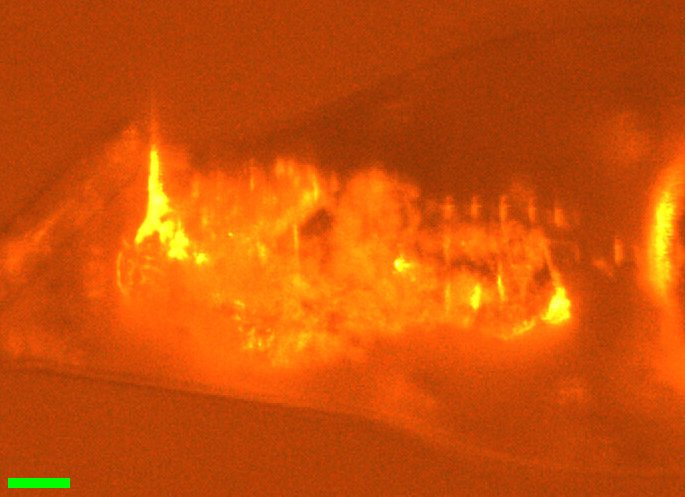](20261028-chess/DHFR_16.jpg)<br>
    Scale bar = 100 µm

    [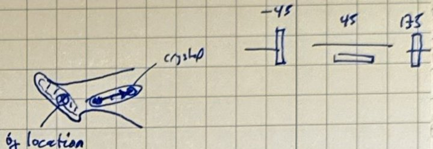](20261028-chess/DHFR_16_sketch.jpg)<br>
    Notebook sketch (p. 69)

11:41 AM: Steve mounted DHFR #16 (well C4). It's on one of the 45° EV loops, but sitting on the neck, not the end. There's a lot of gunk too, making it hard to see. This will not be useful for diffuse, I think... If it diffracts at 295, I'll use it to check if higher temps are possible (try 320 or 325?) The capillary is a bit long + deformed at the tip, so might be a dud?

Wait 10 min at 295 K.

Vector scan (spinx translation: 404.0 µm).

Subdirectory: `DHFR/DHFR_16`

<div style="clear: both;"></div>

| prefix               |   φ0 (deg.) |   φ1 (deg.) |   ∆φ (deg.) |   images |   ∆t (s) |   tf (%) |   d (mm) |
|----------------------|-------------|-------------|-------------|----------|----------|----------|----------|
| DHFR_16_295K_2847    |         -45 |         135 |         0.1 |     1800 |     0.01 |      100 |      185 |
| DHFR_16_295K_bg_2848 |         -45 |         135 |         1   |      180 |     0.1  |      100 |      185 |

xia2 `DHFR_16_295K_2847`: 1.18 Å, Rpim 0.036, cell 34.31, 45.38, 99.11 Å, mosaicity 0.042˚, Wilson B 13.5 Å<sup>2</sup>

Ramped to 325 K at 120 K/hr, then wait 5 mins (20 mins total).

12:18 PM: We're at temp. Since I can't see the crystal under all the gunk, I'm not certain if it's moved on the loop. I'll collect the same scans again and let diffraction tell us...

| prefix               |   φ0 (deg.) |   φ1 (deg.) |   ∆φ (deg.) |   images |   ∆t (s) |   tf (%) |   d (mm) |
|----------------------|-------------|-------------|-------------|----------|----------|----------|----------|
| DHFR_16_325K_2849    |         -45 |         135 |         0.1 |     1800 |     0.01 |      100 |      185 |
| DHFR_16_325K_bg_2850 |         -45 |         135 |         1   |      180 |     0.1  |      100 |      185 |

<!-- TODO: verify against the notebook (p. 69): 2850 is written as "DHFR_16_325K_2850"; the scan log has DHFR_16_325K_bg_2850. -->

xia2 `DHFR_16_325K_2849`: 2.02 Å, Rpim 0.139, cell 34.32, 45.38, 99.34 Å, mosaicity 0.165˚, Wilson B 29.4 Å<sup>2</sup>

Not much diffraction (low res) but peaks look OK. Try cooling again.

Ramped to 295 K at 120 K/hr, then wait 5 mins (20 mins total).

| prefix               |   φ0 (deg.) |   φ1 (deg.) |   ∆φ (deg.) |   images |   ∆t (s) |   tf (%) |   d (mm) |
|----------------------|-------------|-------------|-------------|----------|----------|----------|----------|
| DHFR_16_295K_2851\*  |         -45 |         135 |         0.1 |     1800 |     0.01 |      100 |      185 |
| DHFR_16_295K_bg_2852 |         -45 |         135 |         1   |      180 |     0.1  |      100 |      185 |

xia2 `DHFR_16_295K_2851`: 2.81 Å, Rpim 0.210, cell 34.43, 45.69, 99.53 Å, mosaicity 0.450˚, Wilson B 34.2 Å<sup>2</sup>

!!! warning "diffraction gone"

    \* Diffraction mostly gone, did not recover.

??? info "xia2 processing"

    |                 | DHFR_16_295K_2847                       | DHFR_16_325K_2849                       | DHFR_16_295K_2851                       |
    |-----------------|-----------------------------------------|-----------------------------------------|-----------------------------------------|
    | scan            | 2847                                    | 2849                                    | 2851                                    |
    | Mosaic spread   | 0.042                                   | 0.165                                   | 0.45                                    |
    | Resolution      | 1.18                                    | 2.02                                    | 2.81                                    |
    | Unit Cell       | [34.31, 45.38, 99.11, 90.0, 90.0, 90.0] | [34.32, 45.38, 99.34, 90.0, 90.0, 90.0] | [34.43, 45.69, 99.53, 90.0, 90.0, 90.0] |
    | Image range     | [1, 1800]                               | [1, 1800]                               | [1, 1800]                               |
    | Completeness    | 99.1                                    | 99.3                                    | 100.0                                   |
    | Multiplicity    | 6.1                                     | 6.5                                     | 6.3                                     |
    | I/sigma         | 10.6                                    | 12.5                                    | 18.2                                    |
    | Rpim            | 0.036                                   | 0.139                                   | 0.21                                    |
    | Wilson B factor | 13.49                                   | 29.35                                   | 34.2                                    |
    | Space group     | P 21 21 21                              | P 21 21 21                              | P 21 21 21                              |
    | temperature     | 295                                     | 325                                     | 295                                     |
    | Reports | [xia2.html](https://nyu1.osn.mghpcc.org/diffuse-chess-public/processing/20261028_xia2/DHFR/DHFR_16/DHFR_16_295K_2847/all/xia2.html)<br>[dials.scale.html](https://nyu1.osn.mghpcc.org/diffuse-chess-public/processing/20261028_xia2/DHFR/DHFR_16/DHFR_16_295K_2847/all/LogFiles/AUTOMATIC_DEFAULT_SCALE.html) | [xia2.html](https://nyu1.osn.mghpcc.org/diffuse-chess-public/processing/20261028_xia2/DHFR/DHFR_16/DHFR_16_325K_2849/all/xia2.html)<br>[dials.scale.html](https://nyu1.osn.mghpcc.org/diffuse-chess-public/processing/20261028_xia2/DHFR/DHFR_16/DHFR_16_325K_2849/all/LogFiles/AUTOMATIC_DEFAULT_SCALE.html) | [xia2.html](https://nyu1.osn.mghpcc.org/diffuse-chess-public/processing/20261028_xia2/DHFR/DHFR_16/DHFR_16_295K_2851/all/xia2.html)<br>[dials.scale.html](https://nyu1.osn.mghpcc.org/diffuse-chess-public/processing/20261028_xia2/DHFR/DHFR_16/DHFR_16_295K_2851/all/LogFiles/AUTOMATIC_DEFAULT_SCALE.html) |
    | Logs | [index.log](https://nyu1.osn.mghpcc.org/diffuse-chess-public/processing/20261028_xia2/DHFR/DHFR_16/DHFR_16_295K_2847/all/LogFiles/AUTOMATIC_DEFAULT_NATIVE_SWEEP1_INDEX.log)<br>[integrate.log](https://nyu1.osn.mghpcc.org/diffuse-chess-public/processing/20261028_xia2/DHFR/DHFR_16/DHFR_16_295K_2847/all/LogFiles/AUTOMATIC_DEFAULT_NATIVE_SWEEP1_INTEGRATE.log)<br>[refine.log](https://nyu1.osn.mghpcc.org/diffuse-chess-public/processing/20261028_xia2/DHFR/DHFR_16/DHFR_16_295K_2847/all/LogFiles/AUTOMATIC_DEFAULT_NATIVE_SWEEP1_REFINE.log)<br>[truncate.log](https://nyu1.osn.mghpcc.org/diffuse-chess-public/processing/20261028_xia2/DHFR/DHFR_16/DHFR_16_295K_2847/all/LogFiles/AUTOMATIC_DEFAULT_NATIVE_truncate.log)<br>[scale.log](https://nyu1.osn.mghpcc.org/diffuse-chess-public/processing/20261028_xia2/DHFR/DHFR_16/DHFR_16_295K_2847/all/LogFiles/AUTOMATIC_DEFAULT_SCALE.log)<br>[xtriage.log](https://nyu1.osn.mghpcc.org/diffuse-chess-public/processing/20261028_xia2/DHFR/DHFR_16/DHFR_16_295K_2847/all/LogFiles/Xtriage.log) | [index.log](https://nyu1.osn.mghpcc.org/diffuse-chess-public/processing/20261028_xia2/DHFR/DHFR_16/DHFR_16_325K_2849/all/LogFiles/AUTOMATIC_DEFAULT_NATIVE_SWEEP1_INDEX.log)<br>[integrate.log](https://nyu1.osn.mghpcc.org/diffuse-chess-public/processing/20261028_xia2/DHFR/DHFR_16/DHFR_16_325K_2849/all/LogFiles/AUTOMATIC_DEFAULT_NATIVE_SWEEP1_INTEGRATE.log)<br>[refine.log](https://nyu1.osn.mghpcc.org/diffuse-chess-public/processing/20261028_xia2/DHFR/DHFR_16/DHFR_16_325K_2849/all/LogFiles/AUTOMATIC_DEFAULT_NATIVE_SWEEP1_REFINE.log)<br>[truncate.log](https://nyu1.osn.mghpcc.org/diffuse-chess-public/processing/20261028_xia2/DHFR/DHFR_16/DHFR_16_325K_2849/all/LogFiles/AUTOMATIC_DEFAULT_NATIVE_truncate.log)<br>[scale.log](https://nyu1.osn.mghpcc.org/diffuse-chess-public/processing/20261028_xia2/DHFR/DHFR_16/DHFR_16_325K_2849/all/LogFiles/AUTOMATIC_DEFAULT_SCALE.log)<br>[xtriage.log](https://nyu1.osn.mghpcc.org/diffuse-chess-public/processing/20261028_xia2/DHFR/DHFR_16/DHFR_16_325K_2849/all/LogFiles/Xtriage.log) | [index.log](https://nyu1.osn.mghpcc.org/diffuse-chess-public/processing/20261028_xia2/DHFR/DHFR_16/DHFR_16_295K_2851/all/LogFiles/AUTOMATIC_DEFAULT_NATIVE_SWEEP1_INDEX.log)<br>[integrate.log](https://nyu1.osn.mghpcc.org/diffuse-chess-public/processing/20261028_xia2/DHFR/DHFR_16/DHFR_16_295K_2851/all/LogFiles/AUTOMATIC_DEFAULT_NATIVE_SWEEP1_INTEGRATE.log)<br>[refine.log](https://nyu1.osn.mghpcc.org/diffuse-chess-public/processing/20261028_xia2/DHFR/DHFR_16/DHFR_16_295K_2851/all/LogFiles/AUTOMATIC_DEFAULT_NATIVE_SWEEP1_REFINE.log)<br>[truncate.log](https://nyu1.osn.mghpcc.org/diffuse-chess-public/processing/20261028_xia2/DHFR/DHFR_16/DHFR_16_295K_2851/all/LogFiles/AUTOMATIC_DEFAULT_NATIVE_truncate.log)<br>[scale.log](https://nyu1.osn.mghpcc.org/diffuse-chess-public/processing/20261028_xia2/DHFR/DHFR_16/DHFR_16_295K_2851/all/LogFiles/AUTOMATIC_DEFAULT_SCALE.log)<br>[xtriage.log](https://nyu1.osn.mghpcc.org/diffuse-chess-public/processing/20261028_xia2/DHFR/DHFR_16/DHFR_16_295K_2851/all/LogFiles/Xtriage.log) |
    | MTZ | [free.mtz](https://nyu1.osn.mghpcc.org/diffuse-chess-public/processing/20261028_xia2/DHFR/DHFR_16/DHFR_16_295K_2847/all/DEFAULT/scale/AUTOMATIC_DEFAULT_free.mtz)<br>[scaled_unmerged.mtz](https://nyu1.osn.mghpcc.org/diffuse-chess-public/processing/20261028_xia2/DHFR/DHFR_16/DHFR_16_295K_2847/all/DEFAULT/scale/AUTOMATIC_DEFAULT_scaled_unmerged.mtz) | [free.mtz](https://nyu1.osn.mghpcc.org/diffuse-chess-public/processing/20261028_xia2/DHFR/DHFR_16/DHFR_16_325K_2849/all/DEFAULT/scale/AUTOMATIC_DEFAULT_free.mtz)<br>[scaled_unmerged.mtz](https://nyu1.osn.mghpcc.org/diffuse-chess-public/processing/20261028_xia2/DHFR/DHFR_16/DHFR_16_325K_2849/all/DEFAULT/scale/AUTOMATIC_DEFAULT_scaled_unmerged.mtz) | [free.mtz](https://nyu1.osn.mghpcc.org/diffuse-chess-public/processing/20261028_xia2/DHFR/DHFR_16/DHFR_16_295K_2851/all/DEFAULT/scale/AUTOMATIC_DEFAULT_free.mtz)<br>[scaled_unmerged.mtz](https://nyu1.osn.mghpcc.org/diffuse-chess-public/processing/20261028_xia2/DHFR/DHFR_16/DHFR_16_295K_2851/all/DEFAULT/scale/AUTOMATIC_DEFAULT_scaled_unmerged.mtz) |

!!! note "DEV note"

    Claude and I added a feature to MX Collect for grabbing camera images. It's in the currently checked out branch `spm/camera-save-image`. I tested by saving one to the `setup/` directory, plus JSON metadata: [camera_20261029_124529.png](https://nyu1.osn.mghpcc.org/diffuse-chess-public/20261028/setup/camera_20261029_124529.png), [camera_20261029_124529.json](https://nyu1.osn.mghpcc.org/diffuse-chess-public/20261028/setup/camera_20261029_124529.json).

!!! success "Done!"
